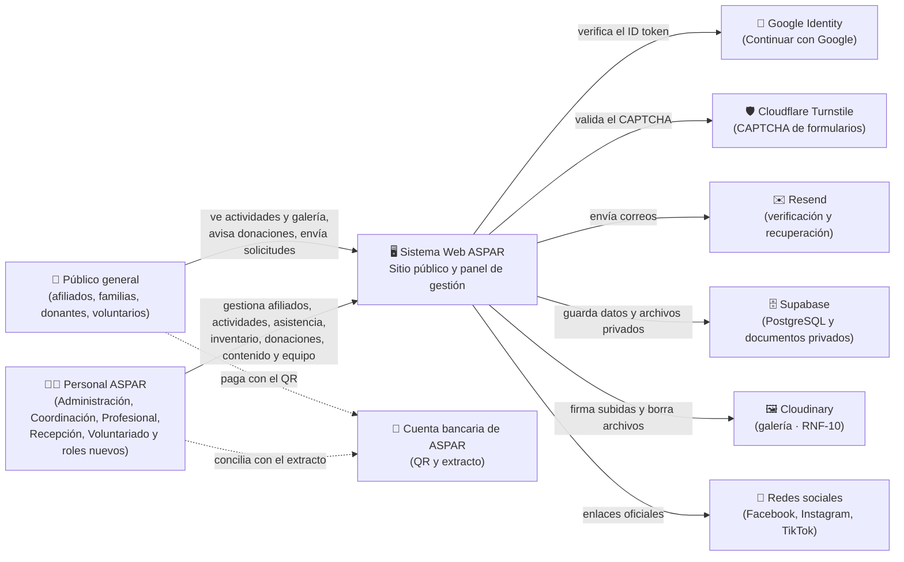
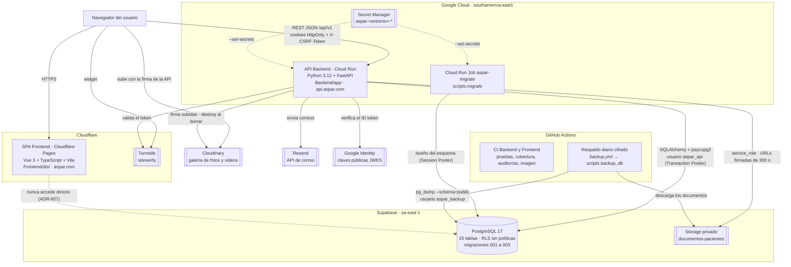
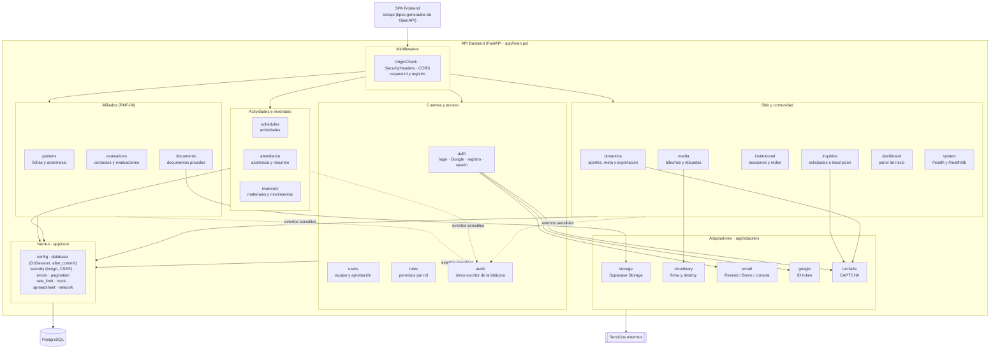
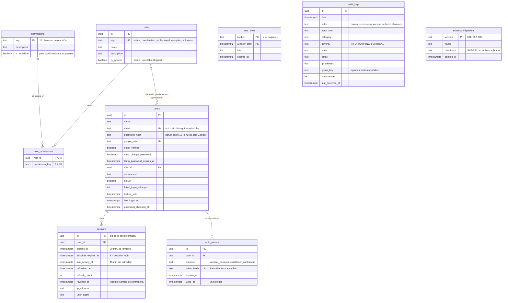
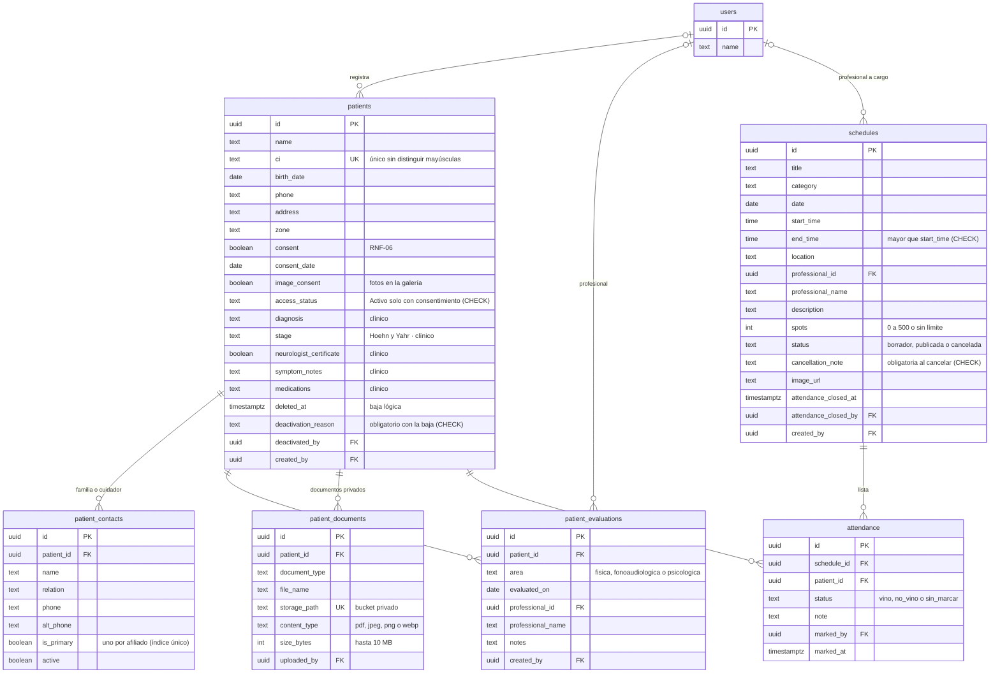
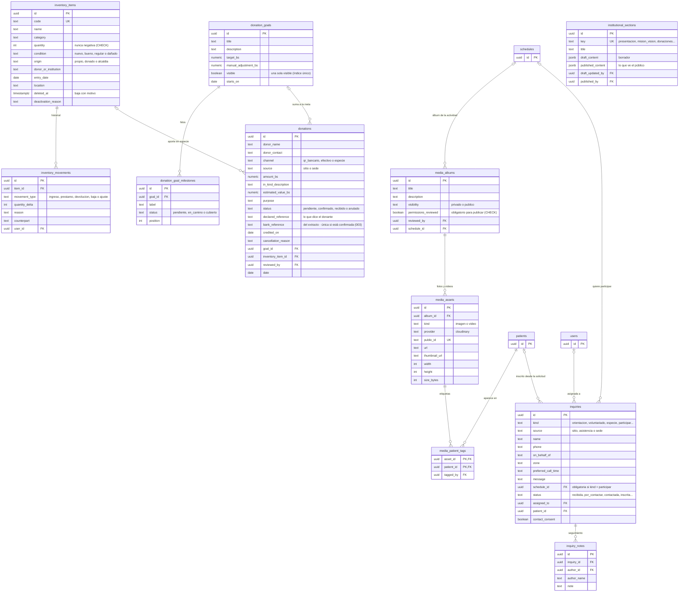

# Diagramas C4 y Modelo Entidad-Relación — estado del Sprint 2 (SCRUM-64 / SCRUM-106)

Los diagramas originales (`modelos/c4/C1.jpeg`, `C2.jpeg`, `C3.jpeg` y [`DOCUMENTO_3.pdf`](./DOCUMENTO_3.pdf)) describen la arquitectura **propuesta**. Este documento es la versión vigente: muestra lo que está implementado en la rama `Sprint2` al cerrar el Backend.

- Las decisiones que explican cada pieza están en el [registro de ADR](./adr/README.md).
- El despliegue (Cloud Run, Cloudflare Pages, Supabase, Secret Manager) sigue [ADR-014](./adr/ADR-014-despliegue-y-operacion.md) y la [guía de despliegue](../despliegue/GUIA_DE_DESPLIEGUE.md). Hasta el primer despliegue el sistema corre en Docker local con la misma imagen.
- El contrato entre Frontend y Backend está en [`MODELO_DATOS_Y_CONTRATOS.md`](./MODELO_DATOS_Y_CONTRATOS.md) y en [`openapi.json`](../api/openapi.json).

## 1. Cambios respecto de los diagramas originales

| Nivel | Diagrama original | Implementación actual | ADR |
| :--- | :--- | :--- | :--- |
| C1 | Personal, público y sistema web; almacenamiento y pasarela de pagos | Sin pasarela: las donaciones por QR bancario se **confirman a mano contra el extracto**. Se suman Google (inicio de sesión), Cloudflare Turnstile (CAPTCHA) y Resend (correos) | ADR-012, ADR-014 |
| C2 | SPA Vue 3, API FastAPI, PostgreSQL y Cloud Storage | SPA en **Cloudflare Pages**, API en **Cloud Run**, migraciones en un **Cloud Run Job**, secretos en **Secret Manager**. PostgreSQL y documentos privados en **Supabase**; galería en **Cloudinary**. Respaldos cifrados con **GitHub Actions** | ADR-002, ADR-007, ADR-010, ADR-014 |
| C3 | JWT Auth Middleware, Routers, Services, Repositories, Adapters | **16 módulos de dominio** con la misma estructura interna, un **núcleo** común y **5 adaptadores**. La sesión va en **cookies HttpOnly con CSRF** y los permisos están en la base | ADR-011, ADR-012 |
| Datos | E-R a cargo de la arquitecta | **25 tablas** en 3 migraciones SQL versionadas (`001` a `003`) | ADR-002 |

## 2. Nivel C1 — Contexto

## 3. Nivel C2 — Contenedores

- La SPA solo habla con la API. Las dos únicas conexiones del navegador a terceros son el widget de Turnstile y la subida a Cloudinary, que la API firma antes (`POST /media/albums/{id}/upload-signature`).
- Cloudflare Pages sirve `index.html` en cualquier ruta (SPA con `vue-router`). La API y la SPA comparten el sitio `aspar.com`, por eso las cookies `SameSite=Lax` funcionan sin `SameSite=None`.
- En Docker local, la API, la base y el frontend corren con `docker compose`. La API aplica las migraciones al arrancar; en Cloud Run lo hace el job.

## 4. Nivel C3 — Componentes de la API

Cada módulo de dominio vive en `Backend/app/modules/<dominio>/` y tiene las mismas capas: `router.py` (HTTP y permisos), `service.py` (reglas de negocio y bitácora), `repository.py` (consultas), `models.py` (SQLAlchemy) y `schemas.py` (Pydantic en camelCase). Un módulo usa el **servicio** de otro, nunca su repositorio.

| Grupo | Módulos | Permisos que usan |
| :--- | :--- | :--- |
| Cuentas y acceso | `auth`, `users`, `roles`, `audit` | `users:manage`, `roles:manage`, `audit:read` |
| Afiliados | `patients`, `evaluations`, `documents` | `patients:read`, `patients:write`, `patients:read_clinical`, `patients:write_clinical`, `patients:deactivate`, `documents:upload`, `documents:delete` |
| Actividades e inventario | `schedules`, `attendance`, `inventory` | `schedules:manage`, `attendance:write`, `inventory:manage` |
| Sitio y comunidad | `donations`, `media`, `institutional`, `inquiries`, `dashboard`, `system` | `donations:manage`, `media:manage`, `content:manage`, `inquiries:manage` (el panel exige cualquier permiso; `/health` es público) |

**Dependencias de la API que cruzan módulos** (`app/modules/auth/dependencies.py`): `get_current_user` valida la cookie contra la tabla `sessions`; `require_permission(*claves, any_of=False)` consulta los permisos del rol en la base y registra en la bitácora cada acceso denegado.

## 5. Modelo Entidad-Relación completo

El modelo tiene **25 tablas** en el esquema `public`, más `schema_migrations`. Por legibilidad se divide en tres diagramas; `users` y `patients` se repiten como referencia.

- Todas las claves primarias son `uuid` (`gen_random_uuid()`), salvo `permissions.key` y `rate_limits (bucket, window_start)`.
- Las columnas `created_at` y `updated_at` existen en casi todas las tablas y se omiten en los diagramas.
- Las referencias de auditoría a `users` (`created_by`, `uploaded_by`, `reviewed_by`, `marked_by`…) son `on delete set null`, para no perder registros si se elimina un usuario. Se dibujan solo las principales.

### 5.1 Cuentas, permisos y seguridad

### 5.2 Afiliados, actividades y asistencia

`attendance` tiene `unique (schedule_id, patient_id)`. `patient_documents`, `attendance` y las etiquetas de la galería usan `on delete restrict` hacia `patients`: un afiliado con historial solo se da de baja (baja lógica), nunca se borra.

### 5.3 Inventario, donaciones, galería, contenido y solicitudes

### 5.4 Migraciones y reglas que no se ven en los diagramas

| Migración | Contenido |
| :--- | :--- |
| [`001_base.sql`](../../Backend/migrations/001_base.sql) | Las 25 tablas, `CHECK`, índices, triggers, RLS activo **sin políticas**, los 5 roles iniciales, las 17 claves de permiso y las 7 secciones del sitio |
| [`002_busqueda_trigram.sql`](../../Backend/migrations/002_busqueda_trigram.sql) | Extensión `pg_trgm` en el esquema `extensions` e índices de búsqueda parcial por nombre y CI de afiliados, nombre y correo del equipo y actor de la bitácora |
| [`003_referencia_bancaria_unica.sql`](../../Backend/migrations/003_referencia_bancaria_unica.sql) | Índice único `donations_referencia_extracto_unica` sobre `lower(bank_reference)` cuando `status = 'confirmado'`: un movimiento del extracto no puede confirmar dos aportes |

- **Bitácora inmutable:** `audit_logs` no admite `UPDATE` ni `DELETE` (trigger, ADR-006).
- **Rol de Administración protegido:** triggers impiden borrar un rol del sistema o quitarle permisos (`roles_proteger`, `role_permissions_proteger_sistema`).
- **Consentimiento:** `patients` no admite `access_status = 'Activo'` sin `consent` (`CHECK`).
- **Acceso:** todas las tablas tienen RLS activo sin políticas y se revocan los permisos de `anon` y `authenticated` (ADR-007). Solo el Backend lee los datos.
- **Concurrencia:** cada regla de unicidad está en la base (CI, correo, `public_id`, referencia bancaria, asistencia por actividad). Si dos peticiones llegan a la vez, la segunda recibe **409** con un mensaje claro; nunca un 500.

## 6. Pendiente

- Reemplazar las imágenes `modelos/c4/*.jpeg` por estas versiones o enlazar este documento como vigente.
- Revisión de los diagramas y de los ADR por la arquitecta del proyecto.
- Aceptar ADR-014 con el primer despliegue real y confirmar la región y los dominios.
