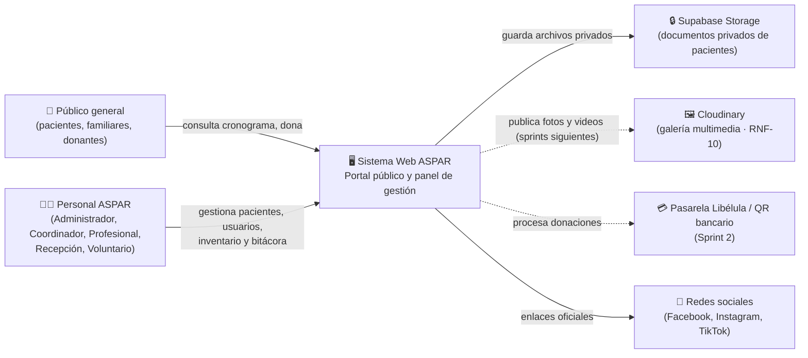
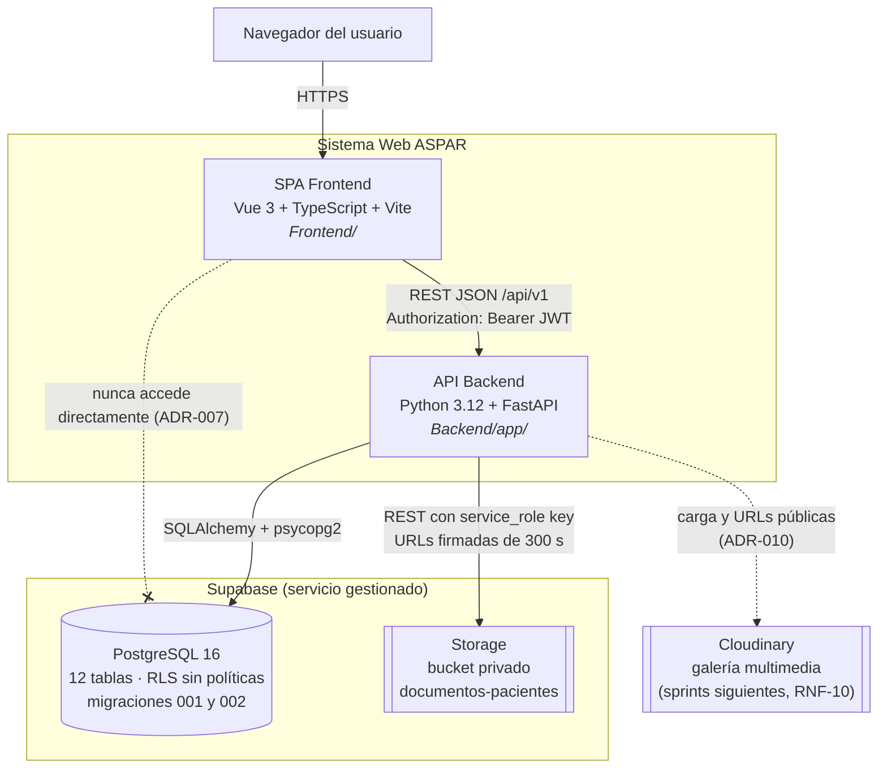
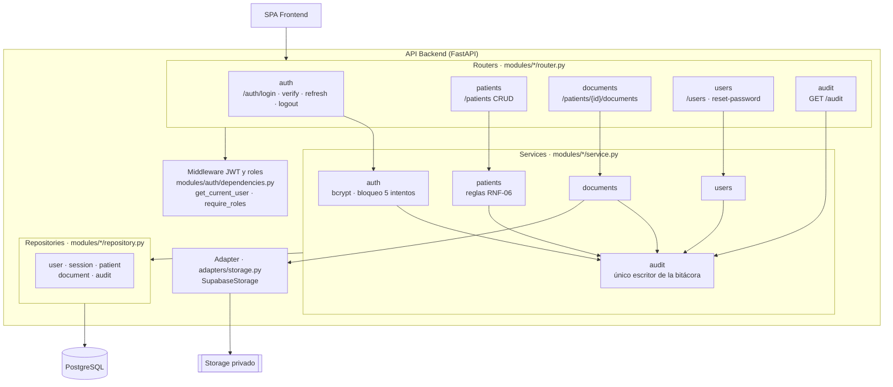
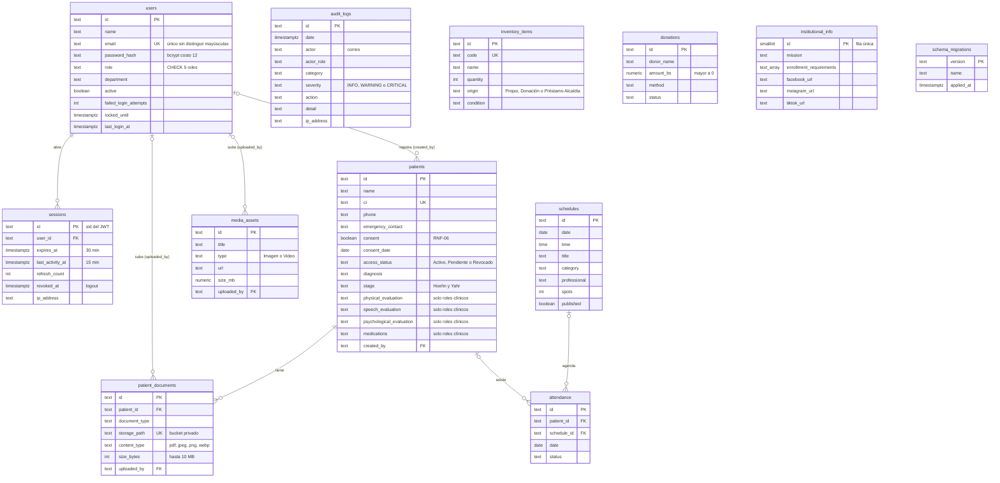

# Diagramas C4 y Modelo Entidad-Relación Actualizados — Sprint 1 (SCRUM-64 / SCRUM-106)

Los diagramas originales (`modelos/c4/C1.jpeg`, `C2.jpeg`, `C3.jpeg` y `docs/arquitectura/DOCUMENTO_3.pdf`) describen la arquitectura **propuesta**. Este documento los actualiza con lo que realmente quedó implementado en la rama `Sprint1`. Las decisiones que explican cada cambio están en el [registro de ADR](./adr/README.md).

## 1. Cambios respecto de los diagramas originales

| Nivel | Diagrama original | Implementación del Sprint 1 | ADR |
| :--- | :--- | :--- | :--- |
| C1 | Personal ASPAR, público y sistema web; servicios externos de almacenamiento y pagos | Sin cambios. Libélula todavía no está integrada (Sprint 2) | — |
| C2 | SPA Vue 3, API FastAPI, PostgreSQL y Cloud Storage | PostgreSQL **gestionado en Supabase**; el «Cloud Storage» se divide en **Supabase Storage** (bucket privado, documentos de pacientes) y **Cloudinary** (galería multimedia, RNF-10, sprints siguientes) | ADR-002, ADR-007, ADR-010 |
| C3 | JWT Auth Middleware, Routers, Services, Repositories (SQLAlchemy), Adapters | Igual, más **sesiones en servidor**, **bitácora** como servicio transversal y routers de usuarios, bitácora y documentos | ADR-001, ADR-003, ADR-006 |
| Datos | E-R a cargo de la arquitecta | 12 tablas en 2 migraciones SQL versionadas | ADR-002 |

## 2. Nivel C1 — Contexto

## 3. Nivel C2 — Contenedores

## 4. Nivel C3 — Componentes de la API

## 5. Modelo Entidad-Relación completo

**Reglas que no se ven en el diagrama:** `audit_logs` no admite `UPDATE` ni `DELETE` (trigger, ADR-006); `patients` no admite `access_status = 'Activo'` sin `consent` (`CHECK`); todas las tablas tienen RLS activo sin políticas (ADR-007). Las tablas `schedules`, `attendance`, `inventory_items`, `media_assets`, `donations` e `institutional_info` ya existen, pero sus endpoints son del Sprint 2.

## 6. Pendiente

- Reemplazar las imágenes `modelos/c4/C2.jpeg` y `C3.jpeg` por versiones que incluyan Supabase y las sesiones en servidor, o enlazar este documento como versión vigente.
- Revisión de estos diagramas y de los ADR por la arquitecta del proyecto.
- Al implementar RF-05, agregar al C3 un adaptador de Cloudinary junto a `adapters/storage.py` (ADR-010).
