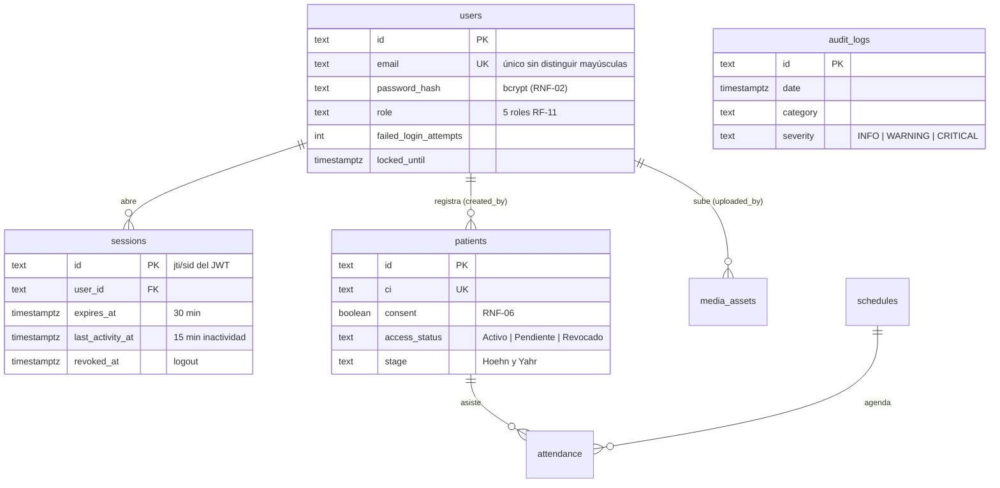

# Arquitectura C4, Modelo de Datos E-R y Contratos de API (SCRUM-64 / SCRUM-105)

> **Versión vigente de los diagramas:** [`C4_Y_MODELO_ER_ACTUALIZADO.md`](./C4_Y_MODELO_ER_ACTUALIZADO.md) (C1, C2, C3 y E-R completo según la implementación del Sprint 1) y [registro de decisiones técnicas (ADR)](./adr/README.md) (SCRUM-106).

## 1. Alineación con la Arquitectura C4 (FastAPI + PostgreSQL + Vue 3 SPA)

El diseño de tipos y formularios del Frontend (`Frontend/src/types/aspar.ts`) refleja los componentes definidos en los diagramas **C1, C2 y C3**:

- **JWT Auth Middleware (`/api/v1/auth/*`)**: Maneja credenciales cifradas, emisión de token Bearer (`access_token`), tiempo de expiración máxima (`30 min`) y límite de inactividad (`15 min`) conforme a **RF-01** y **RNF-02**.
- **PatientRouter & PatientService (`/api/v1/patients/*`)**: Gestiona fichas de afiliados, contacto de emergencia/cuidador, estado de consentimiento informado (**RNF-06**) y anamnesis clínica integral (diagnóstico de Parkinson, estadio Hoehn y Yahr, certificado neurológico y evaluaciones física, fonoaudiológica y psicológica) conforme a **RF-02**.
- **UserRouter (`/api/v1/users/*`)**: Administra usuarios y roles oficiales de ASPAR (`Administrador`, `Coordinador`, `Profesional`, `Recepción`, `Voluntario`) según **RF-11**.
- **AuditRouter (`/api/v1/audit/*`)**: Registra y consulta eventos de auditoría de operaciones sensibles con nivel de severidad (`INFO`, `WARNING`, `CRITICAL`) y categoría, restringido al rol `Administrador` según **RF-17**.
- **InventoryRouter (`/api/v1/inventory/*`)**: Controla mobiliario e insumos clasificados por origen (`Propio ASPAR`, `Préstamo Alcaldía`, `Donación`) y estado físico para reportes ante la Alcaldía (**RF-03**, **RF-09**).
- **ScheduleRouter, MultimediaRouter & DonationRouter**: Cubren cronogramas sabatinos (**RF-04**, **RF-10**), activos multimedia en Cloud Storage (**RF-05**) y donaciones vía QR/Libélula (**RF-06**).

## 2. Correspondencia de Entidades (Backend SQL <-> Frontend TypeScript)

| Tabla PostgreSQL | Interfaz Frontend (`src/types/aspar.ts`) | Campos Clave Validados | Requisito |
| :--- | :--- | :--- | :--- |
| `users` | `User` | `id`, `name`, `email`, `role`, `active`, `department`, `createdAt` | RF-01, RF-11 |
| `sessions` | `Session`, `LoginResponseDto` | `userId`, `token`, `expiresAt`, `lastActivityAt`, `role` | RNF-02 |
| `patients` | `Patient` | `id`, `name`, `ci`, `phone`, `address`, `emergencyContact`, `caregiverRelation`, `consent`, `accessStatus` | RF-02, RNF-06 |
| `patient_anamnesis` | `ClinicalAnamnesis` | `diagnosis`, `stage`, `neurologistCertificate`, `physicalEvaluation`, `speechEvaluation`, `psychologicalEvaluation`, `medications` | RF-02 |
| `audit_logs` | `AuditEvent` | `id`, `date`, `actor`, `actorRole`, `category`, `severity`, `action`, `detail`, `ipAddress` | RF-17 |
| `inventory_items` | `InventoryItem` | `id`, `code`, `name`, `category`, `quantity`, `origin`, `condition`, `location` | RF-03, RF-09 |
| `schedules` | `ScheduleItem` | `id`, `date`, `time`, `title`, `category`, `professional`, `location`, `spots` | RF-04, RF-10 |
| `media_assets` | `MediaAsset` | `id`, `title`, `type`, `storageProvider`, `url`, `sizeMb`, `uploadedAt` | RF-05 |
| `donations` | `DonationRecord` | `id`, `donorName`, `amountBs`, `method`, `purpose`, `status`, `date` | RF-06 |

## 3. Migración SQL Base (`Backend/migrations/001_initial_schema.sql`)

El esquema relacional incluye claves primarias UUID, restricciones `CHECK` para roles, estados de acceso (`Activo`, `Pendiente`, `Revocado`) y orígenes de inventario, asegurando integridad referencial entre pacientes, anamnesis y bitácora de auditoría.

## 4. Revisión de Entidades, Relaciones y Migraciones PostgreSQL (SCRUM-64 / SCRUM-104)

La base de datos del sistema es **PostgreSQL en Supabase**, consumida exclusivamente por el Backend FastAPI (contenedor C2 "API Backend" → "Base de Datos"). El frontend nunca se conecta directamente a Supabase.

La migración [`Backend/migrations/001_initial_schema.sql`](../../Backend/migrations/001_initial_schema.sql) reemplaza al esquema inicial SQLite y define **10 tablas**:

| Tabla | Relaciones | Reglas de integridad revisadas | Requisito |
| :--- | :--- | :--- | :--- |
| `users` | 1:N `sessions`, 1:N `patients.created_by`, 1:N `media_assets.uploaded_by` | Email único (`lower(email)`), `CHECK` de los 5 roles, contraseña bcrypt, bloqueo por intentos (`failed_login_attempts`, `locked_until`) | RF-01, RF-11, RNF-02 |
| `sessions` | N:1 `users` (`ON DELETE CASCADE`) | Expiración absoluta (`expires_at`), inactividad (`last_activity_at`), revocación en logout (`revoked_at`), renovación (`refresh_count`) | RNF-02 |
| `patients` | 1:N `attendance` (`ON DELETE SET NULL`) | CI única, `CHECK` de estadio Hoehn y Yahr y estado de acceso, **`CHECK access_status <> 'Activo' OR consent`** | RF-02, RNF-06 |
| `audit_logs` | — (registra actor por email para conservar el historial aunque se elimine el usuario) | `CHECK` de categoría y severidad; **trigger que impide `UPDATE`/`DELETE`** (bitácora inmutable) | RF-17 |
| `schedules` | 1:N `attendance` | `CHECK` de categoría, cupos `>= 0`, bandera `published` para el portal | RF-04, RF-10 |
| `attendance` | N:1 `patients`, N:1 `schedules` | Índice único (paciente, actividad), `CHECK` de estado | RF-12 |
| `inventory_items` | — | Código único, `CHECK` de categoría, origen (`Propio ASPAR`, `Préstamo Alcaldía`, `Donación`) y estado físico, cantidad `>= 0` | RF-03, RF-09 |
| `media_assets` | N:1 `users` | `CHECK` de tipo (`Imagen`, `Video`), tamaño `>= 0` | RF-05 |
| `donations` | — | Monto `> 0`, `CHECK` de método y estado | RF-06 |
| `institutional_info` | — | Fila única (`CHECK id = 1`), requisitos de inscripción como `text[]` | RF-07, RF-08 |

**Seguridad de Supabase:** todas las tablas tienen Row Level Security activado **sin políticas** y se revocan los permisos de los roles `anon` y `authenticated`. Así, la API REST pública de Supabase no expone datos aunque alguien obtenga la `anon key`; solo el Backend (conectado con el usuario `postgres` mediante `DATABASE_URL`) accede a la información.

**Migraciones versionadas:** los cambios posteriores al esquema se agregan como nuevos archivos numerados (`002_...sql`, `003_...sql`) y nunca se edita una migración ya aplicada.
