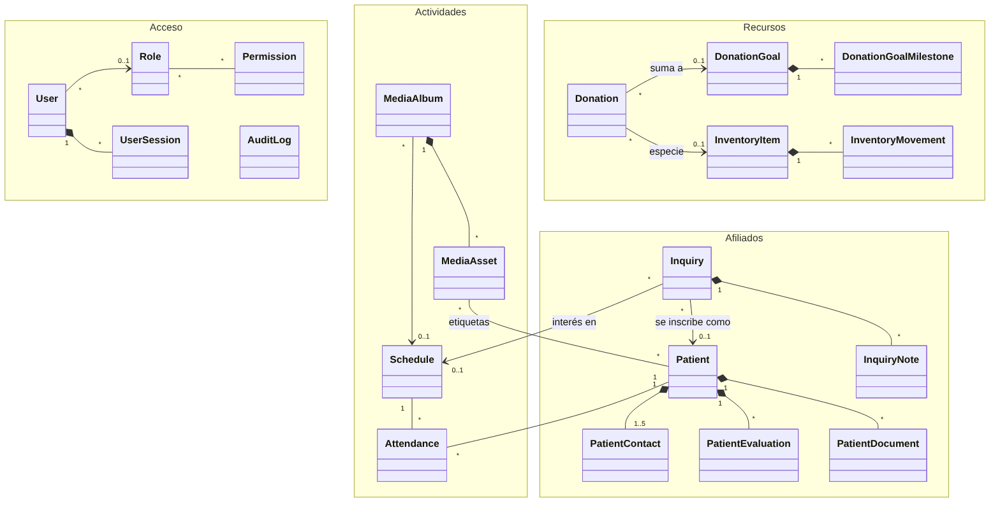
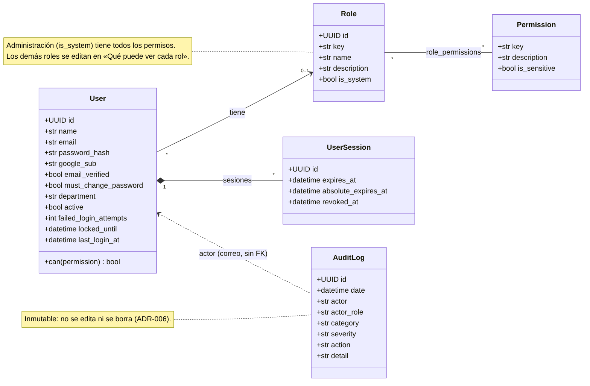
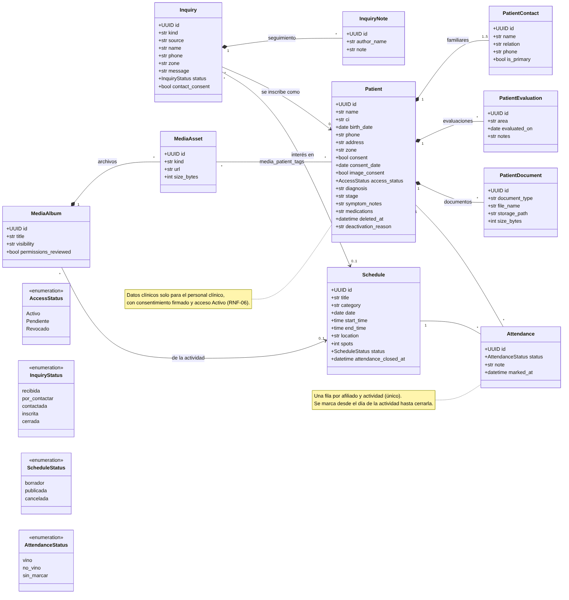
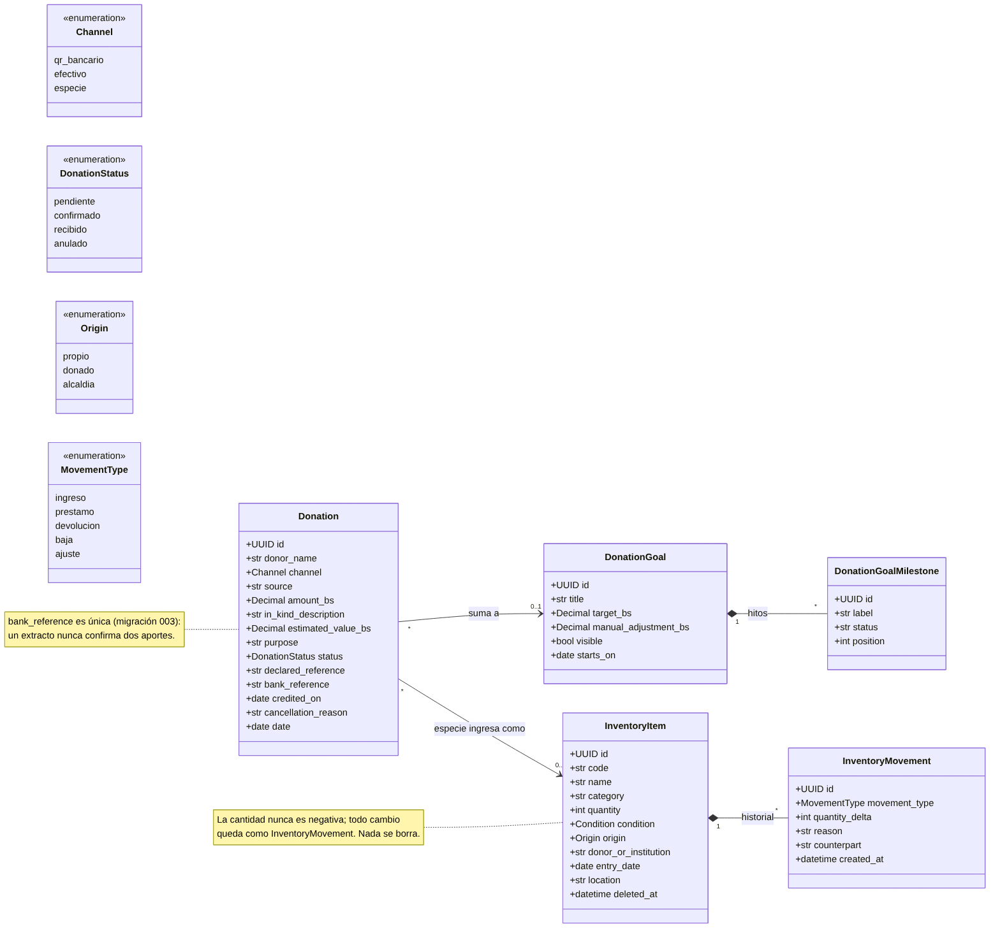
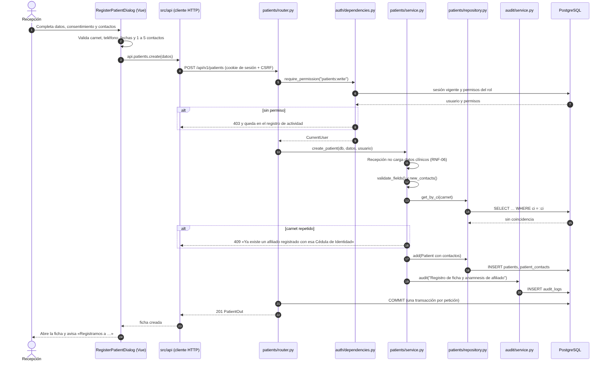
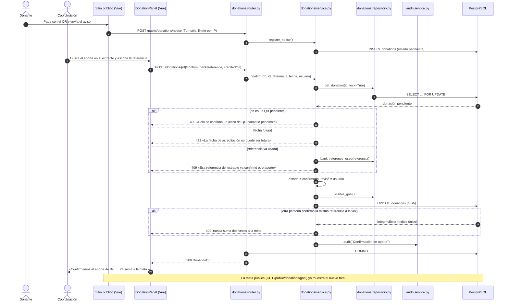
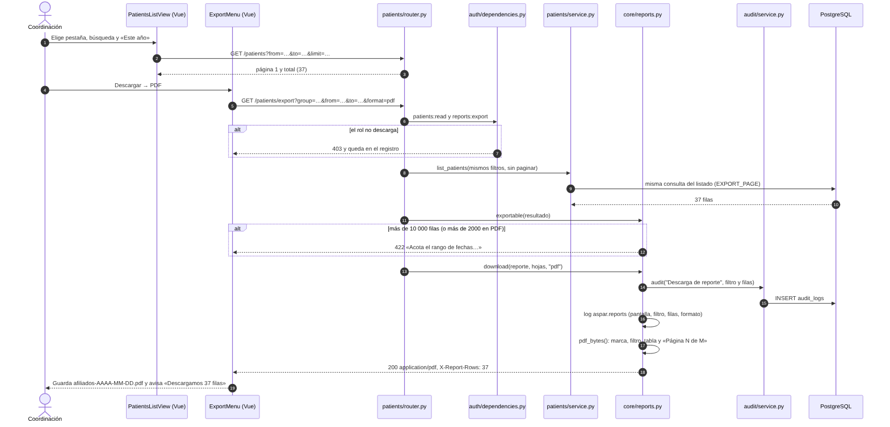
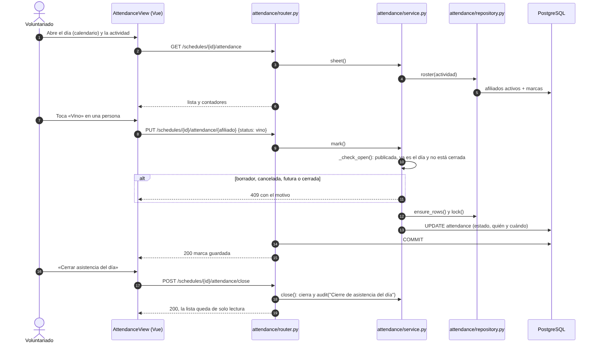

# Paquete UML: diagrama de clases y diagramas de secuencia

Los diagramas salen del código actual, no de un diseño previo:

- **Clases:** los modelos de `Backend/app/modules/*/models.py`, que son las tablas de las migraciones `Backend/migrations/*.sql`.
- **Secuencias:** los routers y servicios de cada módulo, con sus reglas y mensajes reales.

Las fuentes están en [`modelos/uml/`](../../modelos/uml/) en Mermaid (`.mmd`), junto con su imagen (`.png`). GitHub muestra el `.mmd` como diagrama y se edita como texto, así el diagrama cambia en el mismo commit que el código.

Para regenerar las imágenes:

```bash
npx -p @mermaid-js/mermaid-cli mmdc -i modelos/uml/<archivo>.mmd -o modelos/uml/<archivo>.png -b white -s 2
```

## 1. Diagrama de clases del dominio

El dominio tiene 19 clases en cuatro áreas. La vista general muestra solo las relaciones; los tres diagramas siguientes, los atributos de cada área.

| Notación | Significado |
| :--- | :--- |
| ◆ (composición) | La parte no existe sin el todo: los contactos, evaluaciones y documentos de un afiliado; las notas de una solicitud; los movimientos de un material |
| → (asociación dirigida) | Referencia opcional (`0..1`), por ejemplo la donación en especie que ingresa como material |
| `*` – `*` | Tabla intermedia: `role_permissions`, `media_patient_tags` |
| `<<enumeration>>` | Valores permitidos que valida el servicio y la base |

### 1.0 Vista general



### 1.1 Acceso, roles y registro de actividad



### 1.2 Afiliados, solicitudes, actividades, asistencia y galería



### 1.3 Donaciones, meta del sitio e inventario



**Comportamiento.** Las reglas de cada clase viven en el servicio de su módulo (`<módulo>/service.py`), no en el modelo, según la arquitectura en capas de [ADR-001](./adr/ADR-001-api-fastapi-en-capas.md) y [ADR-011](./adr/ADR-011-backend-por-modulos-de-dominio.md). Por ejemplo:

- `donations/service.py:confirm`: solo un QR pendiente, fecha no futura, referencia única.
- `attendance/service.py:_check_open`: se marca desde el día de la actividad hasta cerrarla.
- `inventory/service.py`: el stock nunca queda negativo y todo cambio deja un movimiento.

Las pruebas unitarias de [`Backend/tests/unit/`](../../Backend/tests/unit/) verifican esas reglas sin base de datos.

## 2. Diagramas de secuencia

Se eligieron los cuatro flujos que más pesan en la operación de ASPAR. Cubren las mismas situaciones que piden los ejemplos de la rúbrica: un alta con validaciones, un pago, un reporte y una operación de campo.

| # | Flujo | Equivale a | Requisitos | Prueba que lo recorre |
| :---: | :--- | :--- | :--- | :--- |
| 1 | Registrar un afiliado con consentimiento | Alta / venta | RF-02, RNF-06 | `test_patients_api.py`, E2E `afiliados.spec.ts` |
| 2 | Confirmar un aviso de QR con el extracto del banco | Pago | RF-06, RF-14, RF-15 | `test_donations.py`, `tests/unit/test_reglas_donaciones.py`, E2E `donaciones.spec.ts` |
| 3 | Descargar un reporte con el filtro de la pantalla | Reporte | ADR-015 | `test_reports.py`, E2E `reportes.spec.ts` |
| 4 | Tomar asistencia el día de la actividad | Operación de campo | RF-12 | `test_attendance.py`, `tests/unit/test_reglas_asistencia.py`, E2E `operacion.spec.ts` |

### 2.1 Registrar un afiliado con consentimiento



### 2.2 Confirmar una donación con el extracto del banco

El índice único sobre `bank_reference` (migración 003) es la última defensa: si dos personas confirman a la vez con la misma referencia, la base rechaza la segunda y el aporte nunca suma dos veces a la meta.



### 2.3 Descargar un reporte

La descarga ejecuta la misma consulta del listado, sin paginar. El archivo trae exactamente las filas del filtro ([ADR-015](./adr/ADR-015-filtros-por-fecha-y-reportes.md)).



### 2.4 Tomar asistencia



## 3. Relación con los otros modelos

- **C4 (contexto, contenedores y componentes)** y **modelo ER:** [C4_Y_MODELO_ER_ACTUALIZADO.md](./C4_Y_MODELO_ER_ACTUALIZADO.md) y las imágenes de [`modelos/c4/`](../../modelos/c4/).
- **Procesos de negocio (BPMN, as-is y to-be):** [docs/bpmn](../bpmn/PROCESOS_BPMN_ASPAR.md).
- **Contrato de la API:** [docs/api/openapi.json](../api/openapi.json), también en `/docs` (Swagger) de la API en marcha.
