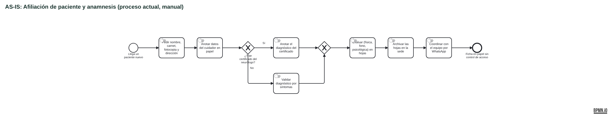
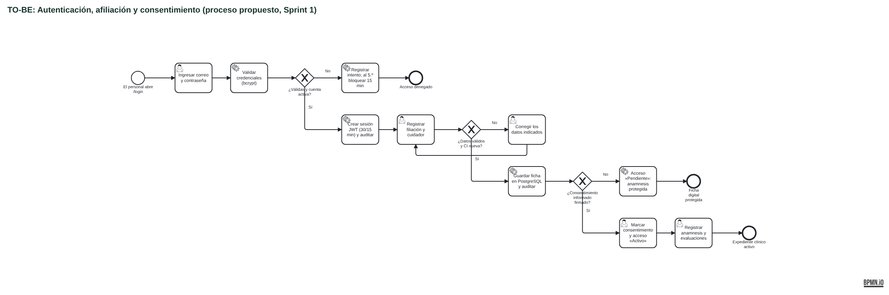
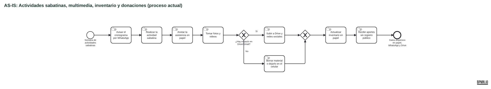
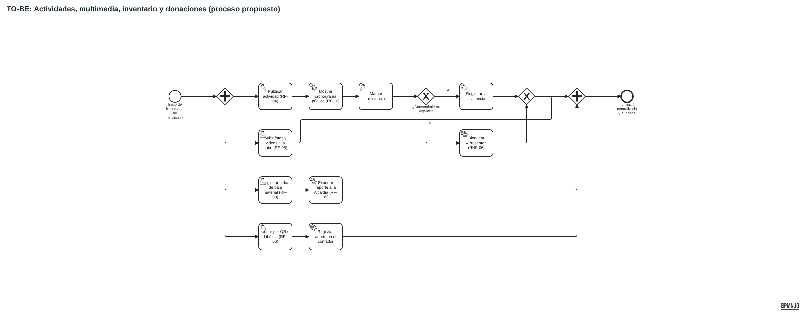
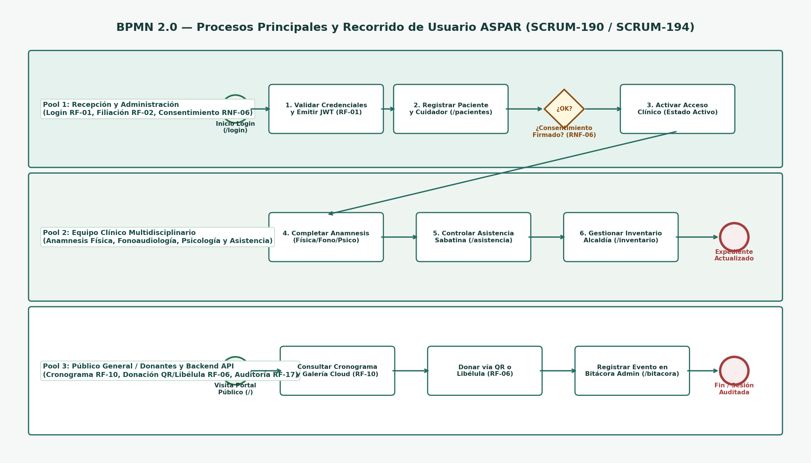

# Modelado de Procesos BPMN 2.0 y Revisión de Pasos de Usuario en la Interfaz (SCRUM-190 / SCRUM-194)

## 0. Flujo actual (AS-IS) y propuesto (TO-BE) según los requisitos (SCRUM-190 / SCRUM-192)

El proceso **actual** sale del análisis AS-IS de la entrevista con ASPAR (`docs/entrevistas/DOCUMENTO_1.pdf`, §2 y §3). El **propuesto** sigue los requisitos del SRS y su adenda, y lo que ya implementa la rama `Sprint1`. Cada diagrama está en formato **BPMN 2.0 XML** (`.bpmn`), editable en [bpmn.io](https://demo.bpmn.io) o Camunda Modeler, y tiene su imagen exportada.

| Proceso | AS-IS (actual) | TO-BE (propuesto) |
| :--- | :--- | :--- |
| Afiliación, anamnesis y acceso | [`as-is_afiliacion_y_anamnesis.bpmn`](./as-is_afiliacion_y_anamnesis.bpmn) | [`to-be_autenticacion_afiliacion_consentimiento.bpmn`](./to-be_autenticacion_afiliacion_consentimiento.bpmn) |
| Actividades, multimedia, inventario y donaciones | [`as-is_actividades_multimedia_inventario.bpmn`](./as-is_actividades_multimedia_inventario.bpmn) | [`to-be_actividades_multimedia_inventario_donaciones.bpmn`](./to-be_actividades_multimedia_inventario_donaciones.bpmn) |

**Notación:** ✋ tarea manual (en papel o WhatsApp) · 👤 tarea de usuario en el sistema · ⚙️ tarea automática del sistema · ✖ decisión (compuerta exclusiva) · ➕ tareas en paralelo.

### 0.1 Afiliación de paciente y anamnesis

**AS-IS:** todo se registra a mano en hojas hechas por los voluntarios. El diagnóstico se toma del certificado del neurólogo o, si no lo hay, se valida observando los síntomas. La coordinación se hace por WhatsApp.

**TO-BE:** el personal inicia sesión, registra la ficha con validaciones y la anamnesis solo se habilita con consentimiento firmado. Todas las compuertas tienen sus dos salidas (en el diagrama anterior, la de consentimiento no tenía camino «No»).

### 0.2 Actividades, multimedia, inventario y donaciones

**AS-IS:** el cronograma se avisa por WhatsApp, la asistencia y el inventario se llevan en papel, las fotos llenan el Drive de la asociación y las donaciones llegan sin registro público.

**TO-BE:** cuatro procesos que corren en paralelo durante la semana, todos dentro del sistema y con registro en la base de datos.

### 0.3 Comparación AS-IS → TO-BE

| Problema del proceso actual (entrevista) | Cambio en el proceso propuesto | Requisito | Estado en `Sprint1` |
| :--- | :--- | :--- | :--- |
| Fichas y anamnesis en hojas de papel, difíciles de buscar | Ficha digital con búsqueda por nombre, CI y estado | RF-02 | ✅ Implementado |
| Cualquiera con acceso a las hojas lee los datos clínicos | Login por rol y anamnesis solo con consentimiento y acceso `Activo` | RF-01, RF-11, RNF-06 | ✅ Implementado |
| No queda registro de quién consultó o cambió una ficha | Bitácora inmutable de operaciones sensibles | RF-17 | ✅ Implementado |
| El diagnóstico sin certificado no queda documentado | Campo «certificado neurológico» y notas de síntomas en la anamnesis | RF-02 | ✅ Implementado |
| Asistencia anotada en papel | Marcación de asistencia con bloqueo RNF-06 y resumen mensual | RF-12, RNF-06 | ⚠️ Pantalla lista; datos solo locales (⏳ Sprint 2) |
| Cronograma avisado solo por WhatsApp | Cronograma público en el portal sin iniciar sesión | RF-04, RF-10 | ⚠️ Visible; la edición por el administrador es del Sprint 2 |
| Fotos y videos llenan Google Drive / Gmail | Galería en Cloudinary con control de cuota | RF-05, RNF-10 | ⏳ Galería y Cloudinary en el Sprint 2 |
| Inventario en listas de papel, sin auditoría | Registro, baja, movimientos con historial y reportes para la Alcaldía | RF-03, RF-09, RF-13 | ⚠️ Registro y CSV listos; baja, PDF y Backend en el Sprint 2 |
| Donaciones sin canal formal ni transparencia | QR oficial, pasarela Libélula, registro por canal y meta pública de recaudación | RF-06, RF-14, RF-15 | ⚠️ QR y registro local; Libélula en el Sprint 2 |
| Pérdida de información en WhatsApp | Toda la información queda en PostgreSQL, accesible según el rol | RF-02, RF-11 | ✅ Para pacientes y usuarios |

### 0.4 Cómo editar los diagramas

1. Abrir el archivo `.bpmn` en <https://demo.bpmn.io> (*Open diagram*) o en Camunda Modeler.
2. Editar y guardar como `.bpmn` y exportar la imagen como PNG con el mismo nombre.
3. Si cambia un paso que ve el usuario, actualizar también las tablas de las secciones 1 a 4.

---

### Diagrama inicial del Sprint 1 (referencia)

## 1. Proceso 1: Autenticación Administrativa, Gestión de Sesión y Auditoría (RF-01, RNF-02, RF-17)

| Paso BPMN | Actor / Rol | Acción del Usuario en la Interfaz Vue 3 | Ruta / Componente | Respuesta Visual y Validación del Sistema |
| :--- | :--- | :--- | :--- | :--- |
| **1.1 Inicio** | Administrador / Personal | Navega a una ruta protegida o pulsa **«Iniciar sesión»** en la barra superior. | `/login` (`LoginView.vue`) | Si intentó abrir `/pacientes` sin sesión, el router redirige a `/login?redirect=/pacientes`. |
| **1.2 Ingreso de credenciales** | Administrador / Personal | Ingresa correo institucional (`admin@aspar.org`) y contraseña (`Admin2026!`). | `LoginView.vue` | Validación reactiva en tiempo real de formato de correo y longitud mínima (`>= 8` caracteres). Tras 5 intentos erróneos se bloquea por 30 s. |
| **1.3 Verificación JWT** | Sistema / API FastAPI | Envía `POST /api/v1/auth/login` y almacena sesión con token JWT. | `services/api.ts` y `services/aspar.ts` | La barra superior muestra el badge con el rol activo y el contador regresivo (`MM:SS`). Se registra evento `INFO` en Bitácora. |
| **1.4 Compuerta de Expiración** | Sistema (`App.vue`) | Monitorea actividad cada 5 s (límite 15 min inactividad / 30 min máximo). | `App.vue` | Cuando restan `<= 2 min`, despliega el banner amarillo **«Renovar sesión»**; si expira, cierra sesión y muestra alerta roja. |

## 2. Proceso 2: Afiliación de Paciente, Consentimiento Informado y Anamnesis Digital (RF-02, RNF-06)

| Paso BPMN | Actor / Rol | Acción del Usuario en la Interfaz Vue 3 | Ruta / Componente | Respuesta Visual y Validación del Sistema |
| :--- | :--- | :--- | :--- | :--- |
| **2.1 Registro de filiación** | Recepción / Profesional / Admin | Completa nombre, CI (5-10 dígitos), teléfono (7-12 dígitos), dirección y datos del familiar/cuidador. | `/pacientes` (`PatientsView.vue`) o `/pacientes/nuevo` | Si la CI ya existe o algún campo incumple formato, muestra alerta `role="alert"` sin perder los datos ingresados. |
| **2.2 Compuerta de Consentimiento (RNF-06)** | Recepción / Admin | Marca la casilla **«Consentimiento informado recibido»** y elige estado de acceso (`Activo`, `Pendiente`, `Revocado`). | `PatientsView.vue` | **Regla de negocio verificada**: El sistema bloquea pasar a estado `Activo` si el consentimiento informado no está marcado. |
| **2.3 Registro de Anamnesis Multidisciplinaria** | Profesional / Admin | Registra diagnóstico neurológico, estadio Hoehn y Yahr y evaluaciones de fisioterapia, fonoaudiología y psicología. | `PatientsView.vue` / `RegisterPatientView.vue` | Al pulsar **«Ver anamnesis»** en el listado, si el paciente tiene consentimiento y acceso `Activo`, se despliega la ficha clínica completa; de lo contrario, se muestra el aviso de protección `🔒 RNF-06`. |
| **2.4 Marcación de Asistencia Sabatina** | Profesional / Voluntario | Marca **«Presente»** o **«Ausente»** en la actividad grupal sabatina. | `/asistencia` (`AttendanceView.vue`) | Si el paciente tiene acceso revocado o carece de consentimiento vigente, el sistema impide marcar `Presente` y notifica la restricción RNF-06. |

## 3. Proceso 3: Portal Público, Galería Cloud, Donaciones e Inventario Alcaldía (RF-03 a RF-10)

| Paso BPMN | Actor / Rol | Acción del Usuario en la Interfaz Vue 3 | Ruta / Componente | Respuesta Visual y Validación del Sistema |
| :--- | :--- | :--- | :--- | :--- |
| **3.1 Consulta Pública** | Paciente / Familiar / Visitante | Accede a la portada pública sin necesidad de iniciar sesión. | `/` (`ScheduleView.vue`) | Visualiza misión institucional (modelo CETRAM), enlaces a Facebook/Instagram/TikTok (RF-08) y el cronograma sabatino ordenado (RF-10). |
| **3.2 Donación QR / Libélula** | Donante Público | Visualiza el QR bancario oficial o completa el formulario de aporte vía **Pasarela Libélula**. | `/` (`ScheduleView.vue`) | Registra el aporte verificado en Bolivianos (Bs.), incrementa el contador de transparencia y genera evento en bitácora (RF-06). |
| **3.3 Control y Exportación de Inventario** | Administrador / Coordinador | Registra bienes (`Préstamo Alcaldía`, `Propio ASPAR`, `Donación`) y pulsa **«Exportar Excel/CSV (RF-09)»** o **«Generar Acta PDF Alcaldía»**. | `/inventario` (`InventoryView.vue`) | Descarga reporte estructurado listo para auditoría municipal y registra la operación en la bitácora administrativa. |

## 4. Validación de Reglas, Datos y Servicios del Backend contra el BPMN (SCRUM-190 / SCRUM-193)

Cada tarea y compuerta del modelo BPMN se contrastó con la regla que la hace cumplir en el Backend, el dato que la sostiene y la prueba que la verifica.

### Proceso 1: Autenticación, sesión y auditoría

| Paso BPMN | Regla de negocio | Servicio / endpoint | Dato (tabla.columna) | Prueba | Resultado |
| :--- | :--- | :--- | :--- | :--- | :--- |
| 1.2 Ingreso de credenciales | Correo con formato válido; contraseña obligatoria | `schemas/auth.py` → `POST /auth/login` (422) | — | `test_auth_credentials.py` | ✅ Coincide |
| 1.2 Bloqueo por intentos | 5 intentos fallidos bloquean la cuenta | `auth_service._register_failed_attempt` (423) | `users.failed_login_attempts`, `users.locked_until` | `test_cinco_intentos_fallidos_bloquean_la_cuenta` | ⚠️ El frontend bloquea **30 s** en el navegador; el Backend bloquea **15 min** en servidor (más seguro). Se recomienda alinear el mensaje del frontend. |
| 1.3 Verificación JWT | Token firmado y sesión registrada | `auth_service.login`, `core/deps.get_current_user` | `sessions.id` (= `sid` del JWT) | `test_auth_login.py` | ✅ Coincide |
| 1.3 Evento en bitácora | Login exitoso INFO, fallido WARNING | `audit_service.record` | `audit_logs` | `test_login_registra_auditoria` | ✅ Coincide |
| 1.4 Compuerta de expiración | 15 min de inactividad / 30 min máximo | `core/deps.get_current_user` | `sessions.last_activity_at`, `sessions.expires_at` | `test_sessions.py` | ✅ Coincide; ahora también se valida en servidor |
| 1.4 Renovar sesión | Extiende 30 min con el mismo `sid` | `POST /auth/refresh` | `sessions.refresh_count`, `sessions.refreshed_at` | `test_refresh_extiende_la_sesion...` | ✅ Coincide |
| 1.4 Cierre de sesión | El token deja de servir | `POST /auth/logout` | `sessions.revoked_at` | `test_logout_revoca_la_sesion` | ✅ Coincide |

### Proceso 2: Afiliación, consentimiento y anamnesis

| Paso BPMN | Regla de negocio | Servicio / endpoint | Dato (tabla.columna) | Prueba | Resultado |
| :--- | :--- | :--- | :--- | :--- | :--- |
| 2.1 Registro de filiación | Nombre ≥ 3, CI de 5–10 dígitos (+extensión), teléfono de 7–12 dígitos, contacto obligatorio | `patient_service.validate_fields` (422) | `patients.*` | `test_validaciones_con_los_mismos_mensajes_del_frontend` | ✅ Mismos mensajes que el frontend |
| 2.1 CI duplicada | No se registran dos fichas con la misma CI | `patient_service.create_patient` (409) | `patients.ci` (único) | `test_ci_duplicada_es_409` | ✅ Coincide |
| 2.1 Roles | Recepción, Profesional y Administrador registran (el BPMN no menciona al Coordinador, que también puede) | `require_roles(*PATIENT_EDITOR_ROLES)` | `users.role` | `test_voluntario_no_puede_registrar_ni_editar` | ✅ Coincide; Voluntario excluido |
| 2.2 Compuerta de consentimiento | Sin consentimiento no hay estado `Activo` | `patient_service.validate_fields` + coerción a `Pendiente` | `CHECK patients_activo_requiere_consentimiento` | `test_no_se_activa_sin_consentimiento`, `test_acceso_activo_sin_consentimiento_es_rechazado_por_la_base` | ✅ Garantizado también por la base de datos |
| 2.2 Revocación | Revocar o retirar consentimiento se audita | `patient_service.update_patient` | `audit_logs` (CONSENTIMIENTO, WARNING) | `test_retirar_consentimiento_pasa_a_pendiente_y_audita_warning` | ✅ Coincide |
| 2.3 Anamnesis multidisciplinaria | Solo personal clínico registra evaluaciones | `patient_service._forbid_clinical_fields` (403) | `patients.symptom_notes`, `*_evaluation`, `medications` | `test_recepcion_no_registra_evaluaciones_clinicas` | ⚠️ El BPMN asigna 2.3 a "Profesional / Admin"; el Backend también permite al Coordinador, que es un rol clínico. |
| 2.3 Ver anamnesis | Solo con consentimiento y acceso `Activo` | `patient_service.can_view_clinical_record` | `patients.consent`, `patients.access_status` | `test_patient_privacy.py` | ✅ Ahora la API no envía la anamnesis si no corresponde |
| 2.4 Marcación de asistencia | No marcar `Presente` sin consentimiento vigente | — | `attendance` | — | ⏳ Tabla lista; endpoints y regla en el Sprint 2 |

### Proceso 3: Portal público, galería, donaciones e inventario

| Paso BPMN | Dato disponible | Estado del Backend |
| :--- | :--- | :--- |
| 3.1 Consulta pública | `institutional_info`, `schedules.published` | ⏳ Endpoints públicos en el Sprint 2 |
| 3.2 Donación QR / Libélula | `donations` (monto > 0, método y estado validados por `CHECK`) | ⏳ Endpoints en el Sprint 2 |
| 3.3 Inventario Alcaldía | `inventory_items` (origen y estado validados por `CHECK`) | ⏳ Endpoints y exportación en el Sprint 2 |

**Conclusión:** las reglas de los procesos 1 y 2 están implementadas en el servidor y cubiertas por pruebas automáticas. Hay dos diferencias menores documentadas (⚠️), y el proceso 3 cuenta con el modelo de datos validado para el Sprint 2.
