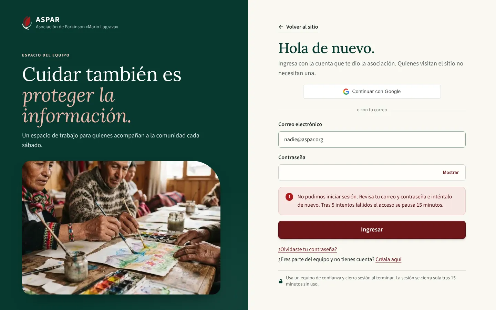
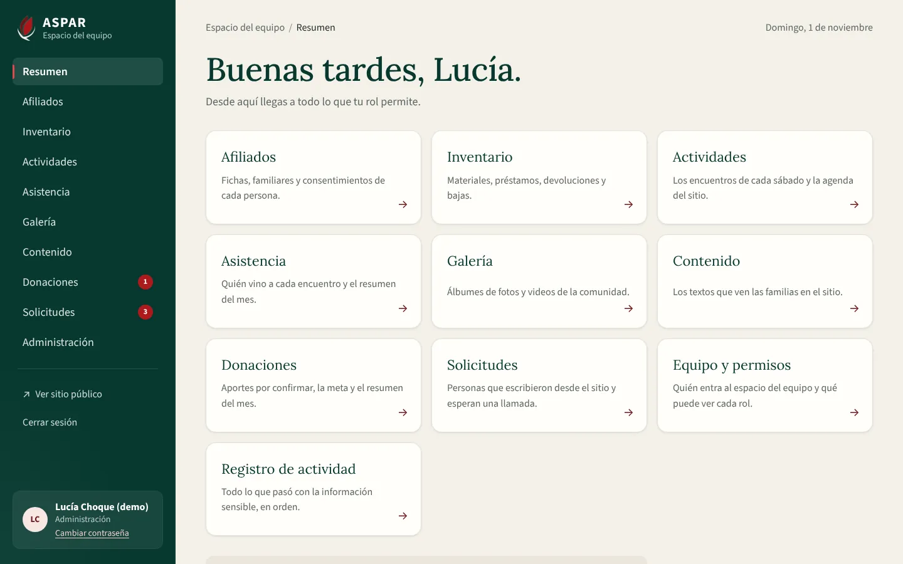
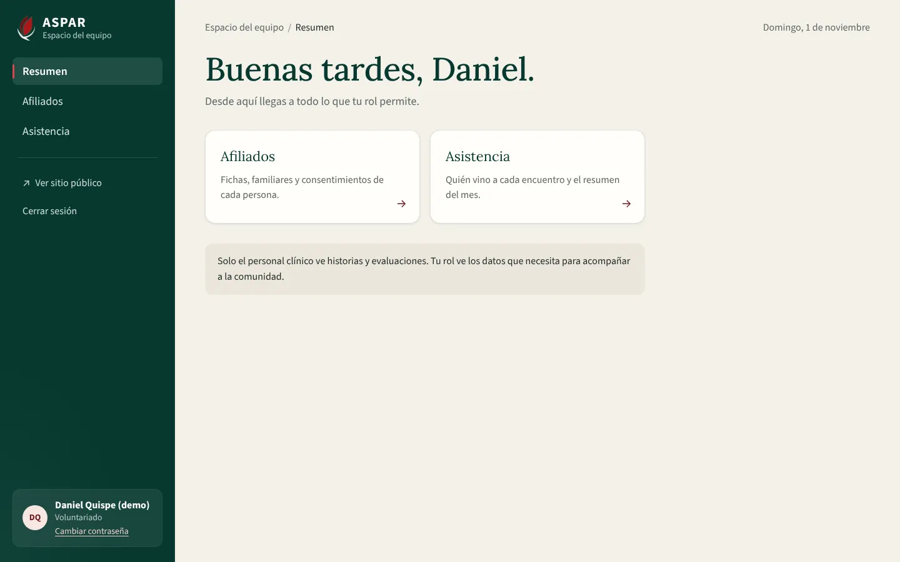
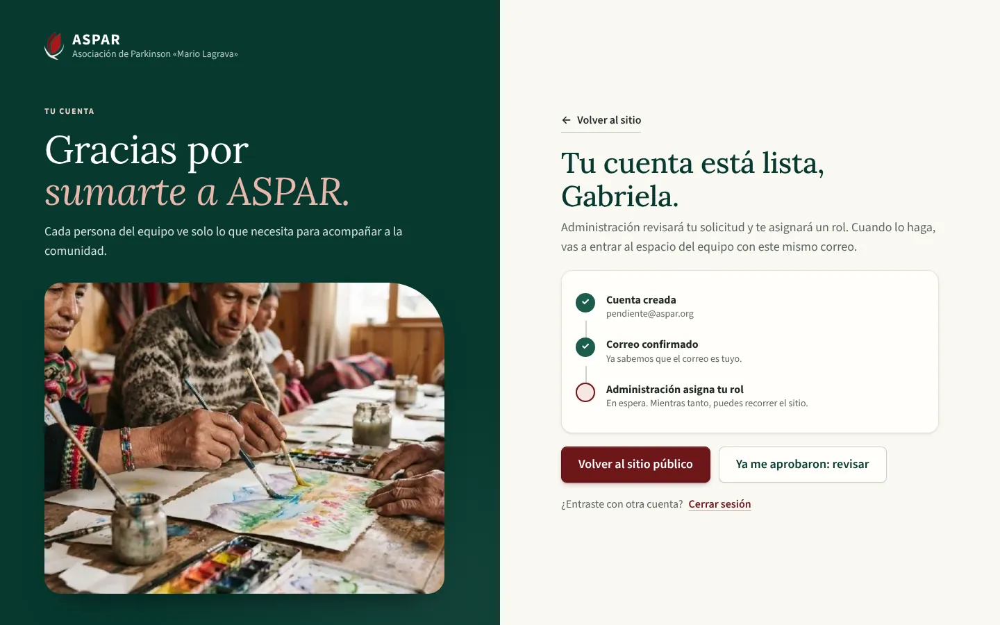
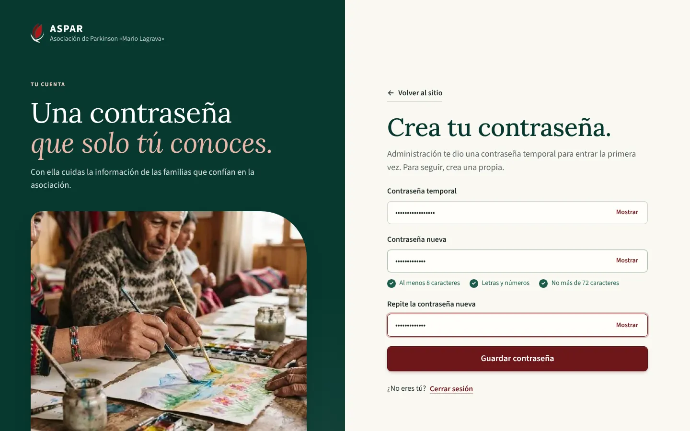
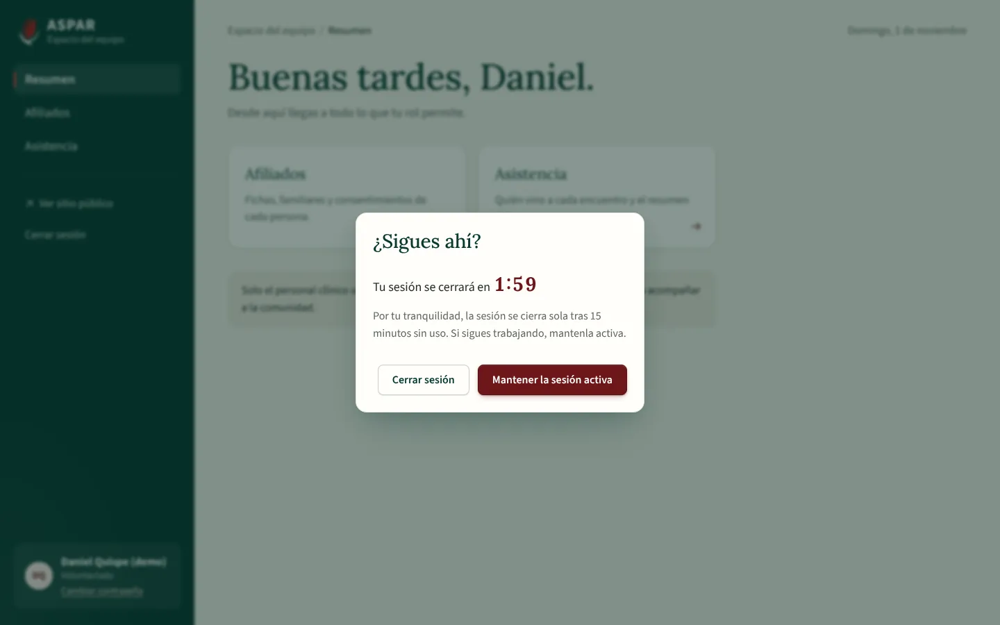
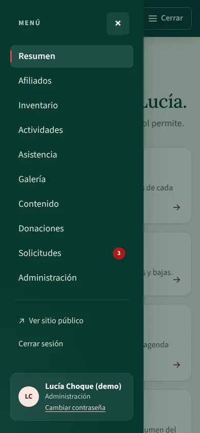
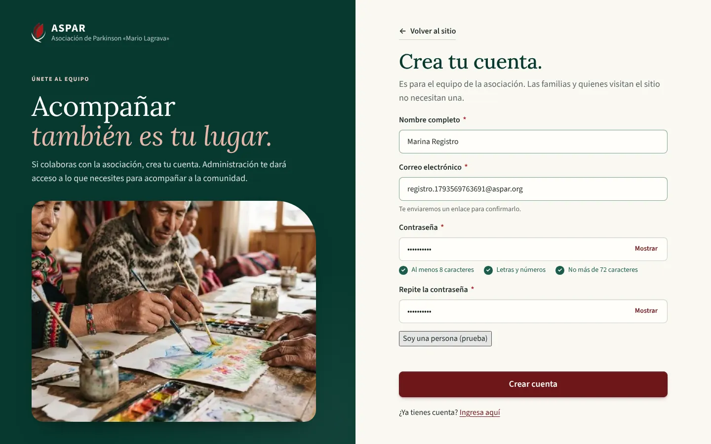
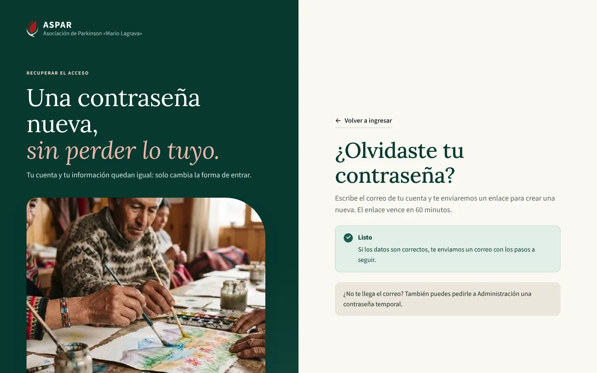
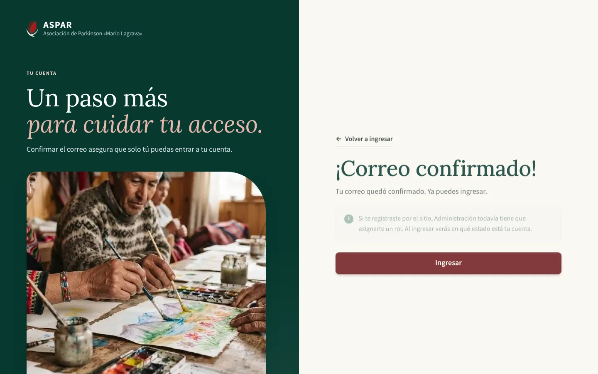

# Evidencia del bloque F1 del Frontend: diseño base, sesión real y acceso

Este bloque reemplaza el ingreso del modo demo por la sesión real de la API. También crea el sistema de diseño y el Espacio del equipo según `ASPAR_diseno_completo.pdf`:

- pág. 6: acceso del equipo;
- pág. 7: barra lateral y resumen;
- pág. 18: contraseña temporal.

Requisitos que cubre:

| Requisito | Qué quedó |
| :--- | :--- |
| RF-01 | Ingreso con correo o Google; registro, confirmación de correo y recuperación |
| RNF-02 | Sesión en cookies, aviso a los 13 minutos sin uso y cierre a los 15 |
| RF-11 | En parte: contraseña temporal y cuentas pendientes de aprobación |

## 1. Cómo se verificó

| Verificación | Resultado |
| :--- | :--- |
| Vitest (`npm run test:coverage`) | 166 pruebas en 18 archivos, 91,34 % de líneas |
| Playwright (`npm run e2e`) contra la API de Docker con `seed_demo` | 12 recorridos sobre el build de producción (`vite preview`) |
| ESLint, Prettier, `vue-tsc` (app, pruebas y E2E) y `vite build` | Sin errores |
| Backend (pytest) | 413 pruebas |

En el E2E todo va contra la API real. Solo los scripts de Cloudflare Turnstile y de Google se reemplazan por dobles en el navegador, porque el entorno de prueba no tiene acceso a esos servicios. La API dejó de consultar a Cloudflare cuando usa la clave secreta de prueba (siempre aprueba), así el registro y la recuperación funcionan de punta a punta sin internet.

Los enlaces reales de los correos también se probaron a mano. En desarrollo, la API escribe cada correo en su consola.

- **Confirmación de correo:** registro → enlace del correo → «¡Correo confirmado!» → ingreso → pantalla de cuenta pendiente. El mismo enlace usado otra vez responde «El enlace no es válido o ya venció».
- **Recuperación:** pedir el enlace → enlace del correo → contraseña nueva → ingreso con la nueva.

## 2. Recorridos E2E

| Recorrido | Qué comprueba |
| :--- | :--- |
| Ingreso fallido | Mensaje único de la API («Tras 5 intentos fallidos el acceso se pausa 15 minutos») sin decir si la cuenta existe; la contraseña se borra |
| Administración | Vuelve a la página pedida antes de ingresar, ve las 10 secciones, abre Administración y cierra sesión; después la cookie ya no sirve |
| Voluntariado | Solo ve Afiliados y Asistencia; entrar por la dirección a Inventario lo devuelve al resumen con un aviso |
| Cuenta pendiente | Pantalla de espera; no entra al equipo; recorre el sitio público con su sesión y puede salir |
| Persona invitada | Administración la crea por la API; al primer ingreso debe crear su contraseña; luego ve las secciones de Recepción |
| Inactividad | A los 13 minutos (reloj del navegador adelantado) aparece «¿Sigues ahí?»; «Mantener la sesión activa» llama a `/auth/refresh`; a los 15 minutos sin uso se cierra la sesión |
| Celular (390 px) | El menú del equipo se abre como panel y se cierra al elegir una sección |
| Crear cuenta | Registro con Turnstile → «Revisa tu correo»; sin confirmar no ingresa y puede pedir un enlace nuevo |
| Enlace vencido | La confirmación explica que el enlace no sirve y ofrece otro |
| Recuperar contraseña | Responde igual exista o no la cuenta |
| Enlace de recuperación inválido | No cambia nada y ofrece pedir otro enlace |
| Google | El botón entrega la credencial a la API; sin `GOOGLE_CLIENT_ID` la API responde 503 y la pantalla lo explica |

## 3. Capturas

| | |
| :---: | :---: |
|  Ingreso con el mensaje seguro de la API |  Resumen de Administración |
|  Voluntariado: solo sus secciones |  Cuenta pendiente de aprobación |
|  Cambio obligatorio de la contraseña temporal |  Aviso de inactividad |
|  Menú del equipo en el celular |  Registro con verificación |
|  Recuperación de la contraseña |  Enlace real del correo de confirmación |

## 4. Decisiones del bloque

- **Mensaje de ingreso:** la API responde lo mismo exista o no la cuenta, por eso la pantalla no muestra «te quedan N intentos» (RNF-02). El texto acordado sale de la propia API.
- **Secciones todavía no migradas:** muestran «Estamos preparando esta sección» en lugar de datos de ejemplo. Las pantallas antiguas siguen en el código, sin ruta, hasta que su bloque las reemplace (F2 a F6).
- **Portada pública:** conserva su contenido hasta F5b, ya dentro del nuevo encabezado y pie, y sin códigos técnicos ni menciones a Libélula.
- **Fuentes y recursos:** Lora y Source Sans 3 se sirven desde el propio sitio (sin pedidos a Google Fonts). El logo y la foto del acceso salen del PDF de diseño.

## 5. Pendiente para staging

- «Continuar con Google» con un ID de cliente real (`VITE_GOOGLE_CLIENT_ID` y `GOOGLE_CLIENT_ID`).
- Turnstile con las claves reales de Cloudflare.
- Correos reales con Resend.
