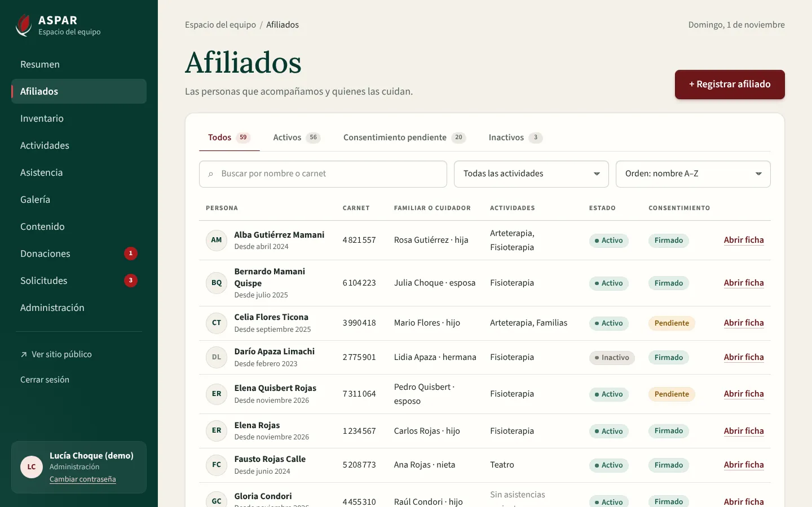
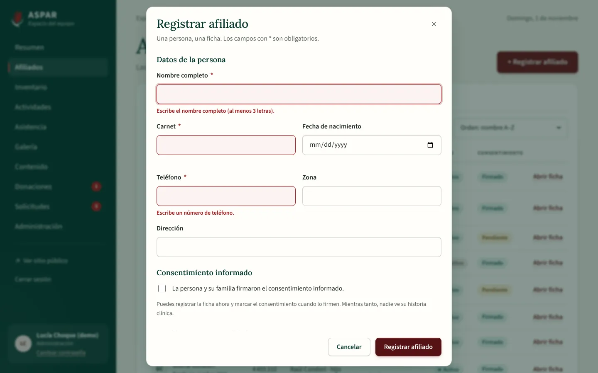
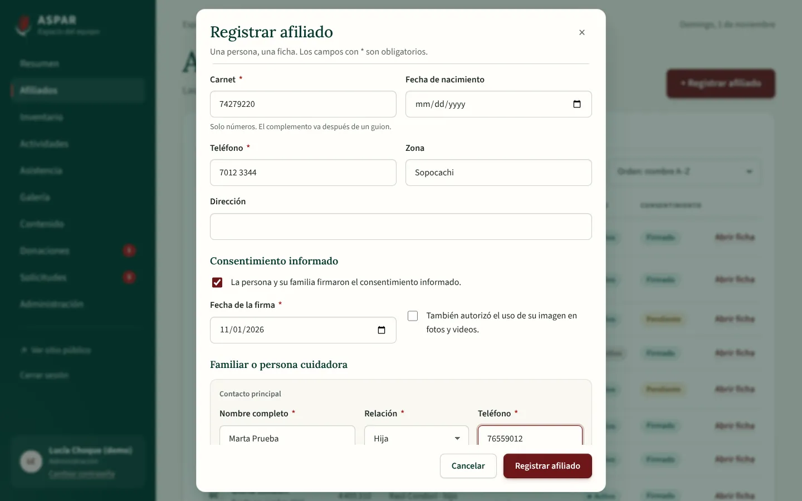
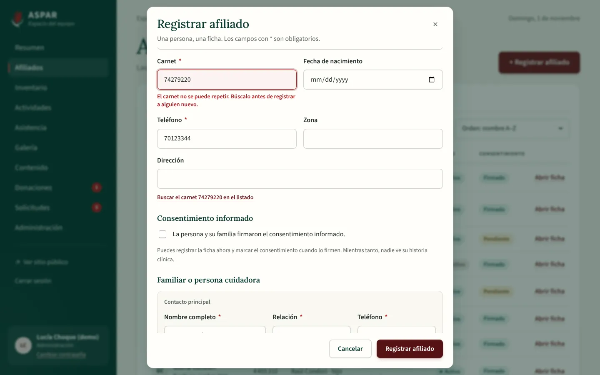
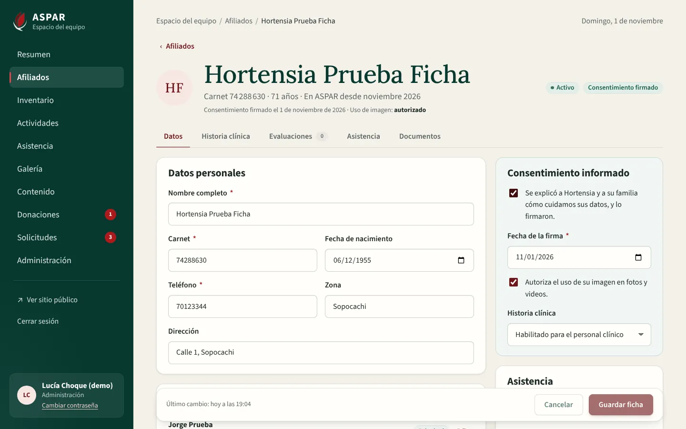
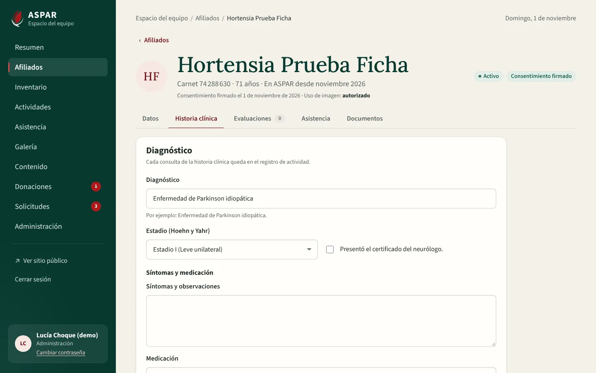
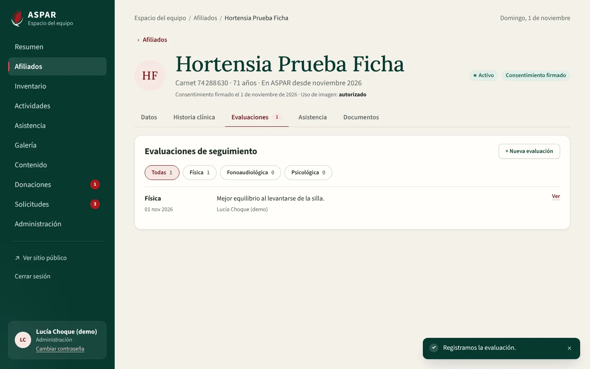
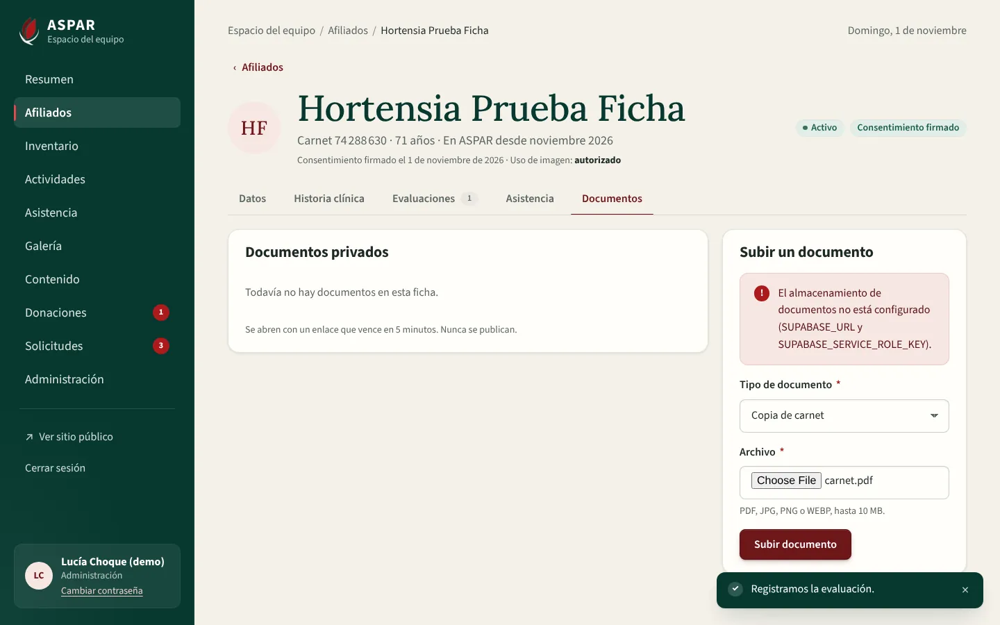
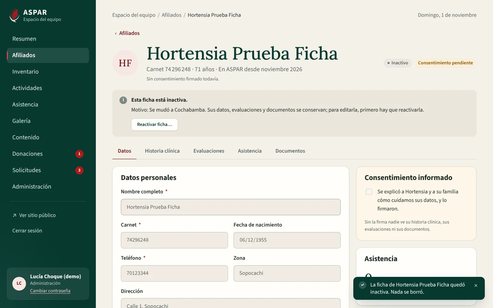
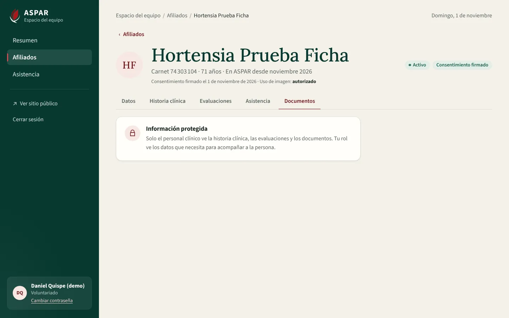

# Evidencia del bloque F2 del Frontend: afiliados

Este bloque conecta a la API las pantallas de afiliados de `ASPAR_diseno_completo.pdf`:

- pág. 8: listado con pestañas, filtros, páginas y «+ Registrar afiliado»;
- pág. 9: ficha del afiliado.

Reemplaza a `PatientsView` y `RegisterPatientView`, que trabajaban con datos del modo demo.

Requisitos que cubre:

| Requisito | Qué quedó |
| :--- | :--- |
| RF-02 | Listado, alta y ficha completa: datos, familiares o cuidadores, historia clínica, evaluaciones, asistencia y documentos. Baja lógica y reactivación con motivo |
| RNF-06 | Lo clínico solo aparece si la API lo envía. Si no, la ficha explica el motivo real: el rol, la falta de consentimiento o el acceso suspendido |
| RF-12 | En parte: la pestaña Asistencia de cada ficha («X de Y sábados este trimestre» e historial). La toma de asistencia llega en F4 |

## 1. Cómo se verificó

| Verificación | Resultado |
| :--- | :--- |
| Vitest (`npm run test:coverage`) | 233 pruebas en 20 archivos, 94,2 % de líneas |
| Playwright (`npm run e2e`) contra la API de Docker con `seed_demo` | 34 recorridos sobre el build de producción: los 23 de F1 y 11 nuevos |
| ESLint, Prettier, `vue-tsc` (app, pruebas y E2E), `api:types:check` y `vite build` | Sin errores |
| Backend (pytest) | 431 pruebas, 98 % de sentencias |

Cada recorrido E2E de la ficha crea su propia ficha por la API, así no depende de los datos de demostración ni los cambia.

## 2. Cambios en la API

Los cambios de la API van en el primer commit del bloque. El Frontend no simula ningún dato.

| Cambio | Para qué |
| :--- | :--- |
| `GET /patients/summary` | Contadores de las pestañas (Todos, Activos, Consentimiento pendiente, Inactivos) con la misma búsqueda y actividad del listado, y las opciones del filtro por actividad |
| `GET /patients?group=&activity=&order=` | Pestaña, actividad de los últimos seis meses y orden (nombre A–Z o Z–A, registro más reciente o más antiguo) |
| `activities` en cada fila del listado | Actividades a las que vino cada persona en los últimos seis meses, de la más frecuente |
| `GET /patients/{id}/attendance` | Sábados del trimestre (con actividades publicadas) a los que vino e historial paginado |
| `POST /patients/{id}/reactivate` con `{ "reason" }` | La reactivación también pide motivo y queda en la bitácora. Los motivos se guardan sin espacios sobrantes (de 3 a 300 letras) |
| `seed_demo`: comunidad de 20 afiliados | Distintos estados, contactos y asistencias pasadas, para ver pestañas, filtros y páginas. Las pruebas siguen usando los tres afiliados de siempre |

## 3. Recorridos E2E nuevos

| Recorrido | Qué comprueba |
| :--- | :--- |
| Listado | Los contadores de las pestañas son los de la API. Busca por carnet escrito con espacios. Doce fichas de prueba ocupan dos páginas, y se pueden ordenar de la Z a la A. Prueba las pestañas Consentimiento pendiente e Inactivos y el filtro por actividad. Al volver desde una ficha se recupera la misma pestaña |
| Alta | Revisa los datos obligatorios. Registra con consentimiento y un contacto, y abre la ficha. Con el mismo carnet responde «El carnet no se puede repetir. Búscalo antes de registrar a alguien nuevo.» y ofrece buscarlo en el listado |
| Voluntariado | Consulta el listado, pero no ve «+ Registrar afiliado» |
| Ficha completa | Guarda los datos personales. Agrega un familiar, lo hace principal y quita al anterior; «Quitar» desaparece cuando queda uno solo. Guarda la historia clínica, que se conserva al recargar, y registra una evaluación con su modal. Recorre Asistencia y Documentos |
| Baja y reactivación | Las dos piden motivo. La ficha inactiva no se edita y aparece en la pestaña Inactivos |
| Privacidad | El Voluntariado ve los datos sin poder editarlos. Historia clínica, Evaluaciones y Documentos muestran «Información protegida» |
| Recepción | Puede subir documentos a una ficha, aunque no puede verlos |
| Una sola barra de desplazamiento | Listado y ficha (las cinco pestañas) a 1366×768 y 1920×1080: sin desplazamiento lateral y sin zonas con su propia barra. El menú lateral entra completo y, a 1920×1080, la paginación queda a la vista |

**Documentos en local:** Docker no tiene las claves de Supabase Storage, así que al subir un documento la API responde «El almacenamiento de documentos no está configurado» y la ficha lo muestra. La subida, el enlace de 5 minutos y el borrado se comprueban en Vitest contra respuestas de la API y en el Backend (`test_storage_adapter.py`). Con las claves reales se verifican en staging.

## 4. Capturas

| | |
| :---: | :---: |
|  Listado con contadores y filtros |  Alta: datos obligatorios |
|  Alta con consentimiento y contacto |  Carnet repetido, explicado |
|  Ficha: datos y consentimiento |  Historia clínica |
|  Evaluaciones de seguimiento |  Documentos privados |
|  Ficha inactiva con su motivo |  Voluntariado: información protegida |

## 5. Decisiones del bloque

- **Diferencias con el diseño:**
  - La API guarda el nombre completo en un solo campo, por eso la ficha muestra «Nombre completo» y no «Nombres» y «Apellidos».
  - La API no tiene «Fecha de revisión» ni «Revisó» del diagnóstico. Quién evaluó y cuándo queda en cada evaluación de seguimiento.
  - La ficha no muestra quién hizo el último cambio, solo cuándo. La persona queda en el registro de actividad.
- **Sin géneros adivinados:** la API no guarda el género, por eso los estados dicen «Activo» o «Inactivo» y el encabezado dice «En ASPAR desde» en lugar de «Afiliada desde».
- **Dirección con estado:** la pestaña, la búsqueda, el filtro, el orden y la página quedan en la dirección (`?pestana=…&buscar=…&pagina=…`). Por eso «‹ Afiliados» y recargar la página no pierden nada.
- **Guardado:**
  - Los datos personales y el consentimiento se guardan juntos con «Guardar ficha». Si quedan cambios sin guardar, la ficha avisa antes de salir.
  - Familiares, evaluaciones y documentos se guardan al momento.
- **Componentes compartidos:**
  - `DataTable` pasa a tarjetas según su propio ancho (container query), no según la pantalla.
  - `AppModal` mantiene fijos el título y los botones; solo se desplaza el contenido.
  - El menú lateral se compacta en ventanas bajas, como 1366×768, para no tener su propia barra.
- **Código retirado:** `PatientsView`, `RegisterPatientView`, sus pruebas y las funciones de pacientes del servicio local del modo demo.

## 6. Pendiente para staging

- Subir, abrir (enlace firmado de 5 minutos) y quitar documentos con el bucket privado real de Supabase.
- Rendimiento del listado con el volumen real de afiliados (RNF-01).
