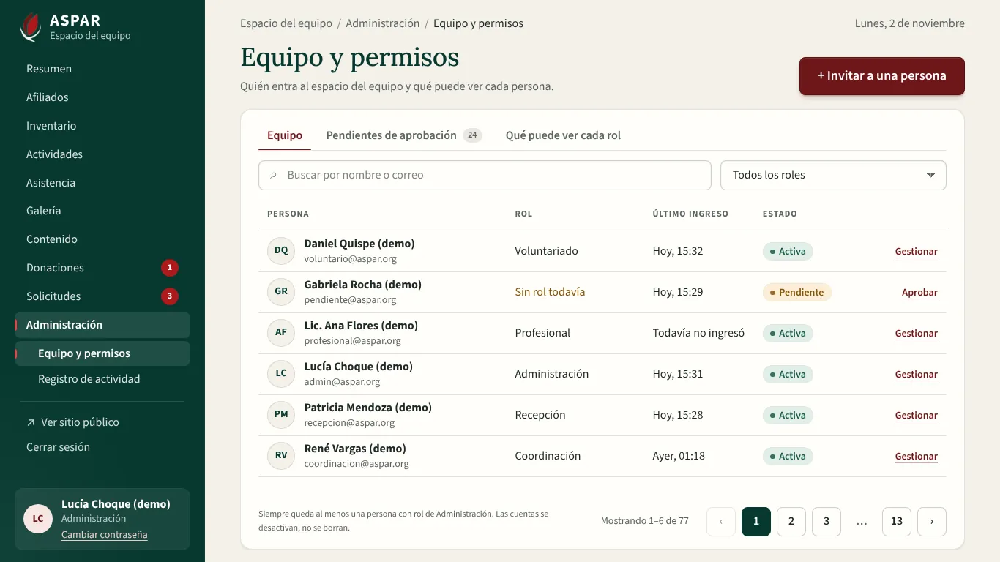
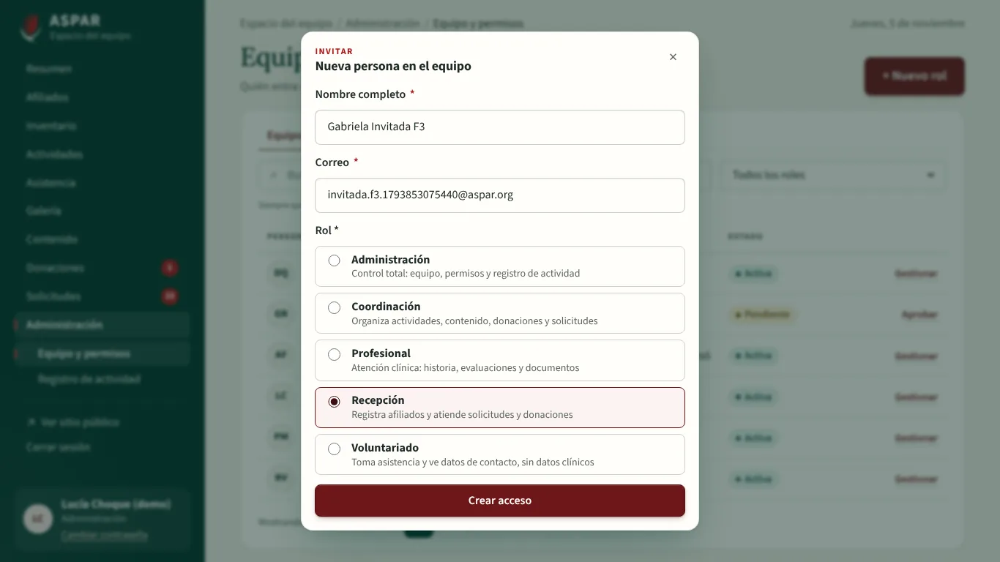
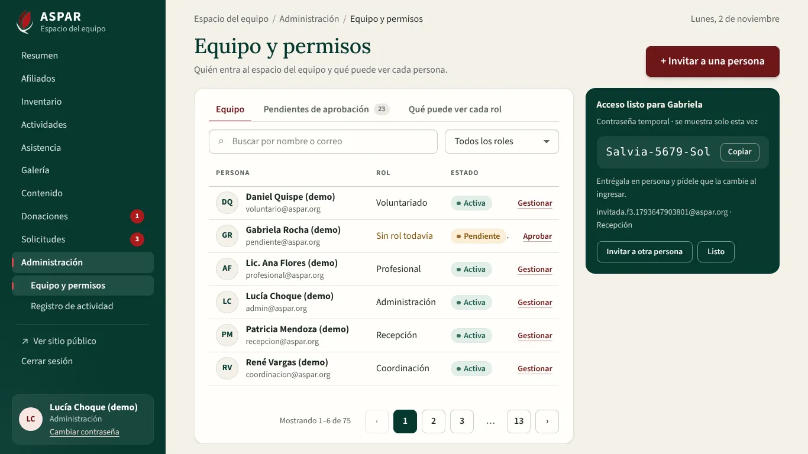
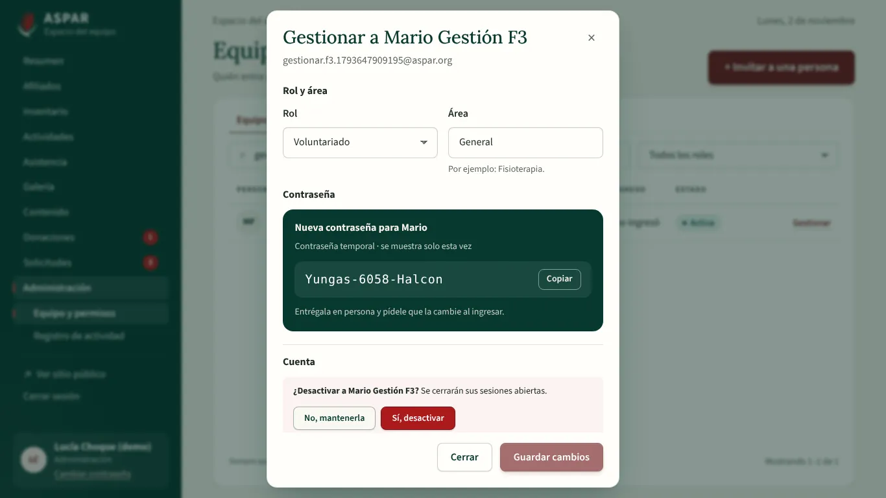
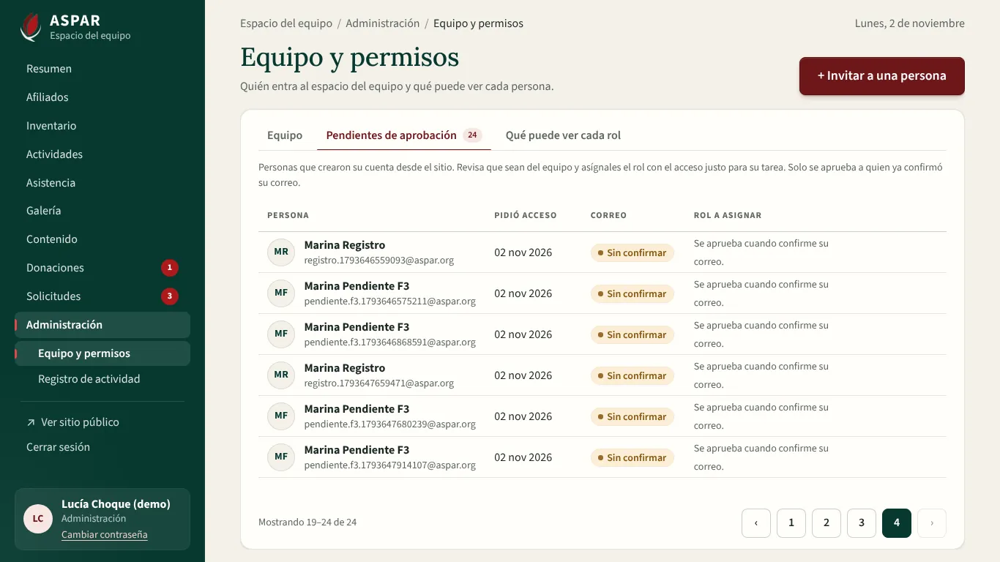
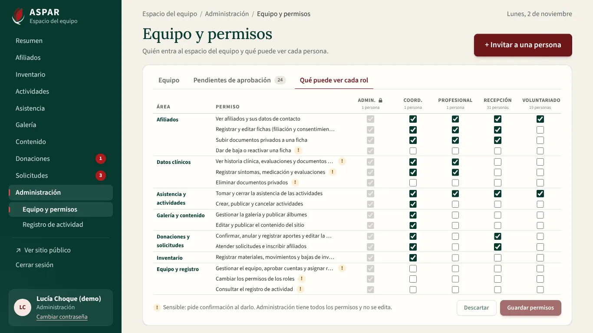
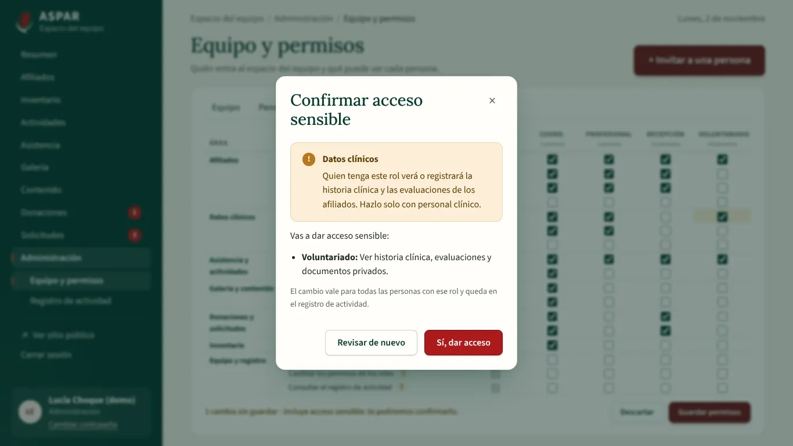
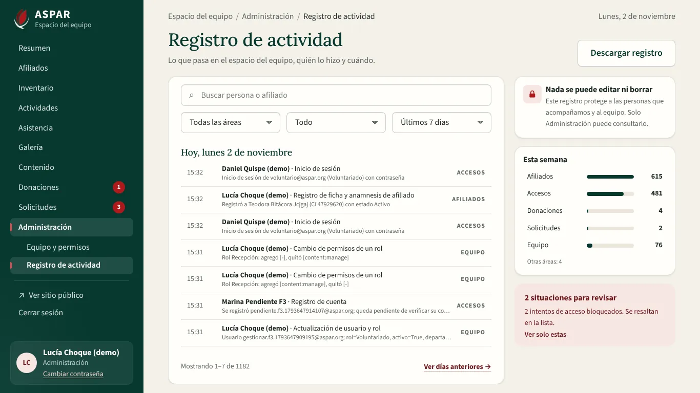
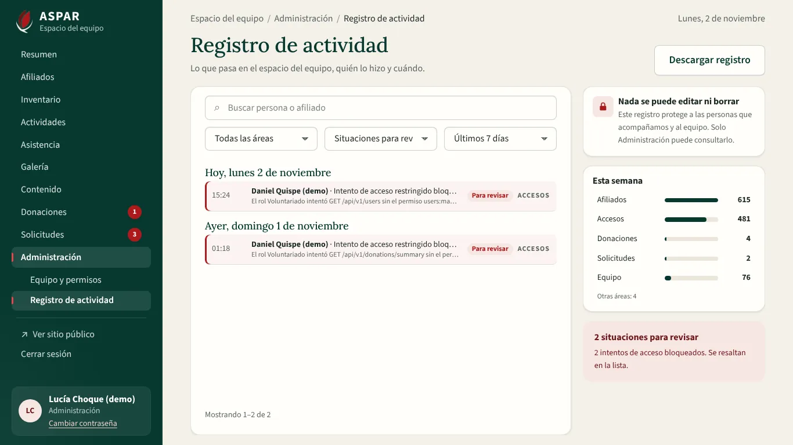

# Evidencia del bloque F3 del Frontend: equipo, permisos y registro de actividad

Este bloque conecta a la API las pantallas de administración de `ASPAR_diseno_completo.pdf`:

- pág. 18: Equipo y permisos;
- pág. 19: Registro de actividad.

Reemplaza a `UsersView` y `AuditView`, que trabajaban con el servicio del modo demo.

Requisitos que cubre:

| Requisito | Qué quedó |
| :--- | :--- |
| RF-11 | Equipo con búsqueda y filtro por rol. Invitar con contraseña temporal del servidor, aprobar cuentas pendientes, cambiar rol y área, restablecer la contraseña, desactivar y reactivar. Siempre queda una persona con rol de Administración activa. Tabla «Qué puede ver cada rol» editable |
| RF-17 | Registro de actividad agrupado por día. Filtros por área, persona o afiliado, situaciones para revisar y días. Resumen de la semana por área y descarga en Excel |
| RNF-06 | Dar datos clínicos a un rol pide una confirmación con aviso propio. El registro solo lo ve Administración (`audit:read`) |
| RNF-08 | Las dos pantallas entran completas a 1366×768 y 1920×1080, sin barra de desplazamiento |

## 1. Cómo se verificó

| Verificación | Resultado |
| :--- | :--- |
| Vitest (`npm run test:coverage`) | 285 pruebas en 25 archivos, 93,21 % de líneas |
| Playwright (`npm run e2e`) contra la API de Docker con `seed_demo` | 58 recorridos: los 41 de F1 y F2, y 17 nuevos |
| ESLint, Prettier, `vue-tsc` (app, pruebas y E2E), `api:types:check` y `vite build` | Sin errores |
| Backend (pytest) | 441 pruebas, 98 % de sentencias |

## 2. Cambios en la API

Van en el primer commit del bloque. Solo el registro de actividad necesitaba algo nuevo: Equipo y permisos usa los endpoints de `users` y `roles` que ya existían.

| Cambio | Para qué |
| :--- | :--- |
| `GET /audit?area=&search=&days=&review=` | Área del diseño (Afiliados, Accesos, Donaciones, Solicitudes, Equipo y tres más). Búsqueda por persona del equipo (nombre o correo) o por afiliado (en el detalle). Últimos N días. Solo las situaciones para revisar |
| `actorName`, `area`, `areaLabel` y `review` en cada movimiento | El nombre de quien lo hizo, el área y si es una situación para revisar: intento de acceso bloqueado o aporte anulado |
| `GET /audit/summary?days=7` | Movimientos por área de la semana y cuántas situaciones para revisar hubo |
| `GET /audit/export?format=xlsx\|csv` | «Descargar registro» con los mismos filtros, hasta 5000 movimientos, con protección contra fórmulas. La descarga queda en el registro |

Pruebas nuevas: `test_audit_activity.py` (8).

## 3. Recorridos E2E nuevos

| Recorrido | Qué comprueba |
| :--- | :--- |
| Invitar | Valida los datos. Crea un acceso con rol Recepción y muestra la contraseña temporal una sola vez. La persona entra con esa contraseña y tiene que cambiarla |
| Gestionar | Restablece la contraseña (se ve una vez). Desactiva con confirmación y reactiva desde la lista |
| Administración | Nadie se quita a sí mismo el rol de Administración |
| Pendientes de aprobación | La cuenta que confirmó su correo se aprueba eligiendo un rol. Una cuenta recién creada explica que falta confirmar el correo |
| Qué puede ver cada rol | Administración fija. Un permiso común se guarda y queda al recargar. Dar datos clínicos pide confirmación, y «Revisar de nuevo» con «Descartar» no cambian nada en la API |
| Registro | Busca un afiliado recién creado, filtra por área y quita los filtros. Un intento de acceso bloqueado de verdad aparece como situación para revisar. Recorre «Ver días anteriores» y «Más recientes». Descarga el Excel y la descarga aparece en el registro |
| Voluntariado | No entra a ninguna de las dos pantallas |
| Ventana completa | Las tres pestañas de Equipo y permisos y el registro, a 1366×768 y 1920×1080, sin barra de desplazamiento |
| Una sola carga | Afiliados, Equipo, Pendientes y el registro piden su lista una sola vez al abrirse (1440×900 y 1366×768) |

## 4. Capturas

| | |
| :---: | :---: |
|  Equipo a 1366×768 |  «+ Invitar a una persona» |
|  Contraseña temporal, una sola vez |  Gestionar: contraseña nueva y desactivar |
|  Pendientes de aprobación |  Qué puede ver cada rol |
|  Confirmar acceso a datos clínicos |  Registro de actividad |
|  Situaciones para revisar, resaltadas | |

## 5. Decisiones del bloque

- **La invitación al costado, cuando hay lugar:**
  - Desde 1500 px de ancho queda fija al costado, como en el diseño.
  - A 1366×768 se abre con «+ Invitar a una persona» y se cierra con «×» o «Listo». Así la tabla del equipo conserva sus columnas.
- **Pestañas en Equipo y permisos:** en el diseño las secciones van una debajo de otra y la página se desplaza. Las tres pestañas (Equipo, Pendientes de aprobación, Qué puede ver cada rol) permiten que cada una entre completa.
- **La tabla de permisos usa los 17 permisos reales:** el diseño muestra 6 filas resumidas. Los permisos se agrupan por área y los sensibles llevan «!». A 1366×768 las filas se compactan y cada permiso va en una línea.
- **Última persona de Administración:**
  - La API lo impide.
  - La pantalla lo explica antes: no deja cambiar el rol ni desactivar a la única persona activa de Administración, ni quitarse el rol a uno mismo.
- **Aprobar exige el correo confirmado:** la API no aprueba cuentas sin confirmar. La bandeja lo dice en lugar de mostrar un botón que fallaría.
- **El registro, por páginas:**
  - En ventana completa no hay desplazamiento. Se piden los movimientos que entran y se muestran los que caben junto con sus encabezados de día.
  - «Ver días anteriores» sigue desde el último que se vio y «Más recientes» vuelve.
- **Detalle legible:** el registro no muestra los identificadores internos (UUID) que guarda la API.
- **Arreglo en Afiliados (F2):** a 1440×900 el listado se pedía dos veces: la paginación aparecía al llegar los datos y achicaba la tabla. Ahora su lugar queda reservado desde el inicio. Se corrigió una falla intermitente del E2E de la ficha.
- **Código retirado:**
  - `UsersView`, `AuditView` y sus pruebas.
  - Las funciones de usuarios y de bitácora del servicio del modo demo.

## 6. Pendiente para staging

- Revisar con el equipo de ASPAR qué permisos necesita cada rol en la práctica. La tabla ya permite ajustarlos, y cada cambio queda en el registro.
- Probar la descarga del registro con el volumen real de movimientos (hasta 5000 por descarga).
