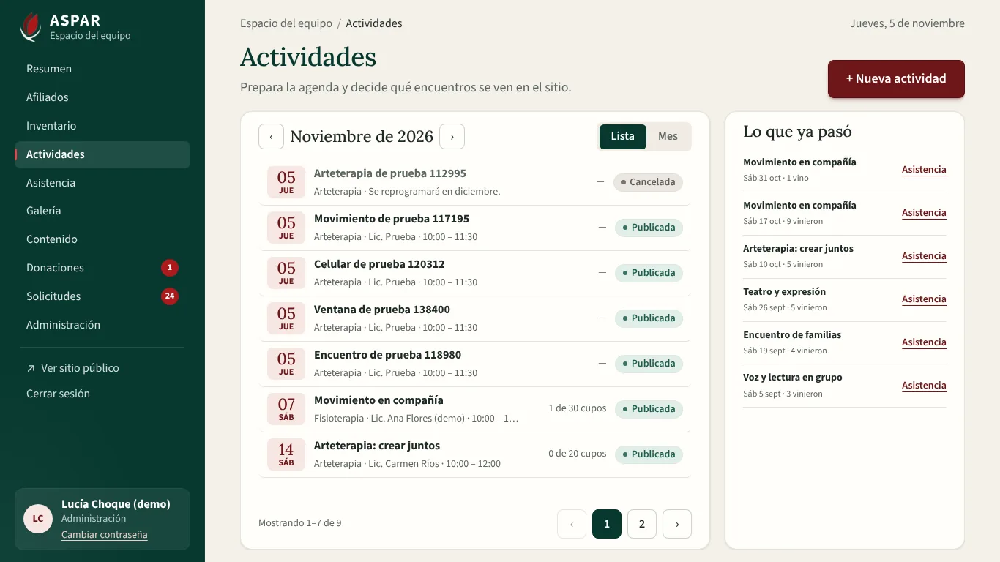
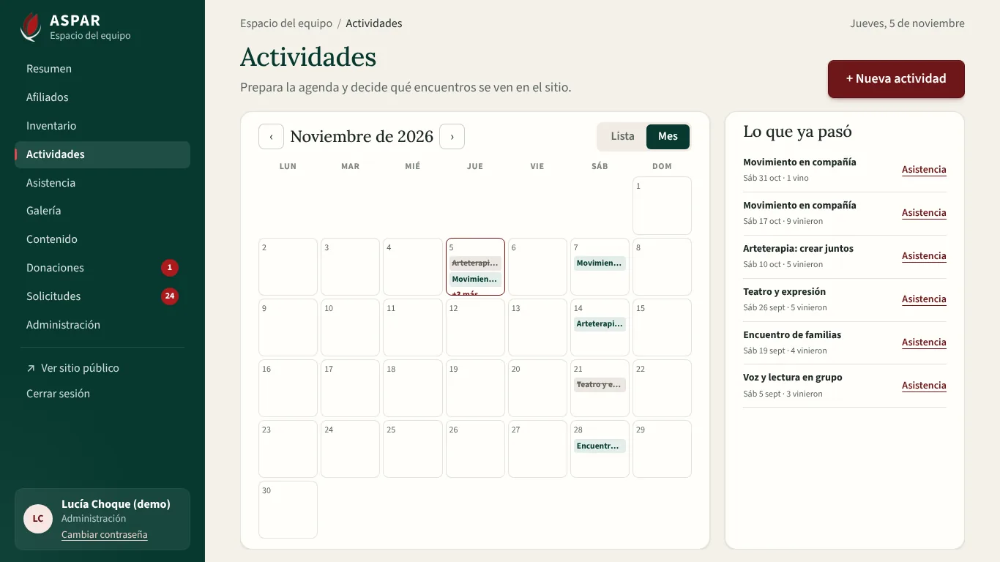
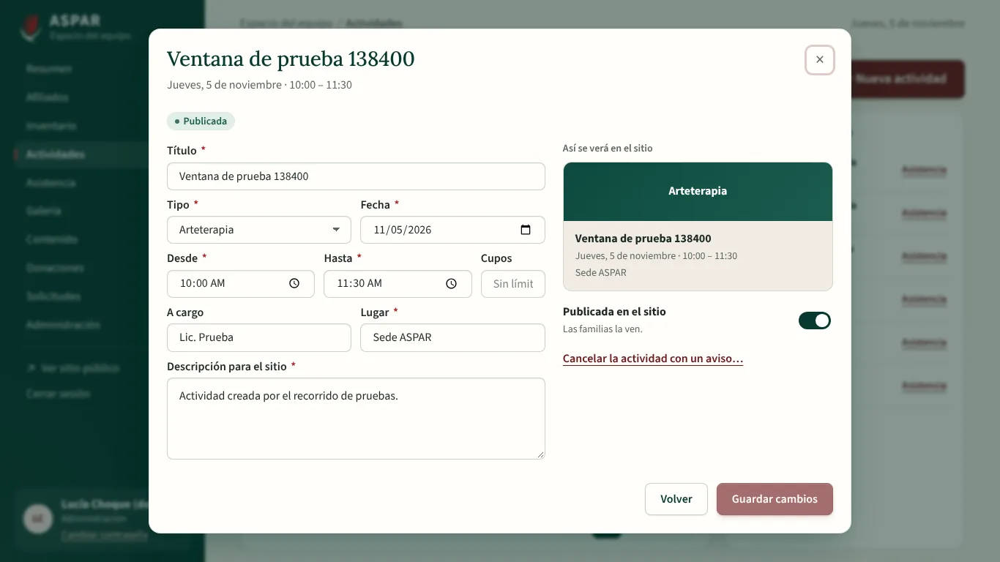
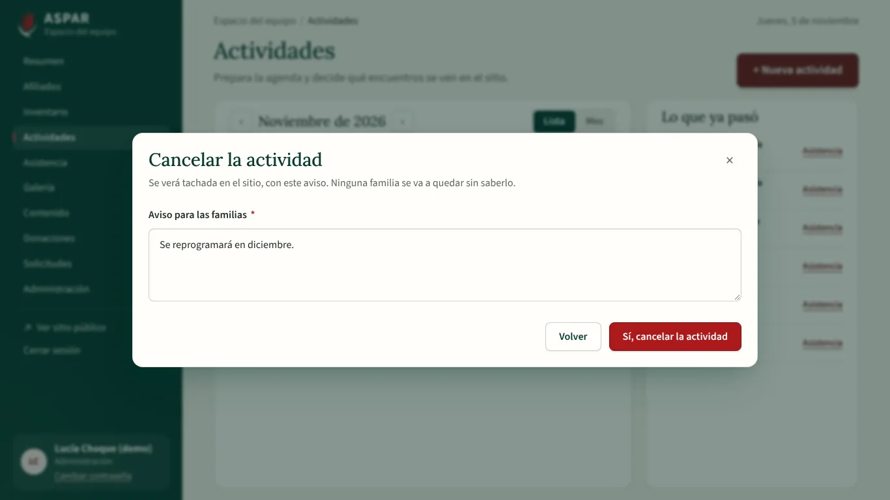
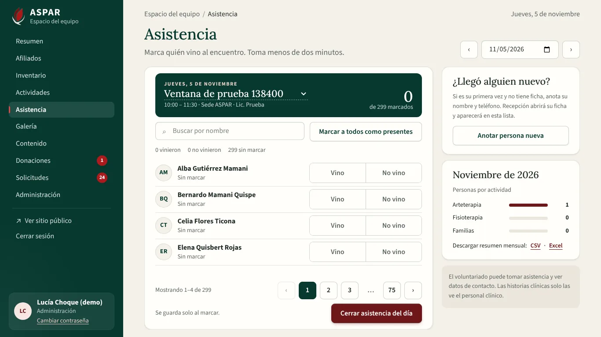
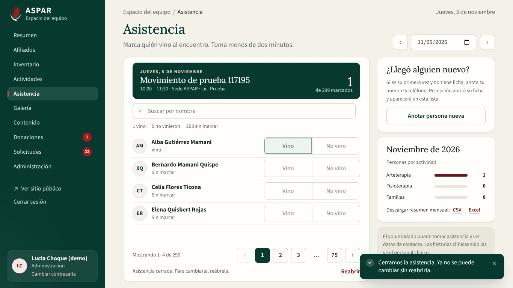
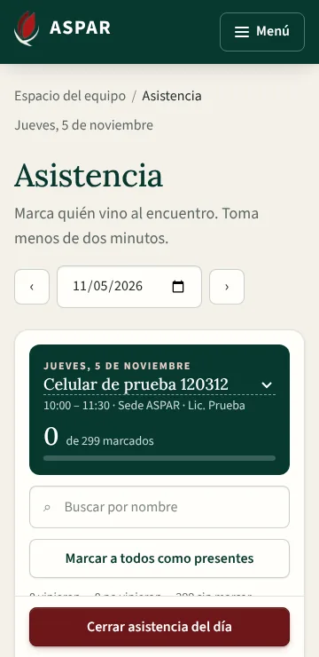
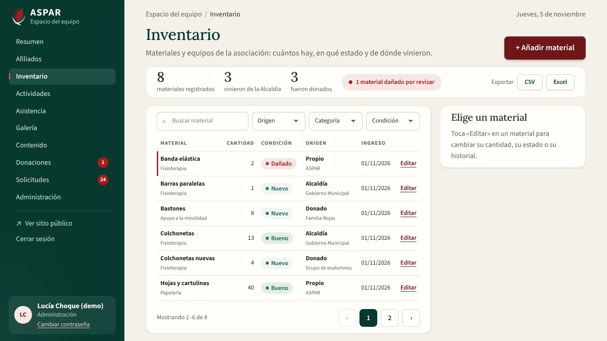
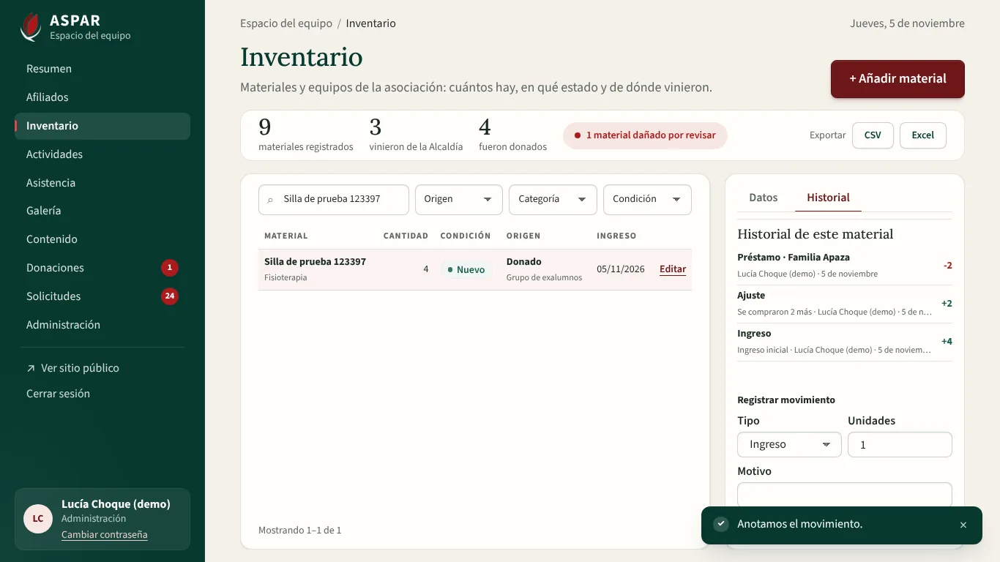
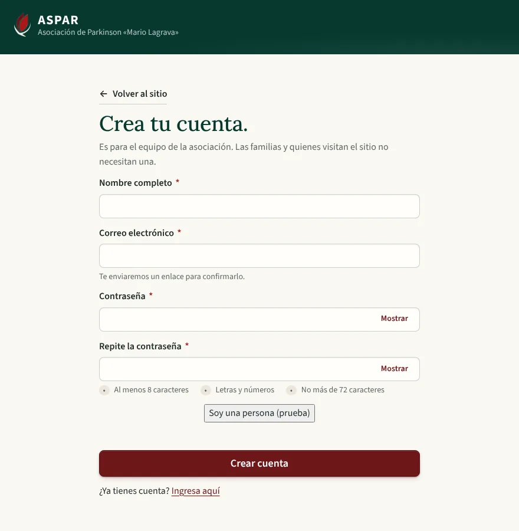

# Evidencia del bloque F4 del Frontend: operación de la sede

Este bloque conecta a la API las pantallas de operación de `ASPAR_diseno_completo.pdf`:

- **Actividades** (págs. 3 y 12): lista o mes, estados, «Lo que ya pasó» y una ventana para crear o editar con vista previa, cancelación con aviso incluida.
- **Asistencia** (págs. 10 y 12): escritorio y celular de 360 px, «Vino» y «No vino», cerrar el día, persona nueva y resumen mensual.
- **Inventario** (pág. 11): contadores, dañados, filtros, panel con historial y baja con motivo, y exportación.

Reemplaza a `ScheduleManagementView`, `AttendanceView` e `InventoryView`, que trabajaban con el servicio del modo demo.

También corrige lo que se pidió al revisar F3 y la primera entrega de F4:

- Crear cuenta entra completa, sin barra, en cualquier ventana de escritorio.
- En Equipo y permisos, «+ Nuevo rol» abre la invitación en una ventana y la lista usa todo el ancho.

## Cómo se entregó

Los dos primeros commits de F4 ya están en `Sprint2`. El parche agrega dos más:

| Commit | Qué trae |
| :--- | :--- |
| `fix(ventana): registro, captcha y equipo…` (en `Sprint2`) | Primer ajuste de crear cuenta y de Equipo y permisos |
| `feat(operacion): actividades y asistencia…` (en `Sprint2`) | Actividades y Asistencia |
| `fix(operacion): correcciones…` (este parche) | Ventanas de actividad y de invitar, agenda a todo el alto, día en Asistencia, crear cuenta sin barra y limpieza de los datos de prueba |
| `feat(operacion): inventario…` (este parche) | Inventario completo, con «+ Añadir material» en una ventana |

## Requisitos que cubre

| Requisito | Qué quedó |
| :--- | :--- |
| RF-03 / RF-09 / RF-13 | Inventario con contadores, filtros, historial, movimientos, baja con motivo y exportación CSV o Excel. Los bienes de la Alcaldía van aparte en la exportación |
| RF-04 / RF-10 | Actividades con borrador, publicación, edición y cancelación con aviso. Vista previa de cómo se verá en el sitio |
| RF-12 | Asistencia por día: marcar, marcar a todos, cerrar y reabrir, persona nueva y resumen mensual en CSV o Excel |
| RNF-06 | La asistencia y los datos del voluntariado no muestran información clínica. El resumen mensual solo lo ve quien gestiona actividades |
| RNF-08 | Operación, crear cuenta y Equipo y permisos entran completos a 1280×720, 1366×768 y 1920×1080, también con las ventanas abiertas. La asistencia funciona en el celular de 360 px con botones de 44 px o más |

## 1. Cómo se verificó

| Verificación | Resultado |
| :--- | :--- |
| Vitest (`npm run test:coverage`) | 319 pruebas en 28 archivos, 92,09 % de líneas |
| Playwright (`npm run e2e`) contra la API de Docker con `seed_demo` | 69 recorridos, todos pasan |
| ESLint, Prettier, `vue-tsc` (app, pruebas y E2E), `api:types:check` y `vite build` | Sin errores |
| Backend (pytest) | 441 pruebas (sin cambios en la API de este bloque) |

Cada recorrido E2E de operación crea sus propias actividades y materiales, con nombres «… de prueba 123456». Al terminar, `e2e/global-teardown.ts` los borra de la base de Docker. Así la agenda, la asistencia y el inventario no se llenan de datos de prueba. Con `E2E_LIMPIAR=0` no se borra nada.

## 2. Cambios en la API

Ninguno. La API de actividades, asistencia e inventario ya existía y estaba probada (`test_schedules.py`, `test_attendance.py`, `test_inventory.py`). El Frontend no simula ningún dato.

## 3. Recorridos E2E nuevos o cambiados

| Recorrido | Qué comprueba |
| :--- | :--- |
| Actividad | «+ Nueva actividad» abre una ventana. La actividad se crea como borrador, se publica con el interruptor y se cancela con el aviso que ven las familias. `?actividad=` abre su ventana |
| Asistencia | Marcar «Vino» se guarda: se espera la respuesta de la API y, al recargar, sigue marcado. Cerrar el día bloquea las marcas y reabrir las libera |
| Persona nueva | Anotar a alguien nuevo crea la solicitud de asistencia |
| Celular | A 360 px los botones «Vino» miden 44 px o más y van en la fila de la persona. «Cerrar asistencia del día» queda a la vista. Ni la asistencia ni el inventario se desplazan de lado, aunque el día tenga varias actividades |
| Voluntariado | Marca asistencia y cierra el día, pero no ve el resumen mensual |
| Inventario | Alta en una ventana, cambio de cantidad sin motivo (no se guarda) y con motivo, préstamo en el historial, baja con motivo y descarga de Excel |
| Ventana completa | Actividades en lista, en mes y con la ventana abierta, asistencia e inventario entran completos a 1366×768 y 1920×1080 |
| Crear cuenta | Entra completa a 880×900, 1366×680 y 1024×600: ni la página ni la columna del formulario se desplazan. El captcha queda centrado |
| Equipo y permisos | «+ Nuevo rol» abre la invitación en una ventana que entra completa. Las tres pestañas entran completas, también a 1567×907 |

## 4. Capturas

| | |
| :---: | :---: |
|  Actividades a 1366×768 |  Vista Mes |
|  Ventana de la actividad |  Cancelar con aviso |
|  Asistencia de un día con dos actividades |  Asistencia cerrada |
|  Asistencia en el celular (360 px) |  Inventario a 1366×768 |
|  Inventario: historial y préstamo |  Crear cuenta a 880×900 |

## 5. Decisiones del bloque

- **Actividades en una ventana:** crear o editar una actividad abre una ventana, como «Registrar afiliado». Los datos van a la izquierda y la vista previa y la publicación a la derecha. Así la agenda (lista o mes) usa todo el alto. «Lo que ya pasó» va a la derecha, con su propia barra si la lista es larga: muestra los encuentros hechos de los últimos cuatro meses, sin canceladas ni borradores.
- **Vista Mes:** las semanas se reparten el alto de la tarjeta, así que el calendario entra completo. Cada día muestra dos actividades y «+N más» lleva a la lista.
- **Sin notas al pie:** se quitaron las notas que ocupaban espacio en Actividades e Inventario, porque tapaban la paginación. Lo que dicen ya se ve en el estado de cada actividad y en el aviso de la exportación.
- **Asistencia por día:** arriba se elige la fecha (se puede escribir o elegir en el calendario), y ‹ y › saltan al día anterior o siguiente con actividad. Si ese día hay más de una, el título del recuadro verde deja elegir cuál. Si no hay ninguna, se ofrecen los días cercanos.
- **Desde qué día se marca:** la API no acepta marcas antes del día de la actividad. En una actividad futura, la pantalla deshabilita las marcas y el cierre, y dice qué día se toma. Una actividad pasada que sigue abierta se puede completar. Solo cuentan las actividades publicadas.
- **Marcar seguido:** cada marca se guarda al tocarla y se puede marcar a otra persona sin esperar. «Cerrar asistencia» espera a que terminen los guardados. «Vino» marcado usa un verde claro, que hace juego con el rosa de «No vino».
- **Fechas en hora de La Paz:** el alta de un material usaba el día en UTC, que la API rechazaba como fecha futura. Ahora se usa la fecha de La Paz, como en el consentimiento de F2.
- **Préstamos:** la API exige a quién se presta el material. El campo se llama «Persona o familia» en préstamos y devoluciones, y «Motivo» en lo demás.
- **Panel de inventario con dos pestañas:** el diseño pone datos, historial y baja en un solo panel lateral, que mide más que la ventana a 1366×768. Con las pestañas Datos e Historial cada parte entra completa. El historial se pagina según el alto, así que el formulario de movimiento siempre queda a la vista. «+ Añadir material» se abre en una ventana; el material nuevo queda abierto en el panel.
- **Motivo del cambio:** la API guarda el motivo solo cuando cambia la cantidad (queda como un ajuste). El campo aparece en ese momento y es obligatorio.
- **Exportación:** el diseño muestra «Exportar PDF». La API exporta CSV y Excel, que es lo que pidió el bloque, así que no hay botón de PDF.
- **Crear cuenta en escritorio:** las dos contraseñas van lado a lado y, en ventanas bajas, también el nombre y el correo. Así el formulario entra completo sin barra. En el celular la página se desplaza como siempre.
- **«+ Nuevo rol»:** en Equipo y permisos, el botón de invitar se llama «+ Nuevo rol», como se pidió, y abre la invitación (nombre, correo y rol) en una ventana.
- **Código retirado:** `ScheduleManagementView`, `AttendanceView` e `InventoryView` con sus pruebas, y las funciones de actividades, asistencia e inventario del servicio del modo demo. `ScheduleView` (la agenda pública) sigue usando el servicio hasta F5.

## 6. Pendiente para staging

- Revisar con el equipo de ASPAR cuántas actividades hay por día en la agenda real, y si hace falta buscar por título.
- Probar la descarga del resumen mensual y del inventario con el volumen real (hasta 5000 movimientos por descarga, según la API).
- El captcha de registro usa la clave de prueba de Cloudflare en local, que siempre aprueba y muestra el aviso «Solo para pruebas». En staging y producción se configura la clave real en `VITE_TURNSTILE_SITE_KEY`, y el aviso desaparece.
- Los recorridos E2E de F2 crean afiliados de prueba («… Prueba Ficha») que siguen apareciendo en la lista de asistencia de la base local. Se pueden dar de baja desde la ficha.
