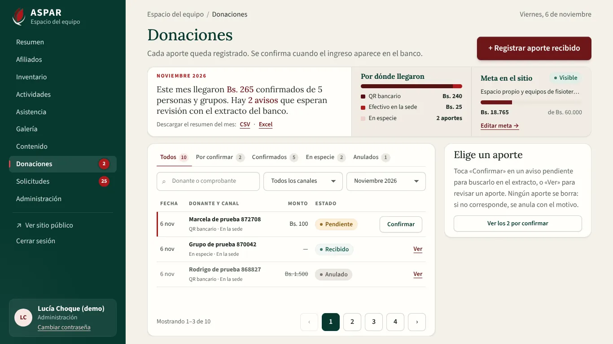
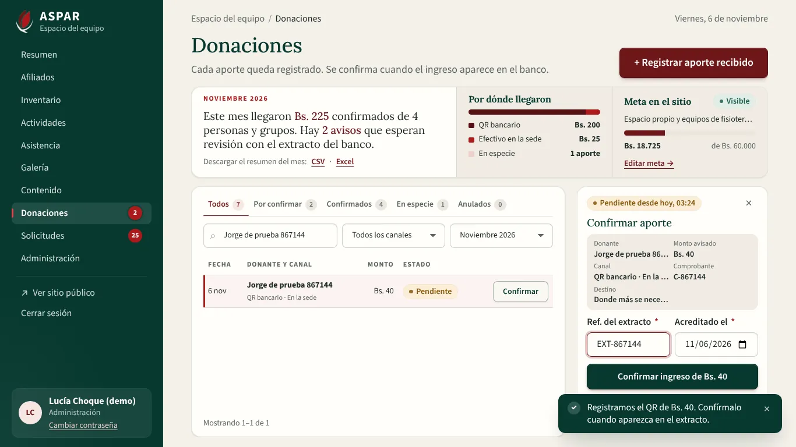
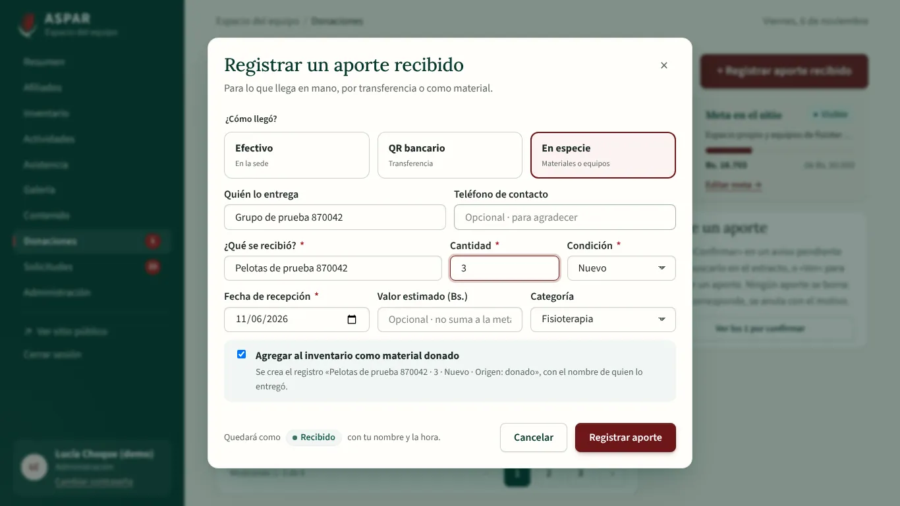
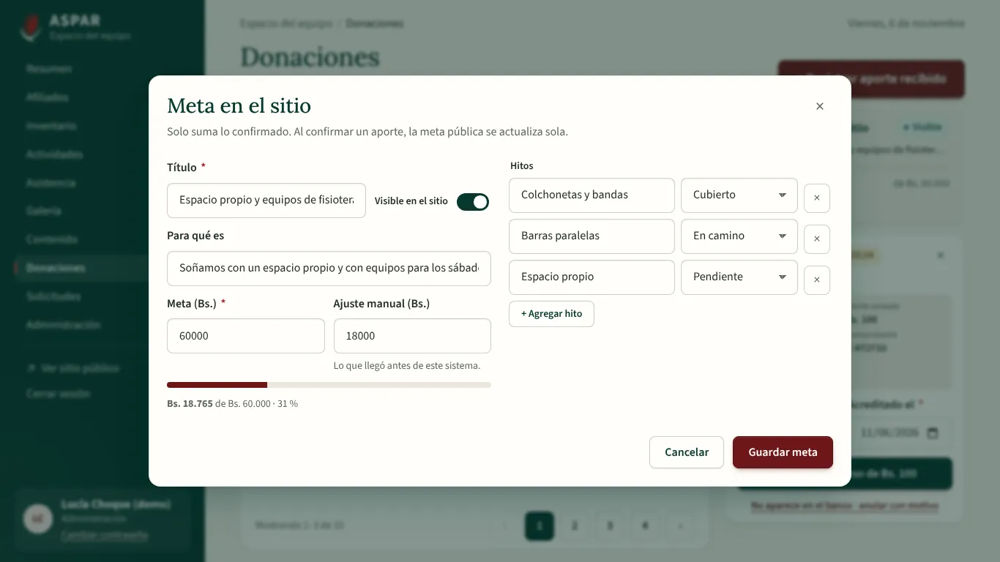
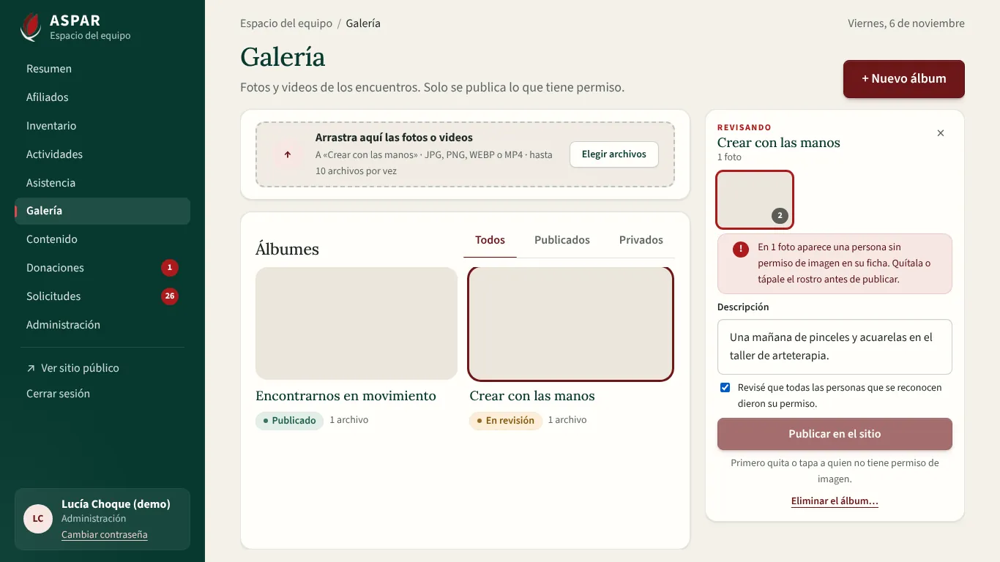
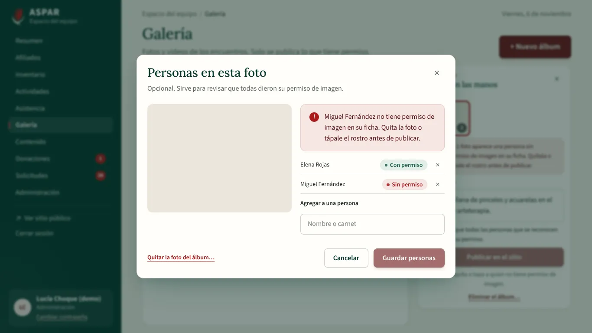
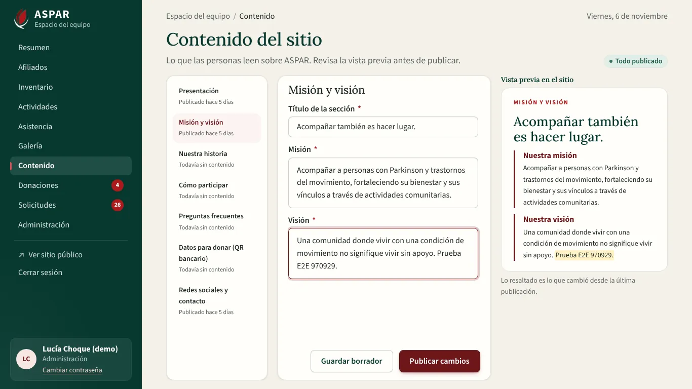

# Evidencia del bloque F5a del Frontend: donaciones, galería y contenido del sitio

Este bloque conecta a la API tres pantallas internas de `ASPAR_diseno_completo.pdf`:

- **Donaciones** (págs. 15 y 16): resumen del mes, canales, avisos por confirmar, meta del sitio y la ventana «Registrar un aporte recibido».
- **Galería** (pág. 13): álbumes, subida a Cloudinary, personas en cada foto y revisión de permisos antes de publicar.
- **Contenido del sitio** (pág. 14): secciones editables con vista previa, borrador o publicación, y redes sociales.

Las tres pantallas mostraban antes «Estamos preparando esta sección».

## Cómo se entregó

| Commit | Qué trae |
| :--- | :--- |
| `feat(donaciones): aportes sin pasarela, QR en la sede y meta del sitio` | Ajuste de la API para el QR recibido en la sede, pantalla de Donaciones, panel «Confirmar aporte», meta e hitos, y la ventana para registrar un aporte |
| `feat(sitio): galería con Cloudinary y contenido del sitio` | Galería, Contenido del sitio, pruebas, evidencias, matriz y README |

## Requisitos que cubre

| Requisito | Qué quedó |
| :--- | :--- |
| RF-06 / RF-14 | Donaciones por canal: QR bancario, efectivo en la sede y en especie, sin Libélula. Resumen del mes con los totales de cada canal, filtros (Todos, Por confirmar, Confirmados, En especie, Anulados) y descarga del resumen en CSV o Excel. Cada aviso se confirma con la referencia del extracto y la fecha, o se anula con motivo |
| RF-15 | Meta pública: título, para qué es, monto, ajuste manual, «Visible en el sitio» e hitos con su estado, con una vista previa del avance |
| RF-05 / RNF-10 | Galería con álbumes (Todos, Publicados, Privados) y subida firmada a Cloudinary. Un álbum nuevo nace privado |
| RNF-06 | Etiquetar personas es opcional. Si alguien no tiene permiso de imagen en su ficha, la foto se marca y no se puede publicar. Publicar pide marcar «Revisé que todas las personas que se reconocen dieron su permiso». La búsqueda de personas solo aparece con permiso para ver afiliados |
| RF-07 / RF-08 | Contenido del sitio por secciones, con «Vista previa en el sitio» que resalta lo que cambió desde la última publicación. «Guardar borrador» no publica y «Publicar cambios» guarda y publica. Las redes sociales se guardan aparte y la API rechaza enlaces que no son los oficiales |
| RNF-08 | Donaciones (lista, panel y las ventanas de registrar y de meta), Galería (con la ventana de álbum nuevo) y las seis secciones del contenido entran completas a 1280×720, 1366×768 y 1920×1080 |

## 1. Cómo se verificó

| Verificación | Resultado |
| :--- | :--- |
| Vitest (`npm run test:coverage`) | 350 pruebas en 31 archivos, 90,75 % de líneas |
| Playwright (`npm run e2e`) contra la API de Docker con `seed_demo` | 84 recorridos, todos pasan |
| ESLint, Prettier, `vue-tsc` (app, pruebas y E2E), `api:types:check` y `vite build` | Sin errores |
| Backend (pytest, cobertura mínima 70 %) | 443 pruebas, todas pasan |

Los recorridos crean aportes y álbumes con nombres «… de prueba 123456». Al terminar, `e2e/global-teardown.ts` los borra de la base de Docker, junto con las fotos y etiquetas de esos álbumes. Así Donaciones y Galería no se llenan de datos de prueba. El recorrido de contenido devuelve la sección al texto que tenía. Con `E2E_LIMPIAR=0` no se borra nada.

## 2. Cambios en la API

- `POST /donations` acepta `qr_bancario` además de `efectivo` y `especie`. Es el aporte por QR que alguien muestra en la sede.
- Ese aporte queda **por confirmar**, con el número de comprobante como referencia declarada y la meta visible asignada. Se confirma con `/confirm` cuando aparece en el extracto, como los avisos del sitio.
- El seguimiento público sigue solo para los avisos del sitio.
- No hizo falta migración: la base ya permitía ese canal desde la sede.
- Prueba nueva en `test_donations.py`: el QR en la sede queda pendiente y se confirma con el extracto. También se comprueba que el QR sin monto y el canal `libelula` se rechazan.
- `docs/api/openapi.json` y `Frontend/src/api/schema.d.ts` se regeneraron.

## 3. Recorridos E2E nuevos

| Recorrido | Qué comprueba |
| :--- | :--- |
| Efectivo | Se registra en la sede y queda confirmado. El resumen del mes lo cuenta |
| QR en la sede | Queda por confirmar. Se confirma con la referencia del extracto y la fecha, y pasa a confirmado |
| Anular | Un aviso que no aparece en el banco se anula con motivo |
| En especie | Con «Agregar al inventario como material donado», el aporte enlaza al material nuevo del inventario |
| Resumen | La descarga del resumen del mes en Excel |
| Álbum nuevo | Nace privado y sin fotos no se publica. Se sube una foto (Cloudinary simulado en el navegador) y publicar pide marcar la revisión de permisos. Luego se elimina. Si la API local no tiene claves de Cloudinary, se comprueba el aviso que ve el equipo |
| Permiso de imagen | En el álbum de ejemplo, la foto con una persona sin permiso se marca y el álbum no se publica, aunque se marque la revisión. La ventana de la foto dice a quién le falta |
| Contenido | Un cambio se resalta en la vista previa, queda como borrador («Sin publicar») y vuelve al texto publicado |
| Redes | Un enlace que no es el oficial de Instagram no se guarda y se ve el error |
| Ventana completa | Donaciones, Galería y cada sección del contenido entran completas a 1280×720, 1366×768 y 1920×1080, también con las ventanas abiertas |

## 4. Capturas

| | |
| :---: | :---: |
|  Donaciones a 1366×768 |  Confirmar un QR recibido en la sede |
|  Registrar un aporte en especie |  Meta en el sitio e hitos |
|  Galería: álbum en revisión |  Personas en la foto, con una sin permiso |
|  Contenido: el cambio resaltado en la vista previa | |

## 5. Decisiones del bloque

- **Sin Libélula:** Donaciones muestra tres canales: QR bancario, Efectivo en la sede y En especie. La API rechaza `libelula` al registrar desde la sede.
- **QR en la sede, por confirmar:** un QR que alguien muestra en la sede no se da por recibido hasta verlo en el extracto. Por eso queda por confirmar, como los avisos del sitio, y se confirma desde el mismo panel. El pie de la ventana dice cómo quedará cada aporte: Confirmado, Por confirmar o Recibido.
- **Panel o ventana:** desde 1200 px de ancho, el aporte elegido se abre en un panel a la derecha de la lista. En pantallas más angostas se abre en una ventana, para que la tabla no se apriete. Desde 720 px de ancho de la tabla aparece la columna Referencia.
- **Descargas en la franja del mes:** «Descargar el resumen del mes: CSV · Excel» va junto al resumen, así el encabezado solo tiene «+ Registrar aporte recibido» y las pestañas entran completas.
- **Sin «Nota interna»:** el diseño muestra una nota interna en el aporte, pero la API no la guarda. No se agregó un campo que se perdería.
- **Meta en dos columnas:** la ventana de la meta lleva los datos a la izquierda y los hitos a la derecha (hasta 10), así entra completa sin barra.
- **Contadores del menú:** al confirmar, anular o registrar un aporte, se actualizan los números del menú lateral sin recargar la página.
- **Subida a Cloudinary:** la API firma cada subida para la carpeta del álbum y el navegador sube el archivo directo a Cloudinary. Luego la API registra la foto, y antes comprueba que esté en esa carpeta. Sin claves de Cloudinary, la pantalla avisa «Pide a Administración que configure las claves de Cloudinary», en lugar de fallar sin explicación.
- **Permiso de imagen:** una foto con alguien sin permiso se marca en rojo y el álbum no se puede publicar hasta quitarla o etiquetar de nuevo. Etiquetar es opcional, pero la revisión de permisos es obligatoria para publicar.
- **Imágenes que no cargan:** si una miniatura no carga (por ejemplo, las fotos de ejemplo de la base local), queda el recuadro de fondo en lugar del ícono roto.
- **Redes dentro de «Redes y contacto»:** Facebook, Instagram y TikTok se guardan con «Guardar enlaces» y se publican al instante, como hace la API. El resto de la sección (WhatsApp, teléfono, correo y dirección) sigue el borrador y la publicación.
- **Qué se resalta:** la vista previa compara con lo último publicado y resalta palabras enteras. Si la sección nunca se publicó, no se resalta nada y se avisa «Esta sección todavía no se publicó».
- **Cambios sin guardar:** al cambiar de sección con algo escrito, se pregunta si descartar o guardar el borrador.
- **Texto plano:** el contenido se guarda y se muestra como texto, sin HTML.

## 6. Pendiente para staging

- Configurar las claves de Cloudinary (`CLOUDINARY_CLOUD_NAME`, `CLOUDINARY_API_KEY`, `CLOUDINARY_API_SECRET` en `Backend/.env`) y probar la subida de fotos y videos reales, y el borrado en Cloudinary.
- Revisar con ASPAR el texto de cada sección y la cuenta bancaria del QR antes de publicar.
- F5b rehace el sitio público, que mostrará lo publicado aquí (contenido, álbumes y meta).
