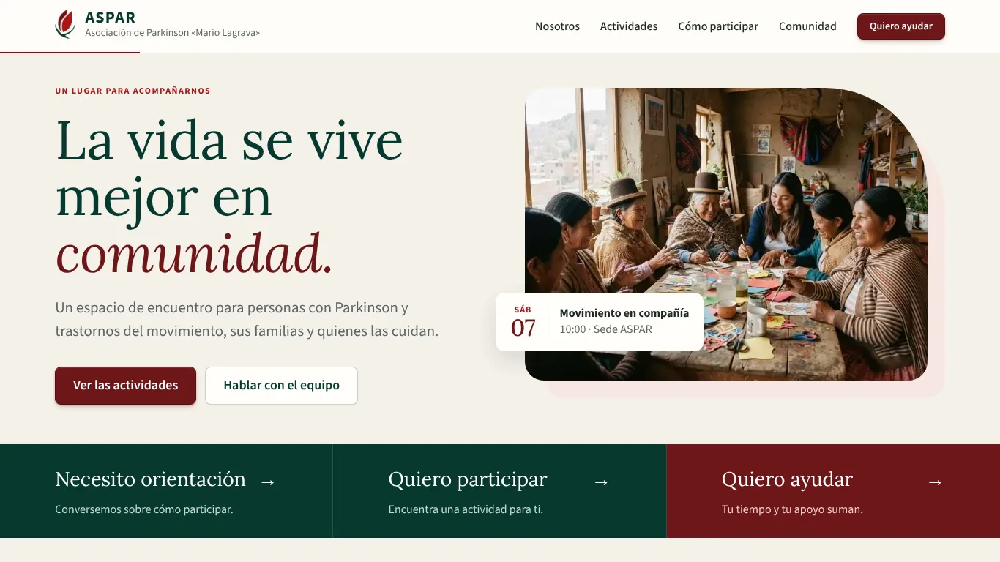
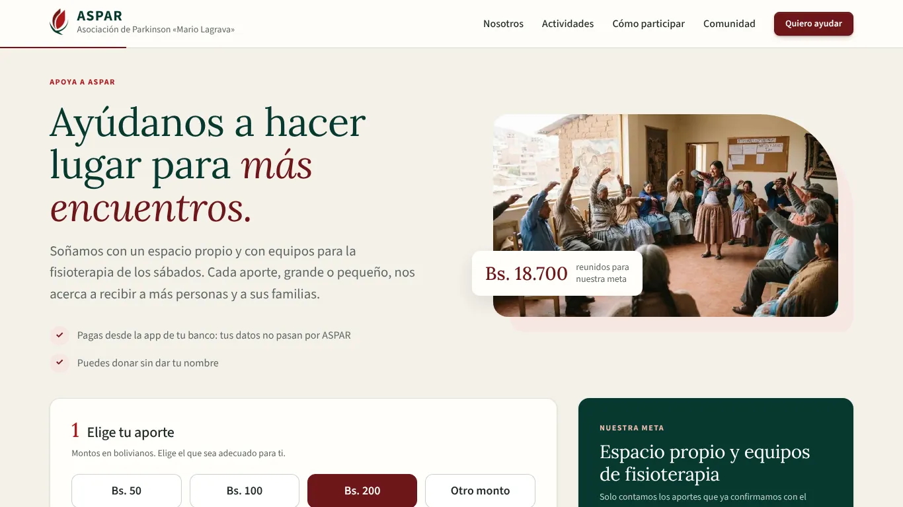
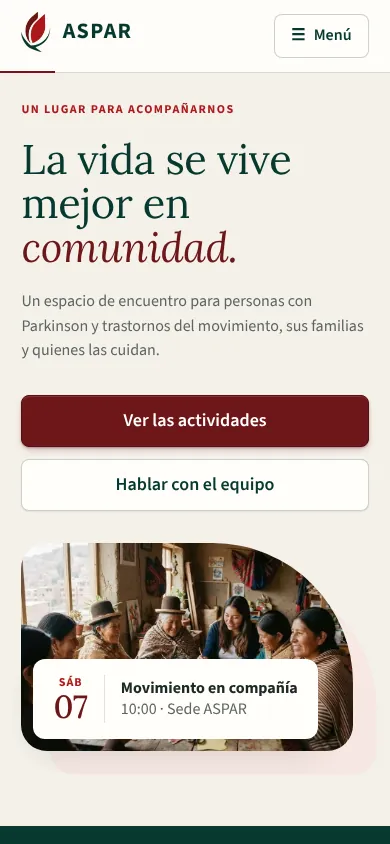
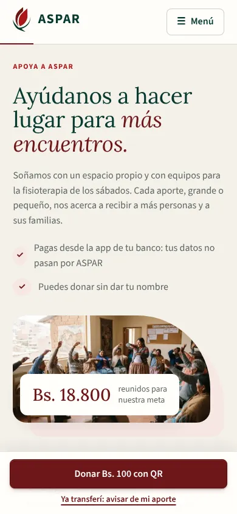
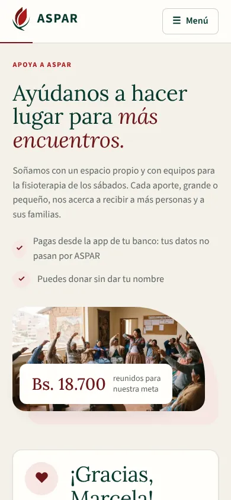

# Evidencia del bloque F5b del Frontend: sitio público en escritorio y celular

Este bloque rehace el sitio público según `ASPAR_diseno_completo.pdf`, conectado a la API:

- **Inicio** (págs. 2 y 3): portada, próximo encuentro, nosotros, agenda del mes, cómo participar, álbumes, formas de ayudar, contacto y preguntas frecuentes.
- **Apoya a ASPAR** (págs. 4 y 5): el aporte en tres pasos, solo con el QR bancario de ASPAR (sin Libélula), el seguimiento del aviso y la meta en vivo.

Reemplaza a `ScheduleView`, la portada antigua que usaba el servicio del modo demo.

## Cómo se entregó

| Commit | Qué trae |
| :--- | :--- |
| `feat(portal): inicio público con agenda, comunidad y contacto` | Encabezado y pie, inicio completo, «Quiero participar» y formulario de contacto, y retiro del modo demo |
| `feat(portal): apoya a ASPAR con QR bancario y seguimiento del aviso` | Página `/apoyar`, pruebas, evidencias, matriz y README |

## Requisitos que cubre

| Requisito | Qué quedó |
| :--- | :--- |
| RF-04 / RF-10 | Agenda pública del mes (`GET /public/schedules`): las publicadas con sus cupos y las canceladas tachadas con su aviso, más la tarjeta del próximo encuentro. Se puede ir a los meses siguientes |
| RF-16 | «Quiero participar» en una actividad y «No tienes que saber por dónde empezar» (`POST /public/inquiries` con Turnstile): nombre, teléfono, motivo y permiso para llamar |
| RF-07 / RF-08 | Presentación, misión y visión, historia, «Cómo participar», preguntas frecuentes, redes y contacto salen de lo publicado (`GET /public/content`). Si una sección no se publicó, se muestra el texto del diseño |
| RF-05 | Los álbumes publicados (`GET /public/media/albums`) se abren con sus fotos y videos. El sitio avisa que solo se publica lo que tiene permiso |
| RF-06 / RF-15 | «Apoya a ASPAR»: Bs. 50, 100, 200 u otro monto, el QR bancario de ASPAR (con «Guardar el QR en mi teléfono»), «Avísanos de tu aporte» (`POST /public/donations/notice`) y el seguimiento en tres pasos. La meta se muestra en vivo con su barra, los aportes confirmados y los hitos (`GET /public/donations/goal`) |
| RNF-08 | La portada y la franja de caminos entran en la primera vista a 1280×720, 1366×768 y 1920×1080. En el celular (390 px) el menú se despliega, los botones miden 44 px o más y nada se desplaza de lado |

## 1. Cómo se verificó

| Verificación | Resultado |
| :--- | :--- |
| Vitest (`npm run test:coverage`) | 360 pruebas en 32 archivos, 92,67 % de líneas |
| Playwright (`npm run e2e`) contra la API de Docker con `seed_demo` | 96 recorridos en 13 archivos, todos pasan |
| ESLint, Prettier, `vue-tsc` (app, pruebas y E2E), `api:types:check` y `vite build` | Sin errores |
| Backend (pytest, cobertura mínima 70 %) | 443 pruebas (sin cambios en la API de este bloque) |

Los recorridos envían solicitudes y avisos con nombres «… de prueba 123456». Al terminar, `e2e/global-teardown.ts` los borra de la base de Docker, junto con las actividades, materiales, aportes y álbumes de prueba de los otros bloques.

## 2. Cambios en la API

Ninguno. Los endpoints públicos ya existían y estaban probados (`test_schedules.py`, `test_inquiries.py`, `test_donations.py`, `test_media.py` y `test_content.py`).

El contenido institucional se lee de `GET /public/content`. No existe un endpoint `/public/institutional`: es el mismo contenido de «Contenido del sitio».

## 3. Recorridos E2E nuevos

| Recorrido | Qué comprueba |
| :--- | :--- |
| Primera vista | A 1366×768, 1280×720 y 1920×1080, la portada con la tarjeta del próximo encuentro y la franja «Necesito orientación / Quiero participar / Quiero ayudar» se ven sin desplazar, y no hay desplazamiento lateral |
| Agenda | El próximo encuentro ofrece «Quiero participar». La actividad cancelada está tachada, dice «Cancelada» y no ofrece inscribirse. «‹» está deshabilitado en el mes actual y «›» pide el mes siguiente |
| Quiero participar | La ventana pide nombre, teléfono y permiso. La API recibe la solicitud con la actividad elegida y se muestra el agradecimiento |
| Contacto | «Ser voluntario/a» del pie lleva al formulario con ese motivo elegido. Sin datos no se envía; con datos se envía |
| Celular | A 390 px el menú se abre y se cierra al elegir «Actividades», que queda a la vista. Los botones de la agenda miden 44 px o más |
| Aporte | Solo QR bancario, sin Libélula. Bs. 200 cambia el texto de lo que permite y el monto del aviso. El QR se puede guardar y la meta muestra su barra y los aportes confirmados |
| Seguimiento | En el celular, el aviso queda pendiente y el agradecimiento queda a la vista. El enlace `?aviso=` sigue mostrando el estado al recargar. Cuando el equipo lo confirma con el extracto, «Ver cómo va» muestra los tres pasos completos |
| Celular del aporte | Los montos van de a dos, con 44 px o más, y «Donar Bs. 100 con QR» queda fijo a la vista y lleva al paso 2 |
| Enlaces | «Ofrecer una donación en especie» abre el formulario del inicio con ese motivo, y «Quiero ayudar» del encabezado abre `/apoyar` |

## 4. Capturas

| | |
| :---: | :---: |
|  Inicio a 1366×768 |  Apoya a ASPAR a 1366×768 |

| | | |
| :---: | :---: | :---: |
|  Inicio en el celular |  Apoya en el celular |  Después de avisar |

## 5. Decisiones del bloque

- **Sin Libélula:** el diseño ofrecía «Tarjeta o QR con Libélula». Se quitó del todo, como se pidió. «Un aporte económico» del inicio dice «Con QR bancario, desde la app de tu banco».
- **El QR es el de ASPAR:** la imagen sale de «Datos para donar» en «Contenido del sitio» (`qrUrl`), junto con el titular, el banco y la cuenta. El sitio no trae un QR propio para no mostrar una cuenta que no es la real. Mientras no se publique, la tarjeta dice «El código QR se publica en unos días» y ofrece pedir los datos de la cuenta.
- **Guardar el QR:** si el QR está en Cloudinary, el enlace pide la descarga (`fl_attachment`). Si no, abre la imagen para guardarla desde el teléfono.
- **Seguimiento con enlace:** después de avisar, la dirección queda como `/apoyar?aviso=…`. Al volver a esa página se ve el estado del aviso: pendiente, confirmado o anulado (este último con su explicación).
- **Lo que permite cada monto:** el diseño solo tenía el texto de Bs. 100 (una colchoneta). Los de Bs. 50 (materiales de un taller de arteterapia) y Bs. 200 (las barras paralelas) son una propuesta para que ASPAR los revise.
- **Textos de respaldo:** las secciones que todavía no se publicaron («Cómo participar», «Preguntas frecuentes», «Datos para donar») muestran el texto del diseño, sin datos inventados. La pregunta «¿Cuánto cuesta participar?» del diseño no tenía respuesta, así que no se incluyó.
- **Primera vista:** el tamaño del título y el alto de la foto dependen del alto de la ventana. Así la portada y la franja de caminos entran completas en las pantallas de escritorio que se probaron.
- **Columna centrada:** en pantallas anchas, todo el contenido se alinea con el encabezado, en una columna de 90rem. Las franjas de color llegan a los bordes.
- **Enlaces a las secciones:** «Nosotros», «Actividades», etc. son secciones de la portada (`/#actividades`). No se anuncian como «página actual» a los lectores de pantalla (`SiteLink`).
- **Fotos del sitio:** las de la portada y de las actividades son las del diseño, en webp (unos 280 KB en total). Las de los álbumes salen de la galería.
- **Retiro del modo demo:** con la portada nueva ya ninguna pantalla usaba `services/aspar.ts`, `services/api.ts`, `types/aspar.ts` ni `legacy.css`. Se retiraron con su prueba, así que F6 ya no tiene que hacerlo.

## 6. Pendiente para staging

- Publicar desde «Contenido del sitio» el QR real, el titular, el banco y la cuenta de ASPAR, y revisar «Cómo participar» y las preguntas frecuentes.
- Configurar la clave real de Turnstile (`VITE_TURNSTILE_SITE_KEY` y la clave secreta en la API).
- Probar el sitio en Firefox, Safari (iPhone) y Chrome de Android (RNF-08, F6).
