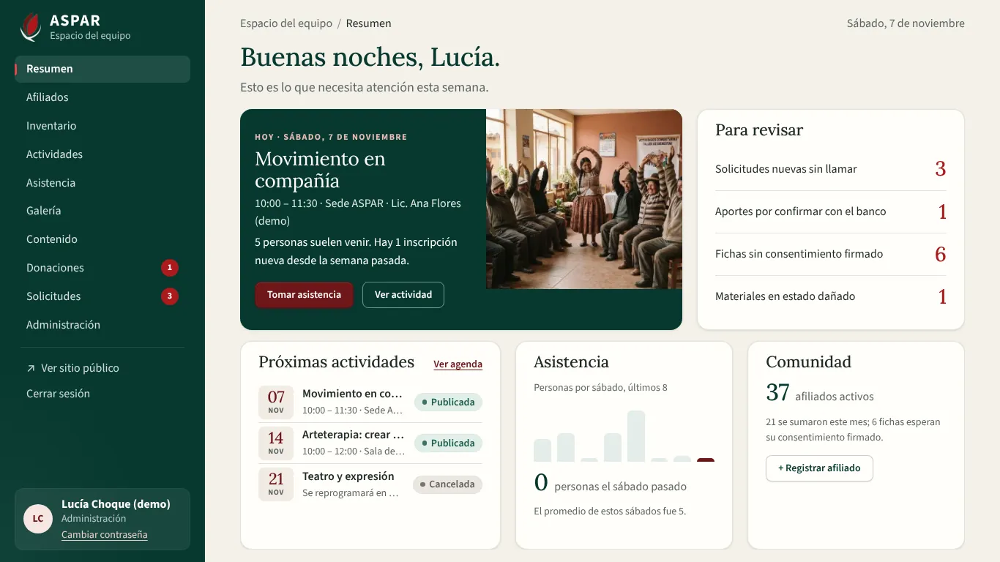
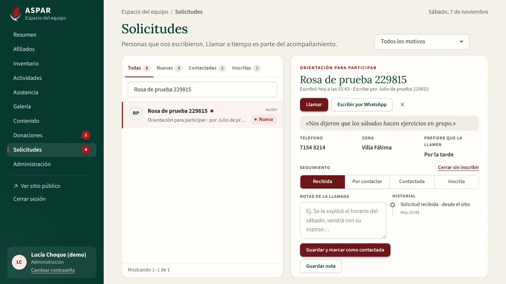
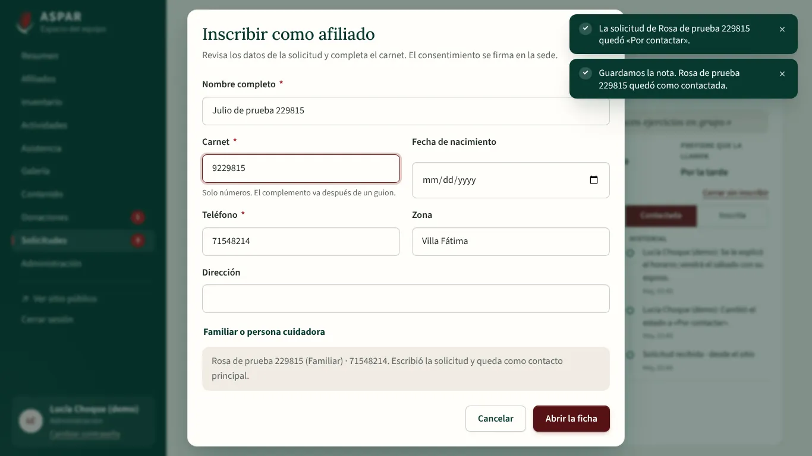

# Evidencia del bloque F6 del Frontend: solicitudes, resumen y cierre

Este bloque termina la migración visual de `ASPAR_diseno_completo.pdf`:

- **Solicitudes** (pág. 17): la bandeja de las personas que escribieron, con su seguimiento hasta la ficha de afiliado.
- **Resumen** (pág. 7): lo que necesita atención esta semana, con `GET /dashboard/summary`.
- **Retiro del modo demo:** ninguna pantalla queda sin conectar a la API.
- **Revisión final:** todas las pantallas de 360 a 1920 px y lo básico de accesibilidad.

## Cómo se entregó

| Commit | Qué trae |
| :--- | :--- |
| `feat(equipo): bandeja de solicitudes y resumen con la API` | Solicitudes, Resumen, «Inscribir como afiliado» y sus pruebas |
| `refactor(frontend): retiro definitivo del modo demo` | Sin `SectionPreparingView` ni `VITE_DEMO_MODE`, ADR-008 retirada y documentación al día |
| `fix(frontend): accesibilidad y pantallas de 360 a 1920 px; cierre de la matriz` | Arreglos de la revisión, recorrido E2E de todas las pantallas, limpieza de los datos de prueba, matriz y esta evidencia |

## Requisitos que cubre

| Requisito | Qué quedó |
| :--- | :--- |
| RF-16 | Bandeja con pestañas Todas, Nuevas, Contactadas e Inscritas, filtro por motivo y búsqueda. Detalle con «Llamar» y «Escribir por WhatsApp», barra de seguimiento (Recibida → Por contactar → Contactada → Inscrita), notas de la llamada con su historial e «Inscribir como afiliado →» (`POST /inquiries/{id}/convert-to-patient`) |
| Panel de inicio | Saludo, «Este sábado» con «Tomar asistencia», los cuatro contadores de «Para revisar», próximas actividades, asistencia de los últimos 8 sábados (`attendanceLastSaturdays`) y afiliados activos. Cada bloque según los permisos del rol |
| RNF-03 | En las 17 pantallas: un solo título `h1`, idioma `es`, imágenes con texto alternativo, campos, botones y enlaces con nombre, sin `id` repetidos y «Saltar al contenido» |
| RNF-08 | Las 17 pantallas a 360, 768, 1024, 1280, 1366, 1440 y 1920 px, sin desplazamiento lateral ni dos barras a la vez |
| RNF-11 | El modo demo se retiró: todas las vistas y pruebas usan `src/api/` |

## 1. Cómo se verificó

| Verificación | Resultado |
| :--- | :--- |
| Vitest (`npm run test:coverage`) | 374 pruebas en 35 archivos, 92,5 % de líneas |
| Playwright (`npm run e2e`) contra la API de Docker con `seed_demo` | 118 recorridos en 15 archivos, todos pasan |
| ESLint, Prettier, `vue-tsc` (app, pruebas y E2E), `api:types:check` y `vite build` | Sin errores |
| Backend (pytest, cobertura mínima 70 %) | 443 pruebas (sin cambios en la API de este bloque) |

Al terminar, `e2e/global-teardown.ts` borra todo lo que crearon los recorridos: actividades, materiales, aportes, álbumes, solicitudes y afiliados «… de prueba 123456». Desde este bloque borra también los afiliados de prueba con nombre fijo de F2 y F4 («Hortensia Prueba Ficha», «Ramiro Prueba Pantalla», etc.), que se iban acumulando en la base local: había más de 280. Con esto, el resumen muestra los números de la demostración (39 afiliados) y no los de las pruebas.

## 2. Cambios en la API

Ninguno. La bandeja y el resumen usan endpoints que ya estaban probados (`test_inquiries.py` y `test_dashboard.py`).

## 3. Lo que encontró la revisión final y cómo se corrigió

El recorrido `accesibilidad.spec.ts` visita cada pantalla a siete tamaños. Al correrlo por primera vez encontró:

| Hallazgo | Corrección |
| :--- | :--- |
| Ingreso, registro y recuperación no tenían «Saltar al contenido» | `AuthLayout` lo agrega, con `<main id="contenido">` |
| A 768 px, las pestañas de Afiliados y Donaciones se desplazaban de lado | `AppTabs` pasa las pestañas a una segunda fila si no entran |
| A 360 px, la tabla de Inventario medía 20 px más que la pantalla | Celdas más juntas por debajo de 400 px |
| A 360 px, la tabla de Equipo y permisos en tarjetas se ensanchaba con un correo largo | En `DataTable`, los títulos ocultos ya no ocupan ancho y el texto largo se corta en varias líneas |
| Los avisos («toasts») tapaban el botón principal de una ventana abierta | Mientras hay una ventana abierta, los avisos esperan detrás. Al cerrarla, se ven si todavía están vigentes |

## 4. Capturas

| | |
| :---: | :---: |
|  Resumen a 1366×768 |  Solicitudes con el detalle abierto |
|  Inscribir como afiliado | |

## 5. Decisiones del bloque

- **Pestañas de la bandeja:** son las cuatro del diseño. «Nuevas» son las recibidas sin llamar. «Todas» incluye también las que están «Por contactar» y las cerradas.
- **Seguimiento:** cada paso de la barra se puede tocar si la API acepta ese cambio (los mismos de `TRANSITIONS`). «Inscrita» no se marca a mano: se llega con «Inscribir como afiliado». «Cerrar sin inscribir» y «Reabrir» cubren el estado «Cerrada», que no está en la barra.
- **Inscribir:** la ficha se abre con el nombre, el teléfono y la zona de la solicitud. Si la persona escribió por otra, la ficha es de esa otra persona y quien escribió queda como su contacto principal. Solo falta el carnet. La ficha queda sin consentimiento firmado: se firma en la sede.
- **WhatsApp:** a un número boliviano de 8 dígitos se le agrega el 591. El mensaje empieza con un saludo con su nombre.
- **Detalle largo:** en laptops (alto de 860 px o menos), el detalle se compacta. Si el historial de notas es largo, solo el detalle se desplaza, con una sola barra. La bandeja y la página no se mueven.
- **Resumen según el rol:** la API manda `null` en lo que el rol no puede ver, y ese bloque no aparece. Por ejemplo, el Voluntariado ve «Este sábado» y «Tomar asistencia», pero no «Para revisar» ni la comunidad.
- **«Este sábado»:** dice «Hoy» si es el mismo día, «Este sábado» si es dentro de la semana y, si no, la fecha del próximo encuentro.
- **«+ Registrar afiliado»** del resumen abre Afiliados con la ventana de alta (`?nuevo=1`).
- **localStorage:** queda solo la hora del último uso, que el aviso de inactividad comparte entre pestañas. No es un dato del sistema, y `sinModoDemo.spec.ts` impide que se agregue otro uso.
- **Accesibilidad automática:** el recorrido revisa lo que una máquina puede comprobar. La revisión con lector de pantalla y teclado queda en la lista manual de la matriz.

## 6. Pendiente

La [matriz](../trazabilidad/MATRIZ_RF01_RF17.md#5-comprobaciones-manuales-en-staging) tiene la lista de lo que se prueba a mano en staging:

- con credenciales reales: Google OAuth, Turnstile, Resend, Cloudinary y Supabase;
- con el despliegue real: RNF-01, RNF-04 y RNF-07;
- con personas: lector de pantalla, Firefox y Safari, y la sesión con ASPAR.
