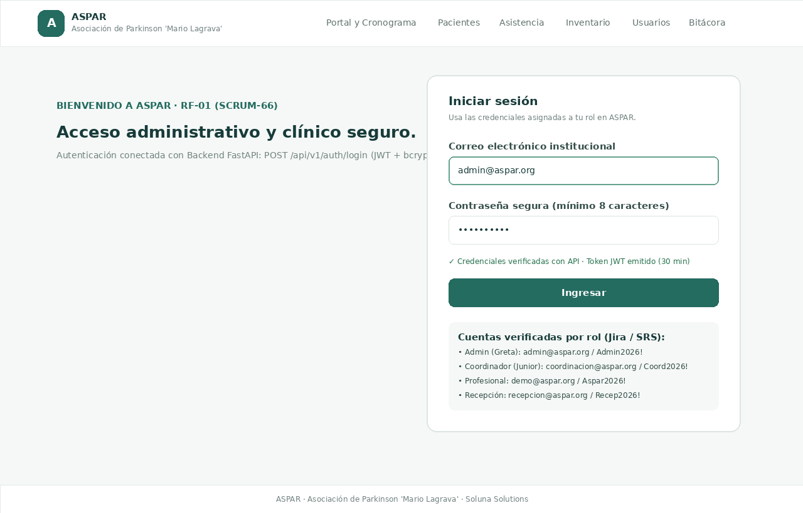
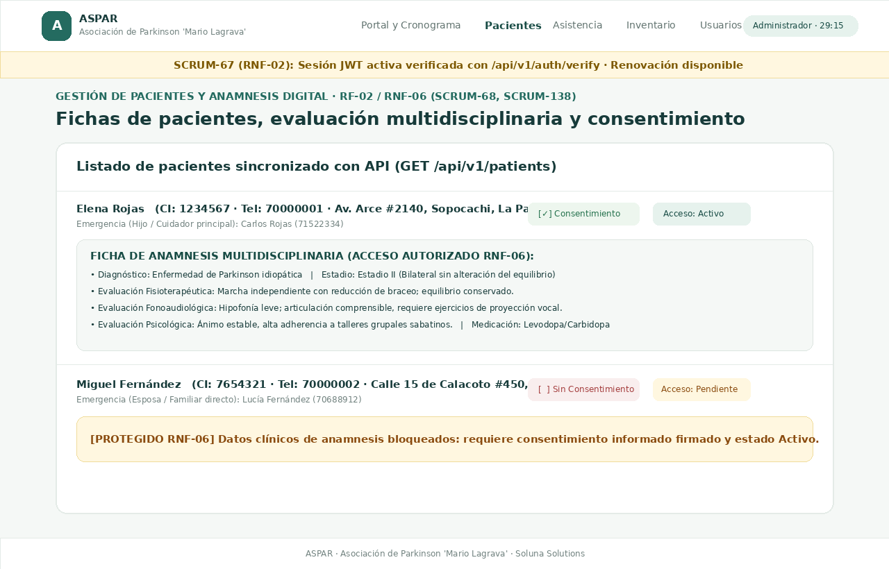
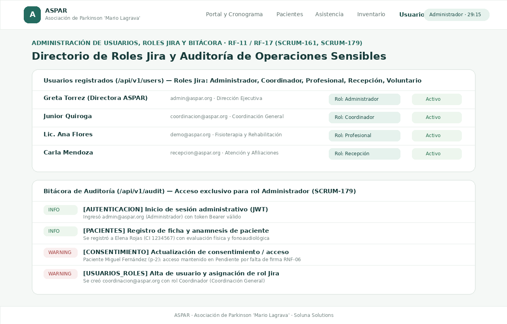
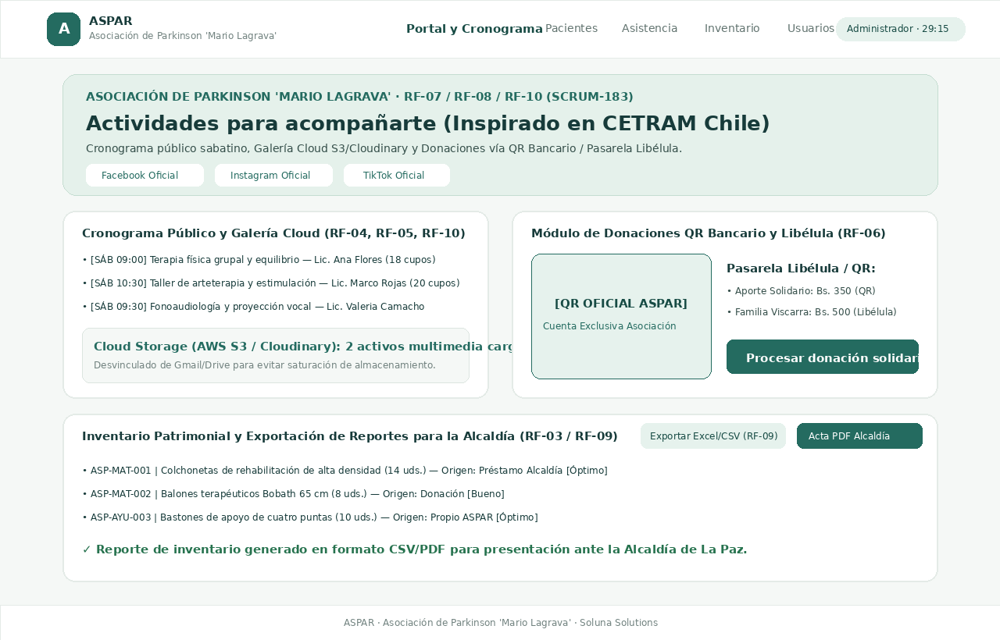

# Acta de Aceptación, Recorrido Probado y Evidencias Visuales del Sprint 1 (SCRUM-57 / SCRUM-85)

Este documento reúne la evidencia visual organizada y el recorrido de aceptación ejecutado sobre el sistema **ASPAR (Soluna Solutions)** para verificar el cumplimiento de las historias y tareas técnicas del Sprint 1.

## 1. Resumen de Criterios de Aceptación Verificados

| Subtarea Jira | Historia / Tarea Padre | Criterio de Aceptación Probado | Resultado | Evidencia Visual |
| :--- | :--- | :--- | :--- | :--- |
| **SCRUM-66** | SCRUM-11 (RF-01) | Formulario de login con validación de formato de correo, mínimo 8 caracteres, bloqueo tras 5 intentos fallidos y autenticación contra `POST /api/v1/auth/login`. | **Cumple** | `01_login_validaciones_scrum66.png` |
| **SCRUM-67** | SCRUM-12 (RNF-02) | Sesión con token JWT, contador regresivo de expiración (30 min máx. / 15 min inactividad), banner de renovación (`/api/v1/auth/verify`) y cierre de sesión (`/api/v1/auth/logout`). | **Cumple** | `02_pacientes_anamnesis_consentimiento_scrum68_138.png` |
| **SCRUM-68** | SCRUM-13 (RF-02) | Registro, listado y filtrado de pacientes con ficha completa de anamnesis digital (diagnóstico, estadio Hoehn y Yahr, fisioterapia, fonoaudiología y psicología) integrada con `/api/v1/patients`. | **Cumple** | `02_pacientes_anamnesis_consentimiento_scrum68_138.png` |
| **SCRUM-138** | SCRUM-123 (RNF-06) | Control estricto de consentimiento informado y estado de acceso (`Activo`, `Pendiente`, `Revocado`). Bloqueo automático de visualización de anamnesis y asistencia si no hay consentimiento vigente. | **Cumple** | `02_pacientes_anamnesis_consentimiento_scrum68_138.png` |
| **SCRUM-161** | SCRUM-129 (RF-11) | Gestión de usuarios y roles alineados con Jira (`Administrador`, `Coordinador`, `Profesional`, `Recepción`, `Voluntario`) conectada con `/api/v1/users`. | **Cumple** | `03_usuarios_roles_bitacora_scrum161_179.png` |
| **SCRUM-179** | SCRUM-135 (RF-17) | Consulta de bitácora de auditoría restringida exclusivamente al rol `Administrador`, con filtros por categoría y severidad (`INFO`, `WARNING`, `CRITICAL`) vía `/api/v1/audit`. | **Cumple** | `03_usuarios_roles_bitacora_scrum161_179.png` |
| **SCRUM-183** | SCRUM-136 (RF01–RF17) | Portal público con misión (modelo CETRAM), redes sociales, cronograma sabatino, galería Cloud S3/Cloudinary, donaciones QR/Libélula e inventario con exportación CSV/PDF para la Alcaldía. | **Cumple** | `04_portal_cronograma_inventario_scrum183.png` |

## 2. Recorrido Paso a Paso y Capturas Organizadas

### Paso 1: Inicio de Sesión Administrativo y Validaciones (SCRUM-66 / SCRUM-87)
1. Se ingresa a `/login` y se verifica la alerta en caso de campos vacíos o formato de correo inválido.
2. Se autentica con `admin@aspar.org` / `Admin2026!`, recibiendo el token JWT desde `POST /api/v1/auth/login`.

### Paso 2: Fichas de Pacientes, Anamnesis Digital, Expiración de Sesión y Protección RNF-06 (SCRUM-67 / SCRUM-68 / SCRUM-138)
1. En la barra superior se visualiza el badge `Administrador · 29:15` junto con el banner preventivo de renovación de sesión JWT.
2. En `/pacientes`, para **Elena Rojas** (con consentimiento firmado y acceso `Activo`), al desplegar **«Ver anamnesis»** se consultan sus evaluaciones física, fonoaudiológica y psicológica.
3. Para **Miguel Fernández** (sin consentimiento firmado, acceso `Pendiente`), el sistema protege la ficha clínica mostrando el aviso de bloqueo **RNF-06**.

### Paso 3: Gestión de Usuarios con Roles Jira y Bitácora de Auditoría (SCRUM-161 / SCRUM-179)
1. En `/usuarios`, se administran cuentas con los 5 roles oficiales (`Administrador`, `Coordinador`, `Profesional`, `Recepción`, `Voluntario`).
2. En `/bitacora`, el Administrador filtra y audita las operaciones sensibles registradas tanto en el Frontend como en `GET /api/v1/audit`.

### Paso 4: Portal Público, Cronograma, Galería Cloud, Donaciones e Inventario Alcaldía (SCRUM-183)
1. En `/`, el público general consulta el cronograma sabatino, los enlaces a redes sociales oficiales, la galería en Cloud Storage (S3/Cloudinary) y el módulo de donaciones con QR bancario y pasarela **Libélula**.
2. En `/inventario`, se registran activos por origen (`Préstamo Alcaldía`, `Propio ASPAR`, `Donación`) y se exporta el reporte en **Excel/CSV** y **Acta PDF** para la Alcaldía.

## 3. Evidencias del Backend (SCRUM-84)

Las evidencias de API, persistencia en PostgreSQL/Supabase y seguridad del Backend están en [`EVIDENCIAS_BACKEND_SPRINT1.md`](./EVIDENCIAS_BACKEND_SPRINT1.md).
