# Manual del espacio del equipo de ASPAR

Guía breve para el personal de la Asociación de Parkinson «Mario Lagrava»: cómo entrar, qué hace cada pantalla y qué puede hacer cada rol. Las capturas usan los datos de demostración, no datos reales.

## 1. Entrar

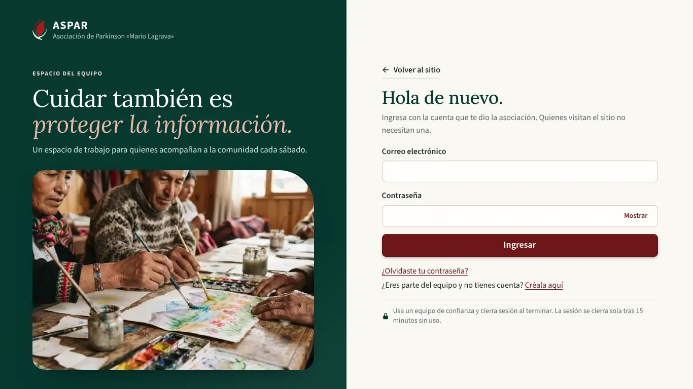

- Entra con tu correo y tu contraseña o con **Continuar con Google**.
- **¿Primera vez?** Hay dos formas:
  - **Crear cuenta:** la cuenta queda pendiente hasta que Administración la apruebe y le asigne un rol.
  - **Invitación:** Administración te invita desde «+ Nuevo integrante».
- **¿Olvidaste la contraseña?** Pide un enlace de recuperación al correo.
- **Seguridad:**
  - Tras 5 intentos fallidos, la cuenta espera 15 minutos.
  - Si dejas la sesión sin uso, aparece un aviso y luego se cierra sola.

## 2. Qué puede hacer cada rol

Administración puede cambiar los permisos de cada rol en **Administración → Equipo y permisos → Qué puede ver cada rol**. Por defecto:

| Pantalla o acción | Administración | Coordinación | Recepción | Profesional | Voluntariado |
| :--- | :---: | :---: | :---: | :---: | :---: |
| Ver afiliados y sus contactos | ✅ | ✅ | ✅ | ✅ | ✅ |
| Registrar y editar fichas | ✅ | ✅ | ✅ | ✅ | — |
| Historia clínica y evaluaciones | ✅ | ✅ | — | ✅ | — |
| Dar de baja o reactivar una ficha | ✅ | — | — | — | — |
| Tomar asistencia | ✅ | ✅ | ✅ | ✅ | ✅ |
| Actividades (crear, publicar, cancelar) | ✅ | ✅ | — | — | — |
| Inventario | ✅ | ✅ | — | — | — |
| Donaciones y meta del sitio | ✅ | ✅ | ✅ | — | — |
| Solicitudes del sitio | ✅ | ✅ | ✅ | — | — |
| Galería | ✅ | ✅ | — | — | — |
| Contenido del sitio | ✅ | ✅ | — | — | — |
| Descargar reportes (Excel o PDF) | ✅ | ✅ | ✅ | — | — |
| Equipo, roles y registro de actividad | ✅ | — | — | — | — |

**Privacidad:** la historia clínica solo se ve con permiso clínico, con el consentimiento firmado y con el acceso de la ficha en **Activo**. Si falta una de las tres, nadie la ve.

## 3. Resumen

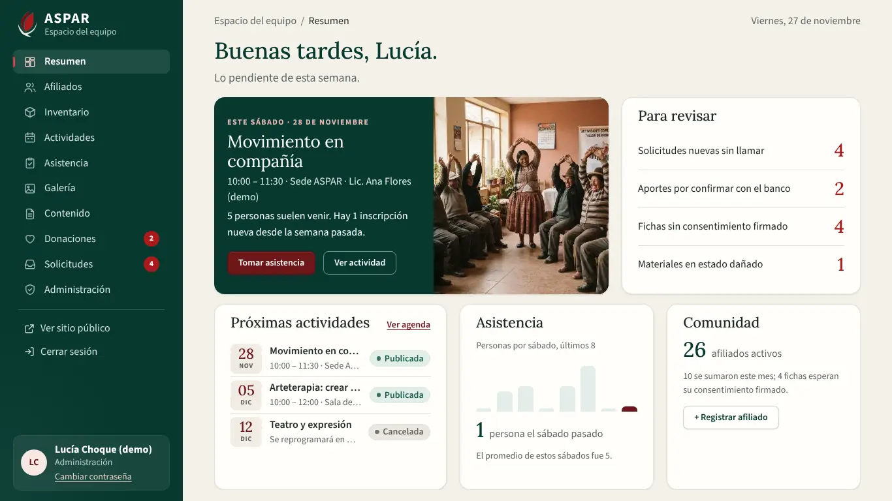

Al entrar ves lo pendiente de la semana:

- la próxima actividad, con un acceso directo a **Tomar asistencia**;
- lo que espera revisión (solicitudes nuevas, aportes por confirmar, fichas sin consentimiento y materiales dañados);
- las próximas actividades;
- la asistencia de los últimos sábados.

## 4. Afiliados

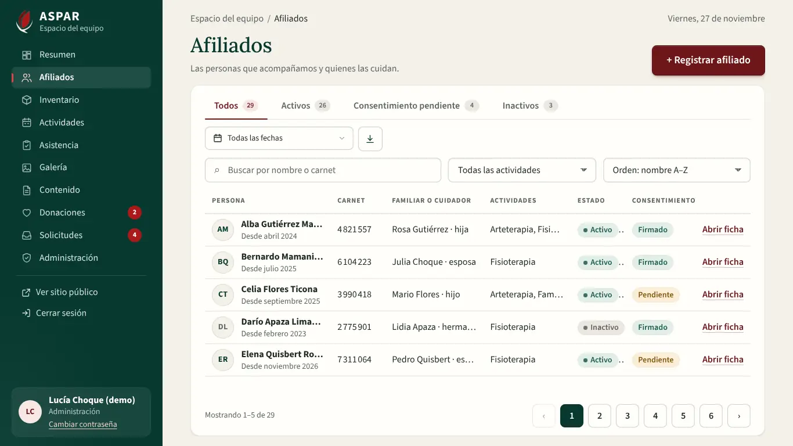

- **Pestañas:** Todos, Activos, Consentimiento pendiente e Inactivos.
- **Filtros:** busca por nombre o carnet, filtra por actividad, ordena y elige las fechas de registro.
- **Registrar afiliado:** botón **+ Registrar afiliado**.

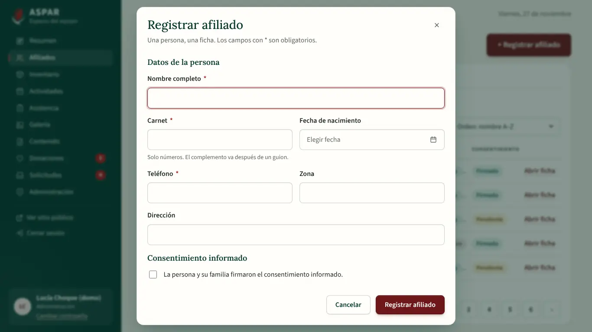

- Los campos con * son obligatorios.
- Toda ficha lleva de 1 a 5 familiares o personas cuidadoras, una de ellas principal.
- Si la persona firmó el consentimiento, márcalo e indica la fecha; si no, la ficha queda **pendiente**.
- Un carnet no se puede registrar dos veces.

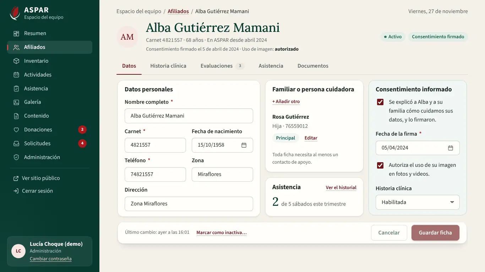

La ficha tiene cinco pestañas:

- **Datos:** datos personales, familiares, consentimiento y uso de imagen.
- **Historia clínica:** solo para el personal clínico.
- **Evaluaciones:** se registran con fecha y profesional. Una cargada por error se quita indicando el motivo.
- **Asistencia:** las asistencias de los últimos sábados.
- **Documentos:** archivos privados de la ficha.

Una ficha no se borra: se marca como **inactiva** con su motivo y se puede reactivar.

## 5. Actividades

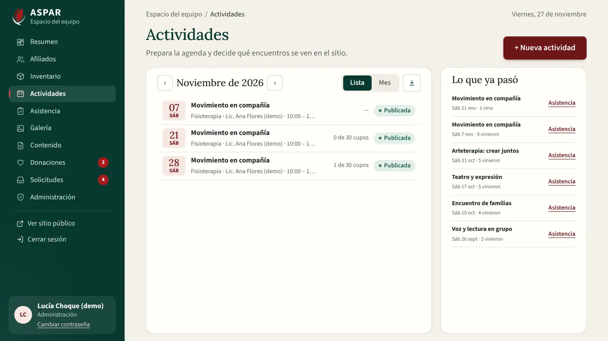

- **Crear:** **+ Nueva actividad** la guarda como borrador; **Publicar** la muestra en el sitio.
- **Cancelar:** pide un aviso para las familias, que se ve en la agenda pública.
- **Ver el mes:** usa **Lista** o **Mes** y cambia de mes con ‹ y ›.
- **Lo que ya pasó:** a la derecha están las actividades pasadas, con acceso a su asistencia.
- **Descargar:** el botón ⤓, junto a Lista / Mes, baja las actividades de un rango de fechas.

## 6. Asistencia

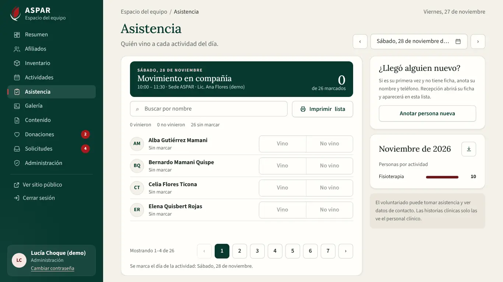

1. **Elige el día** en el calendario. Los días con actividad tienen un punto; ‹ y › saltan al anterior y al siguiente.
2. **Marca a cada persona** con **Vino** o **No vino**. Cada toque se guarda al instante.
   - **Marcar a todos como presentes** solo cambia a quienes siguen sin marcar.
   - **Anotar persona nueva** registra a alguien que vino por primera vez; Recepción abrirá su ficha.
   - **Imprimir lista** sirve de respaldo en papel si falla internet en la sede.
3. **Cierra con «Cerrar asistencia del día».** Solo Coordinación puede reabrirla.

La asistencia se toma desde el día de la actividad, nunca antes. A la derecha está el resumen del mes, con su botón ⤓ para descargar el resumen mensual o las asistencias de un rango.

## 7. Inventario

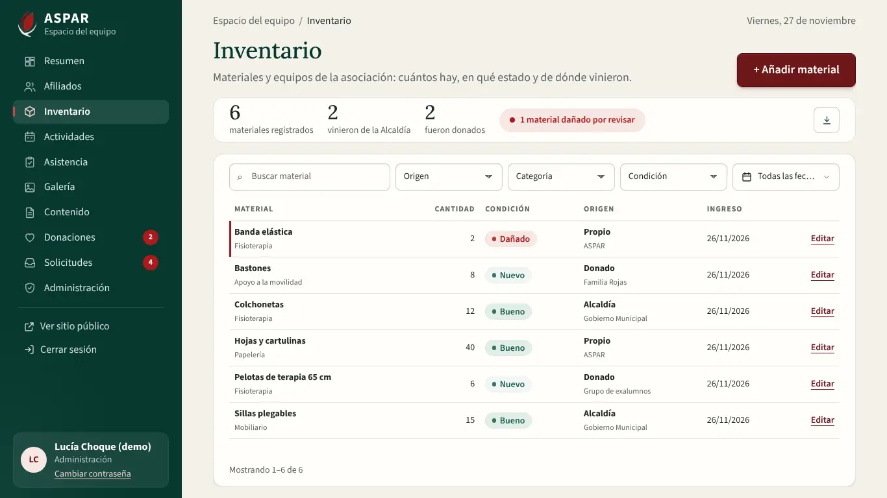

- **Registrar:** **+ Añadir material**, con su categoría, condición y origen (propio, donado o de la Alcaldía).
- **Cambiar la cantidad:** se pide el motivo, y el cambio queda en el historial.
- **Movimientos:** ingreso, préstamo (se indica a quién), devolución y ajuste. La cantidad nunca queda en negativo.
- **Dar de baja:** con motivo. El material y su historial se conservan.
- **Descargar:** los bienes de la Alcaldía salen aparte, para la rendición de cuentas.

## 8. Donaciones

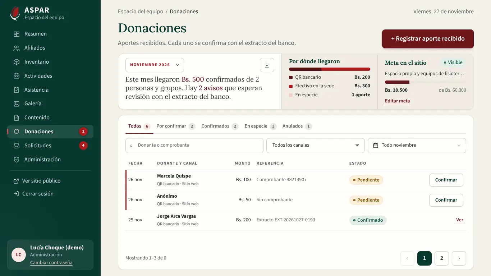

- **El mes:** arriba eliges el mes y ves el total confirmado, por dónde llegaron los aportes y la meta del sitio.
- **Registrar un aporte en la sede:** **+ Registrar aporte recibido**, en efectivo, QR bancario o en especie. Lo que llega en especie puede pasar al inventario.
- **Confirmar un aviso del sitio:** busca el aporte en el extracto del banco y escribe la referencia y la fecha. Una referencia no puede confirmar dos aportes.
- **Anular:** con motivo. Un aporte confirmado ya no se anula.
- **Meta del sitio:** se edita desde la franja superior. Solo suma lo confirmado y no muestra datos de los donantes.
- **Descargar:** el botón ⤓, junto al mes, trae el **resumen del mes** y el **registro de aportes** con el filtro de la tabla.

## 9. Solicitudes

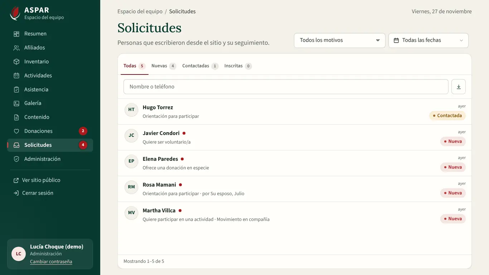

Son las personas que escribieron desde el sitio («Quiero participar», contacto, voluntariado, donación en especie).

- Ábrela, llama a la persona y anota lo que conversaron.
- Cambia el estado: nueva, por contactar, contactada o cerrada.
- Cuando venga a su primer sábado, **inscríbela como afiliada**: se crea su ficha con los datos de la solicitud.

## 10. Galería

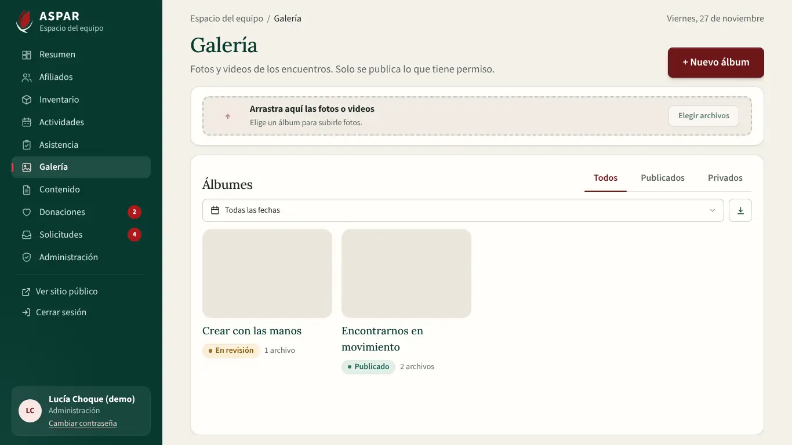

- Crea un álbum (puede ir ligado a una actividad) y sube fotos y videos.
- Etiqueta a las personas que aparecen.
- Un álbum se publica en el sitio solo cuando sus permisos están revisados y todas las personas etiquetadas autorizaron el uso de su imagen.

## 11. Contenido del sitio

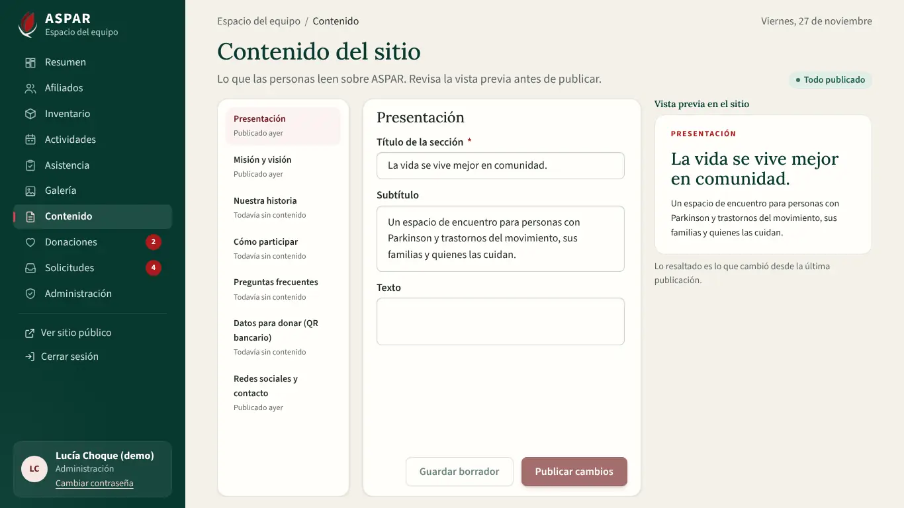

- **Secciones:** edita los textos del sitio (quiénes somos, actividades, cómo participar, apoyo…), revisa la vista previa y publica.
- **QR bancario:** se carga en la sección de donaciones.
- **Redes sociales:** los enlaces del pie del sitio.

## 12. Administración

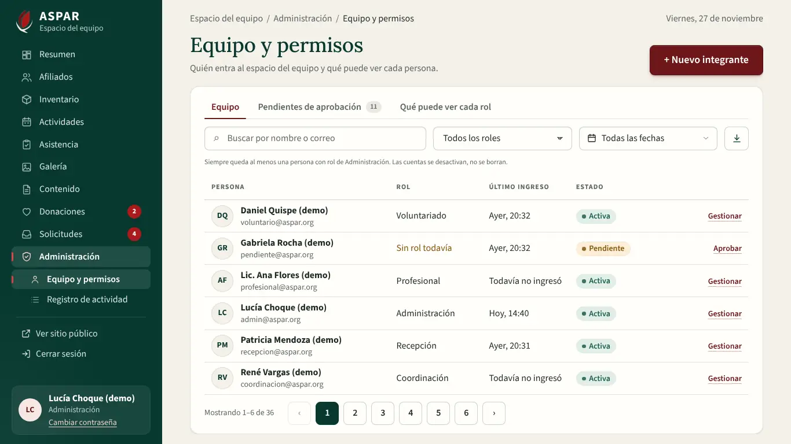

- **Equipo:**
  - invita con **+ Nuevo integrante**;
  - con **Gestionar**, cambia el rol, desactiva una cuenta o entrega una contraseña temporal.
  - Siempre queda al menos una persona con rol de Administración, y las cuentas se desactivan, no se borran.
- **Pendientes de aprobación:** las cuentas creadas desde el ingreso esperan aquí su rol.
- **Qué puede ver cada rol:** los permisos de cada rol. Los sensibles (datos clínicos, descargas) piden confirmación.

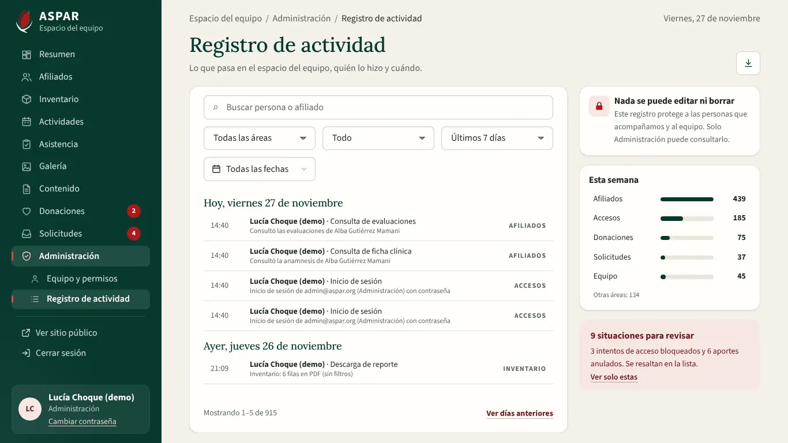

El **registro de actividad** guarda quién hizo qué y cuándo: ingresos, cambios de fichas, aportes, descargas, accesos bloqueados. No se puede editar ni borrar. Las **situaciones para revisar** destacan lo que conviene mirar, por ejemplo varios intentos fallidos de ingreso.

## 13. Filtrar por fechas y descargar

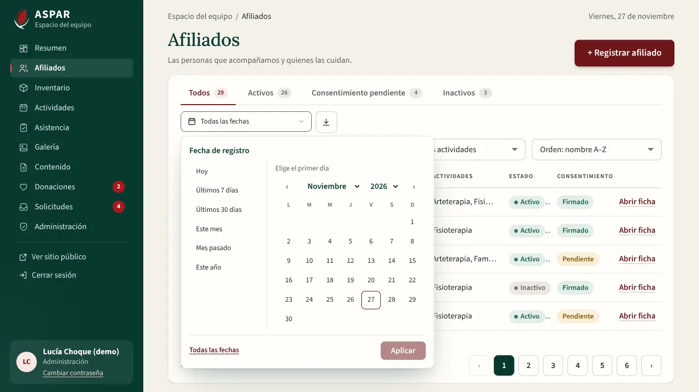

- **Filtrar:** en cada listado, el botón de fechas tiene atajos (hoy, últimos 7 o 30 días, este mes, mes pasado, este año) y un calendario para elegir un rango propio: primer día, último día y **Aplicar**.
- **El rango se conserva:** queda en la dirección de la página, así que al recargar o volver atrás sigue igual.

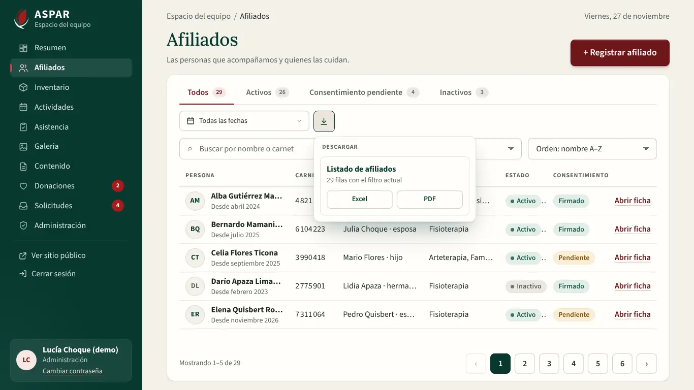

- **Descargar:** el botón ⤓ trae **todo** lo que cumple el filtro, no solo la página que se ve.
  - **Excel**, para trabajar los datos.
  - **PDF**, para imprimir o enviar: lleva la marca de ASPAR, el filtro, la cantidad de filas, quién lo descargó y cuándo.
- **Límites:** hasta 10 000 filas en Excel y 2000 en PDF; si hay más, el sistema pide acotar el rango.
- **Registro:** cada descarga queda en el registro de actividad.

## 14. Ayuda rápida

| Situación | Qué hacer |
| :--- | :--- |
| «Tu cuenta espera aprobación» | Avisa a Administración para que te asigne un rol |
| No ves la historia clínica de una ficha | Revisa que tenga el consentimiento firmado y el acceso en «Activo»; tu rol debe tener permiso clínico |
| No puedes marcar asistencia | La actividad debe estar publicada, ser de hoy o de días anteriores y no estar cerrada |
| No aparece el botón ⤓ | Tu rol no tiene permiso para descargar reportes |
| La página tarda la primera vez | La API se enciende sola al primer uso; espera unos segundos |
