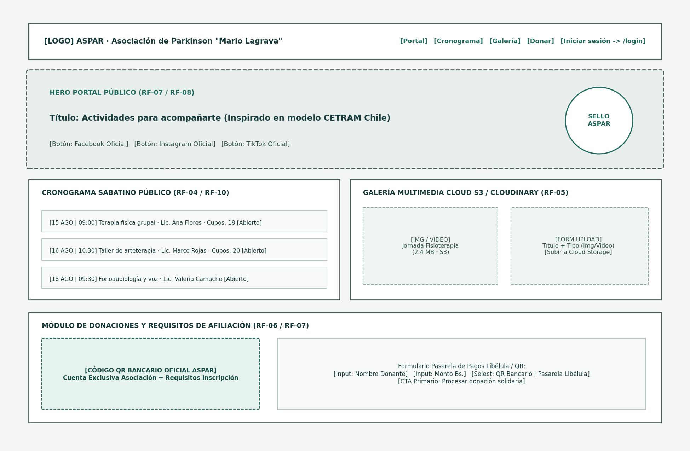
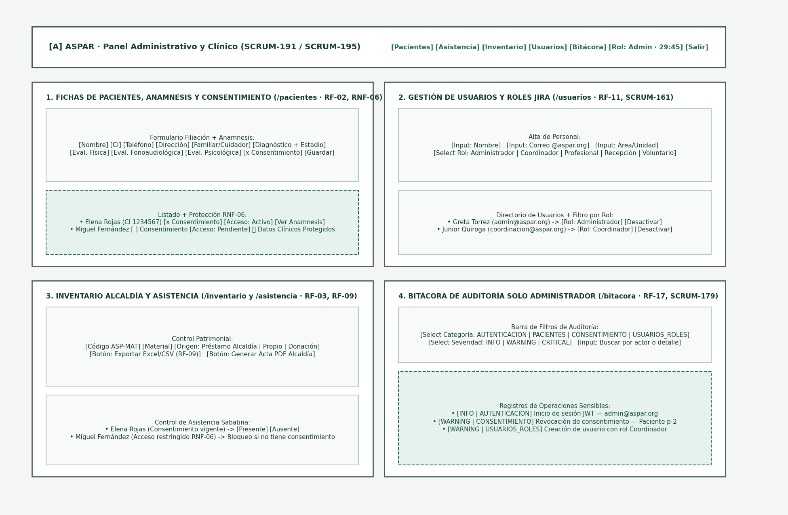

# Wireframes y Flujos de Pantallas Principales — Portal Público y Panel Administrativo (SCRUM-191 / SCRUM-195)

Este documento entrega los wireframes estructurales identificables y el mapa de navegación del sistema web de **ASPAR**, cubriendo tanto el **Portal Público** como el **Panel Administrativo y Clínico**.

## 1. Wireframe del Portal Público (`/`)

### Componentes y Flujos del Portal Público
- **Cabecera Institucional (`topbar`)**: Identidad visual de ASPAR, acceso directo al cronograma y botón de acceso administrativo (`/login`).
- **Hero Institucional y Redes Sociales (RF-07, RF-08)**: Misión de la fundación inspirada en el modelo de la Corporación CETRAM (Chile) y botones de redirección directa a **Facebook**, **Instagram** y **TikTok**.
- **Cronograma Público de Actividades Sabatinas (RF-04, RF-10)**: Tarjetas ordenadas cronológicamente con fecha, hora, especialidad (`Fisioterapia`, `Arteterapia`, `Fonoaudiología`), profesional a cargo, salón y cupos disponibles.
- **Galería Multimedia en Cloud Storage (RF-05)**: Visualización y carga de fotografías y videos almacenados en **Cloudinary / AWS S3** para liberar el almacenamiento de Google Drive/Gmail de la asociación.
- **Módulo de Donaciones y Afiliación (RF-06, RF-07)**: Despliegue del **Código QR Bancario Oficial** de la asociación, listado de requisitos de inscripción para nuevos pacientes y formulario de pago integrado con la pasarela **Libélula**.

## 2. Wireframe del Panel Administrativo y Clínico (`/pacientes`, `/usuarios`, `/inventario`, `/asistencia`, `/bitacora`)

### Componentes y Flujos del Panel Administrativo
1. **Monitor de Sesión Activa (RNF-02 / SCRUM-67)**: Indicador en tiempo real del rol activo y tiempo restante (`MM:SS`), con banner preventivo de renovación de token JWT y cierre automático tras 15 minutos de inactividad.
2. **Fichas de Pacientes, Anamnesis Digital y Consentimiento (`/pacientes` — RF-02, RNF-06 / SCRUM-68, SCRUM-138)**:
   - Formulario unificado de datos personales, contacto de emergencia/cuidador y evaluación clínica multidisciplinaria (fisioterapia, fonoaudiología y psicología).
   - Interruptor de consentimiento informado y selector de estado de acceso (`Activo`, `Pendiente`, `Revocado`) con bloqueo automático de visualización de datos sensibles cuando el consentimiento no está vigente.
3. **Gestión de Usuarios y Roles Jira (`/usuarios` — RF-11 / SCRUM-161)**:
   - Alta de personal y asignación de los 5 roles del proyecto (`Administrador`, `Coordinador`, `Profesional`, `Recepción`, `Voluntario`), unidad organizacional y activación/desactivación de cuenta.
4. **Control de Inventario Municipal y Asistencia (`/inventario` y `/asistencia` — RF-03, RF-09 / SCRUM-183)**:
   - Clasificación de materiales por origen (`Préstamo Alcaldía`, `Propio ASPAR`, `Donación`) y botones de exportación en **CSV/Excel** y **Acta PDF** para rendición ante la Alcaldía.
   - Marcación de asistencia sabatina vinculada al estado de consentimiento del paciente.
5. **Bitácora de Auditoría de Operaciones Sensibles (`/bitacora` — RF-17 / SCRUM-179)**:
   - Vista exclusiva para el rol `Administrador` con filtros por categoría (`AUTENTICACION`, `PACIENTES`, `CONSENTIMIENTO`, `USUARIOS_ROLES`, `INVENTARIO`, `DONACIONES`) y severidad (`INFO`, `WARNING`, `CRITICAL`).
